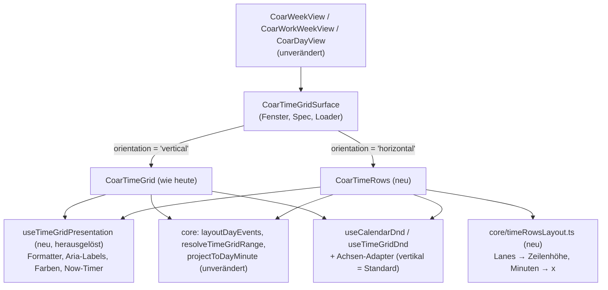

# Gedrehte Wochen-, Arbeitswochen- und Tagesansicht

Heute zeigt die Zeitansicht Tage als Spalten nebeneinander, die Uhrzeit läuft senkrecht. Für Zeiterfassung, Schichten und Anwesenheiten ist das unpraktisch: Beginn, Ende und Lücken verschiedener Tage lassen sich nicht auf einen Blick vergleichen. Nach dieser Arbeit kann jede der drei Zeitansichten (`week`, `workWeek`, `day`) auch **waagrecht** dargestellt werden: ein Tag pro Zeile, alle Zeilen auf derselben Zeitachse, mit denselben Hooks, derselben Navigation und demselben Verschieben und Größenändern, nur waagrecht.

```
            07:00   08:00   09:00   10:00   11:00   12:00   13:00
Mo., 19.  │ [ Entwicklung   ][Daily][ Entwicklung      ]   [ Learning ]
Di., 20.  │ [ Entwicklung   ][Daily][ Entwicklung      ]   [ Backlog  ]
          │                  [ Review ]                       ← 2. Lane bei Überlappung
Mi., 21.  │         [ Meeting    ]        [ Entwicklung          ]
```

## Entschieden (2026-10-28, wie empfohlen)

| # | Frage | Entscheidung |
| --- | --- | --- |
| 1 | **API-Form:** Ausrichtungs-Option am Builder **oder** neue View-Werte (`weekRows`, `workWeekRows`, `dayRows`)? | **Option am Builder**, `timeGridOrientation('horizontal')`. Begründung unten unter „Builder-API“. |
| 2 | Bietet `<CoarCalendar>` selbst einen Umschalter senkrecht ↔ waagrecht an? | **Nein in 3.2.0.** Der Host setzt die Ausrichtung; ein Umschalter im Mode-Switcher kann später kommen. |
| 3 | Ganztägige Termine in der waagrechten Ansicht: als Chips in der Tageskopf-Zelle jeder Zeile **oder** als gedrehtes Band (senkrechte Balken über mehrere Zeilen)? | **Chips in der Tageskopf-Zelle**, klickbar, in 3.2.0 nicht ziehbar. Das gedrehte Band ist deutlich aufwendiger und für Zeiterfassung kaum nötig. |
| 4 | Wischen zum Blättern: In der waagrechten Ansicht scrollt die Zeitachse waagrecht und kollidiert mit dem heutigen Wisch-Blättern. | **Kein Wisch-Blättern im Zeilenbereich**; Blättern über Kopfzeile/Buttons. Waagrechtes Wischen scrollt die Zeit. |
| 5 | Die Anfrage nennt „Arbeitszeiten wie in der Wochenansicht“ — eine Arbeitszeiten-Schattierung **gibt es auch in der senkrechten Ansicht nicht** (nur `workDays` als Filter der Arbeitswoche). | **Nicht Teil dieses Plans**; als eigener Feature-Request für beide Ausrichtungen. Der sichtbare Zeitbereich (`timeRange`) wird unterstützt. |
| 6 | Touch-Drag: Termine haben heute `touch-action: none` (ein Drag beginnt nach 5 px). In dichten Zeilen beginnt dann Scrollen auf einem Termin nicht. | **Gleiches Verhalten wie senkrecht** in 3.2.0 (konsistent). Long-Press-Start wäre eine Vertragsänderung für beide Ansichten und kommt separat. |
| 7 | Branch und Release | Eigener Branch `feature/calendar-time-rows` **vom Stand `fix/calendar-touch-date-click`** (er braucht `composables/surfaceTap.ts` und die Touch-Fixes); nach dem Merge des Fix-Branches auf `develop` rebasen. Release mit **3.2.0** (noch nicht getaggt, `develop` ist Beta). |

Der Nutzer hat alle sieben Empfehlungen im Review bestätigt.

## Was sich ändert

### Builder-API: eine Ausrichtung, keine neuen Views

Eine „View“ legt in dieser Bibliothek fest, **welche Tage** sichtbar sind und **wie geblättert** wird (`core/viewWindow.ts`, `core/timeGridRange.ts`). Die Drehung ändert davon nichts; Fenster, Bereichstitel, Blättern, `onRangeChange` und Loader bleiben gleich. Sie ist ein Darstellungs-Knopf wie `monthDensity` und `dayMode`:

```ts
const { builder, api } = useCalendar();
builder
  .view('week')                       // oder 'workWeek' / 'day' (+ dayMode)
  .timeGridOrientation('horizontal')  // neu, Standard: 'vertical'
  .timeRange([7, 19])
  .pixelsPerHour(120);                // gilt jetzt waagrecht

api.setTimeGridOrientation('vertical'); // zweiwegig bindbar wie setDayMode
```

- Neuer Typ `CalendarTimeGridOrientation = 'vertical' | 'horizontal'`, State-Feld `timeGridOrientation`, Setter in `builders/calendar-builder-config.ts`, `api.setTimeGridOrientation` über `writePresentationKnob` in `builders/internal/navigation.ts`.
- `EventRendererCtx` bekommt `orientation`, damit eigene Renderer sich anpassen können.
- **Warum nicht neue View-Werte:** `CalendarView` ist eine öffentliche Union; drei neue Werte brechen exhaustive `switch`-Anweisungen bei Verwendern, ändern zwei `never`-Switches in `viewWindow.ts`, `viewLabels`, `TimeGridView`, die Presets, `navigation.ts:64`, Body-CSS und i18n, und der View-Switcher bräuchte einen dritten Filter wie bei `monthList`/`dayAgenda` — für eine 3×2-Matrix in einer flachen Union.
- **iOS/Android:** Beide haben nichts Vergleichbares und kein achsen-generisches Raster. Eine Ausrichtung, die sie nicht kennen, ignorieren sie und zeichnen senkrecht — ein harmloser Rückfall. Der Nachteil gegenüber neuen View-Werten: Ein Host, der den Zustand in der URL hält, speichert zwei Werte statt einem. Native Umsetzung ist nicht Teil dieses Plans; die Doku markiert die Ausrichtung als „Web only“.

### Eine neue Zeilen-Komponente neben dem bestehenden Raster

`CoarTimeGrid.vue` ist in jeder Geometrie senkrecht (Template, CSS, Swipe, Hit-Test, Resize-Kanten, Cascade, Karten-Anatomie, Nachbarseiten). Eine Achsen-Weiche darin würde die meistgetestete und meistgetunte Datei überall anfassen. Stattdessen:



- **Unverändert wiederverwendet:** `layoutDayEvents` (gibt nur Minuten und Lanes aus, keine Pixel), die Projektion pro Tag in der Anzeige-Zeitzone (ein Termin 23:00–01:00 wird wie heute zu zwei Segmenten — hier in zwei Zeilen), `resolveTimeGridRange` und die Presets, Hook-Verdrahtung und `surfaceTap`.
- **Herausgelöst ohne Verhaltensänderung:** Formatter, Aria-Labels, Farben und Now-/Heute-Timer aus `CoarTimeGrid.vue` (etwa Zeilen 683–843 und 645–670) in `composables/useTimeGridPresentation.ts`. Das ist die einzige Änderung am bestehenden Raster und durch dessen Tests abgedeckt.
- **Klein und additiv:** `CoarTimeGridNowMarker.vue` bekommt `orientation` (Standard `'vertical'`).
- **Neu:** `components/internal/time-rows/` mit `CoarTimeRows.vue` (Zeilen, Kopfzeile mit Stunden, Tageskopf-Spalte), `CoarTimeRowsEvent.vue` (eigene Karte mit linken/rechten Resize-Griffen; Dekorationen und Assignees aus den vorhandenen Komponenten) und `core/timeRowsLayout.ts`.

### Zeilen, Lanes und Achse

- **Lanes statt Spalten:** Überlappungen kommen als Lanes aus `layoutDayEvents` und werden **untereinander** gestapelt — keine Apple-Cascade (die ist für schmale, hohe Karten gemacht).
- **Zeilenhöhe:** `max(minZeilenhöhe, maxLanes × (laneHöhe + Abstand) + Polster)`; die Lane-Höhe hängt an `density` (etwa 24 px). Zeilen wachsen mit dem Inhalt; das Layout rechnet die Höhen selbst, ohne DOM-Messung.
- **Waagrechte Achse:** `x = (minuten − rangeStart) × pixelsPerHour / 60`. Ist der Bereich schmaler als der Container, wird gestreckt (fit-to-width). Sonst scrollt der Bereich waagrecht; die Stunden-Kopfzeile bleibt oben und die Tageskopf-Spalte links kleben (`position: sticky`).
- **Kartentext:** Titel immer, Uhrzeit ab genügend Pixelbreite (eigene Breiten-Schwellen statt der dauerbasierten `resolveTimedCardAnatomy`).
- **Now-Marker:** senkrechte Linie in der Zeile von heute, mit Markierung in der Stunden-Kopfzeile.
- **`scrollToTime`** setzt `scrollLeft` statt `scrollTop`.
- **`day` mit `dayMode('multiDay')`:** Die Anzahl der Tage ergibt sich heute aus der Containerbreite. Waagrecht gilt stattdessen `dayColumnCount` (Standard 3).

### Interaktion: Hooks, Drag-and-drop, Tastatur, Touch

Die Drop-Logik ist schon achsenfrei: Ziel, Vorschau, Ghosts, Snap-back und `buildDropPayload` arbeiten in Datum + Minuten. Achsengebunden sind nur der Hit-Test, der Greif-Versatz, der Resize-Cursor und die Pfeiltasten. Dafür ein kleiner Adapter, dessen senkrechte Variante der heutige Code unverändert ist:

```ts
// composables/useCalendarDnd.ts — neue, optionale Option
interface TimedAxisAdapter {
  pointToSlot(x: number, y: number, ctx: { grabOffsetMinutes: number; draggedDurationMin: number }): CalendarDropTarget | null;
  grabOffsetMinutes(e: PointerEvent, card: DOMRect): number;
  resizeCursor: 'ns-resize' | 'ew-resize';
}
// Standard: verticalTimedAxis(...)  (heutige Zeilen 328–379 und 649–654)
// Neu:      horizontalRowsAxis(...) (Zeile über data-day-key am Punkt, Minuten aus clientX)
```

- **Hooks:** `onEventClick`/`onEventDoubleClick` über die Karte; `onTimeClick`/`onTimeDoubleClick` über eine waagrechte `slotTimeAt` (Minuten aus `clientX`), auf Touch durch `onSurfacePointerdown`; `onDateClick` auf der Tageskopf-Zelle; `onEventDrop`, `canDrop` und `dstPolicy` unverändert.
- **Verschieben** auf eine andere Zeile = anderer Tag; **Länge ändern** an linker/rechter Kante; Einrasten auf `slotDuration`, Begrenzung auf `timeRange` (ein gemeinsamer Helfer für beide Adapter).
- **Tastatur** (`useTimeGridDnd`, Option `axis`): Pfeiltasten folgen der Bildschirmrichtung: ←/→ = ±Slot, Shift+←/→ = Ende ±Slot, ↑/↓ = ±Tag. Der Ghost-Fokus-Selektor wird konfigurierbar. Die Ansagen bleiben gleich.
- **Touch:** kein Wisch-Blättern im Zeilenbereich (Entscheidung 4), `touch-action: pan-x pan-y` auf den Zeilen, Termine wie senkrecht (Entscheidung 6).
- **a11y:** jede Zeile ist eine Region mit dem Datum als Label, die Karten behalten ihre Aria-Labels, die Stunden-Kopfzeile ist `aria-hidden`.

## Schritte

- [x] 1. Branch `feature/calendar-time-rows` vom Stand `fix/calendar-touch-date-click` anlegen.
- [x] 2. Builder: Typ `CalendarTimeGridOrientation`, State, Setter `timeGridOrientation`, `api.setTimeGridOrientation`, `EventRendererCtx.orientation`; Tests in `builders/__tests__/time-grid-orientation.test.ts`.
- [x] 3. `useTimeGridPresentation` aus `CoarTimeGrid.vue` herauslösen (keine Verhaltensänderung); die bestehende Suite muss unverändert grün sein.
- [x] 4. `core/timeRowsLayout.ts`: Zeilen aus `layoutDayEvents` (Lanes, Zeilenhöhen, kumulierte Offsets, Minuten → x, fit-to-width); Unit-Tests inkl. Mitternacht, Punkt-Termine, Überlappung mit 3 Lanes, `timeRange`-Clipping.
- [x] 5. `CoarTimeRows.vue` + `CoarTimeRowsEvent.vue` rendern (nur Anzeige): Stunden-Kopfzeile, Tageskopf-Spalte mit Ganztags-Chips, Zeilen, Karten, Now-Marker (`orientation`-Prop), Heute/Wochenende-Tönung, `scrollToTime`; `CoarTimeGridSurface` wählt nach Ausrichtung. Komponententests.
- [x] 6. Klick-Hooks verdrahten: waagrechte `slotTimeAt`, `onTimeClick`/`onTimeDoubleClick`/`onDateClick`/`onEventClick`/`onEventDoubleClick`, Touch über `surfaceTap`; Tests nach dem Muster von `touchDateClick.test.ts` / `touchEventClick.test.ts`.
- [x] 7. DnD-Adapter: heutigen timed Hit-Test und Greif-Versatz nach `verticalTimedAxis` verschieben (Standard); bestehende DnD-Tests unverändert grün.
- [x] 8. `horizontalRowsAxis` + Verschieben über Zeilen + Resize links/rechts in `CoarTimeRows`; Tests für Verschieben auf anderen Tag, Resize, `canDrop`-Veto mit Snap-back, `dstPolicy`.
- [x] 9. Tastatur-DnD mit `axis: 'horizontal'` und konfigurierbarem Ghost-Selektor; Tests.
- [x] 10. Playground: Demo `/calendar-time-rows` (Woche, Arbeitswoche, Tag, Ausrichtung umschaltbar, Hook-Log) und Playwright-Spec `apps/playground/e2e/calendar-time-rows.spec.ts`.
- [ ] 11. Doku: Abschnitt „Waagrechte Ausrichtung“ in `apps/docs/components/calendar/day-view.md` (dort steht „ein Modell für jede Zeitansicht“), Builder-Tabelle in `coar-calendar.md`, Skill über `node apps/docs/scripts/sync-skill.mjs`; CHANGELOG 3.2.0 „Added“.

## Wie es geprüft wird

- [ ] `pnpm --filter @cocoar/vue-calendar test`: alle bestehenden Tests grün, ohne geänderte Erwartungen (Regressionsschutz für die senkrechte Ansicht und das DnD).
- [ ] Neue Unit- und Komponententests aus den Schritten 2–9 grün.
- [ ] `pnpm turbo run typecheck lint --filter @cocoar/vue-calendar` und `pnpm skill:check` grün.
- [ ] Playwright (`apps/playground`, Chromium, auch mit `hasTouch`): Tipp auf eine leere Stelle liefert `onTimeClick` mit der richtigen Uhrzeit; ein Termin lässt sich auf eine andere Zeile ziehen (`onEventDrop` mit neuem Datum, gleiche Uhrzeit); Ziehen der rechten Kante verlängert um ein Vielfaches von `slotDuration`; waagrechtes Wischen scrollt, ohne zu blättern; ein Sheet aus `onEventClick` bleibt auf Touch offen.
- [ ] Sichtprüfung im Playground: Woche mit Überlappungen, Termin über Mitternacht (zwei Segmente), Arbeitswoche, Tag, `day` + `multiDay`, Dark Mode.

## Entscheidungen

| Entscheidung | Wahl | Warum |
| --- | --- | --- |
| API-Form | `timeGridOrientation` am Builder | Fenster und Blättern bleiben gleich; Muster wie `dayMode`/`monthDensity`; keine Union-Erweiterung, die Verwender bricht |
| Umsetzung | Neue `CoarTimeRows`-Komponente auf gemeinsamem Kern | Achsen-Weiche in `CoarTimeGrid` wäre hohes Risiko für die Wochenansicht |
| Überlappung | Lanes untereinander, keine Cascade | Waagrechte Karten sind breit und flach |
| Zeilenhöhe | Wächst mit der Lane-Zahl | Nichts wird verdeckt; ein Lane-Limit mit „+N“ kann folgen |
| Ganztags-Termine | Chips in der Tageskopf-Zelle | Einfach, gut lesbar; gedrehtes Band später möglich |
| Native Parität | Keine in diesem Plan | iOS/Android haben kein achsen-generisches Raster; unbekannte Option fällt auf senkrecht zurück |

## Risiken

- **Herauslösen aus `CoarTimeGrid.vue` und Verschieben des Hit-Tests** könnten die senkrechte Ansicht verändern. Gegenmittel: rein mechanische Schritte (3, 7) mit unveränderter Testsuite, jeweils eigener Commit.
- **Touch in dichten Zeilen:** Mit `touch-action: none` auf Terminen lässt sich auf einem Termin nicht scrollen. Begrenzt durch bewusste Entscheidung 6 und eine Playwright-Prüfung.
- **Umfang:** etwa so viel neuer Code wie ein Drittel von `CoarTimeGrid.vue` plus Tests. Wird es für 3.2.0 knapp, kann man nach Schritt 6 (Anzeige + Klicks, ohne DnD) als „Preview“ veröffentlichen und DnD nachreichen.

## Außerhalb dieses Plans

- Arbeitszeiten-Schattierung (gibt es senkrecht auch nicht).
- Umschalter für die Ausrichtung in `<CoarCalendar>`.
- Gedrehtes Ganztags-Band und Ziehen ganztägiger Termine in der waagrechten Ansicht.
- Native Umsetzung in `Cocoar.Calendar.iOS` / `.Android`.
- TimeBooking-Wünsche wie Zeitraum markieren durch Ziehen, Lücken als Klickfläche, Hintergrund-Bänder je Zeile (eigene Feature-Requests).

<details><summary>Belege aus der Recherche</summary>

- `CalendarView` ist eine öffentliche String-Union (`packages/calendar/src/core/types.ts:253`); exhaustive Switches in `core/viewWindow.ts` (`navigateCursor`), `viewLabels` als `Record<CalendarView,string>` in `CoarCalendar.vue:254`.
- week/workWeek/day sind ein Modell: `core/timeGridRange.ts` (`TIME_GRID_PRESETS`, `timeGridRangeSpecFor`), gerendert über `components/internal/time-grid/CoarTimeGridSurface.vue`; „Multi-day“ ist `day` + `dayMode('multiDay')`.
- `layoutDayEvents` (`core/timeGridLayout.ts:100`) liefert `{ lane, laneCount, startMinutes, endMinutes, clippedTop, clippedBottom }`, keine Pixel; Mitternacht wird pro Tag geschnitten (`:153–171`, `projectToDayMinute` `:433`).
- Senkrechte Stellen im DnD: `pointToSlot` (`composables/useCalendarDnd.ts:328`), Greif-Versatz (`:649`), `cursorForMode` (`:71`), Pfeiltasten (`composables/useTimeGridDnd.ts:512`), Ghost-Fokus-Selektor (`:771`).
- Wisch-Blättern ist waagrecht (`composables/useTimeGridSwipe.ts`), Termine haben `touch-action: none` (`CoarTimeGridEvent.vue:239`), Spalten `pan-y` (`CoarTimeGrid.vue:1367`).
- Keine Arbeitszeiten-Schattierung im Code; nur `workDays` als Filter (`core/timeGridRange.ts`).
- Die Zeitansicht nutzt keine `VirtualizedSurface*`; sie ist ein großes DOM, das in einem Vorfahren scrollt.
- iOS: `CalendarView`-Enum mit denselben String-Werten (`Sources/CocoarCalendarCore/ViewWindow.swift:24`), Sub-Modi als eigene Enums (`MonthDensity`, `DayMode`); Zeitraster nur senkrecht; nichts zu gedrehten Ansichten in Doku oder Roadmap. Android gleich.
- 3.2.0 ist noch nicht getaggt (letzter Tag `v3.1.0`); `develop` ist der Beta-Zweig (`GitVersion.yml`).

</details>
