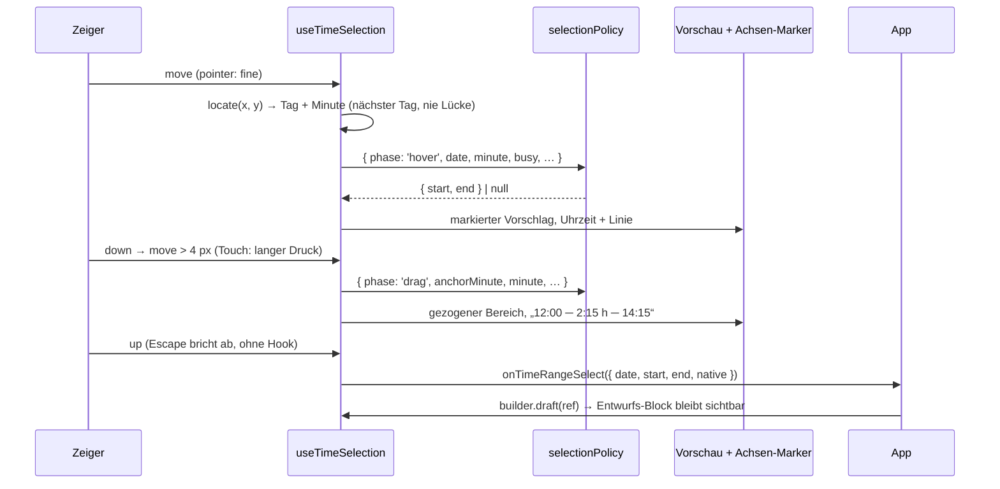

# Zeitraum-Auswahl, Entwurf und Hintergrund-Bänder

Heute meldet das Zeitraster auf freier Fläche nur einen Zeitpunkt (`onTimeClick`). Neue Termine in einem Zug anlegen, sehen was ein Klick wählen wird, den Zeitraum eines offenen Formulars im Kalender zeigen und Arbeitszeit-Regeln hinterlegen muss jede App selbst bauen — TimeBooking hat das in ~1000 Zeilen getan. Nach dieser Arbeit kann der Kalender das in beiden Ausrichtungen selbst; was gewählt wird, bestimmt die App über eine **Policy**. TimeBooking baut seine heutigen Regeln in wenigen Zeilen nach:

```ts
const draft = ref<{ start: Temporal.ZonedDateTime; end: Temporal.ZonedDateTime } | null>(null);

builder
  .timeGridOrientation('horizontal')
  .timeRangeSelect(true)                                       // Ziehen + Klick wählen Zeiträume
  .hoverIndicator(true)                                        // Uhrzeit + Linie unter der Maus
  .selectionPolicy(gapOrDurationPolicy({ minutes: 60, overlap: false }))
  .onTimeRangeSelect(({ start, end }) => {
    draft.value = { start, end };                              // Entwurf zeigen …
    openBookingPanel(start, end);                              // … und Formular öffnen
  })
  .draft(draft)                                                // folgt dem Formular, null blendet aus
  .backgrounds((date) => workRuleBands(date));                 // Kernzeit, Rahmen, Max-Linie
```

## Entschieden (2026-10-30, wie empfohlen)

| # | Frage | Entscheidung |
| --- | --- | --- |
| 1 | **Touch:** Ziehen auf freier Fläche ist auf Touch das Scrollen. | **Langer Druck (500 ms) startet die Auswahl**, dann ziehen — wie das Anlegen in `Cocoar.Calendar.iOS` und im System-Kalender. Ein Tipp wählt den Vorschlag der Policy. Hover-Vorschlag und Uhrzeit-Linie nur bei `pointer: fine` (Maus, Stift mit Hover). |
| 2 | **Typen von Beginn/Ende** im Hook und im Entwurf | **`Temporal.ZonedDateTime` in der Anzeigezone** wie `onEventDrop` (`next.start`/`end`): direkt als Termin speicherbar, sicher über Zeitumstellung. Dazu `date: PlainDate` für den Tag der Auswahl. Die Policy selbst rechnet in **Minuten des Tages** — einfach und testbar wie in TimeBooking. |
| 3 | **Verhältnis zu `onTimeClick` / `onTimeDoubleClick`** | **Unverändert, nichts wird unterdrückt.** Mit `timeRangeSelect(true)` kommt beim Klick zusätzlich `onTimeRangeSelect` (nach `onTimeClick`), beim Ziehen nur `onTimeRangeSelect`. Wer beides hängt, bekommt beides — dokumentiert. |
| 4 | **iOS / Android** | **Web only** in diesem Schritt, in der Doku markiert. iOS hat Anlegen per langem Druck, aber keine Policy, keinen Entwurf, keine Bänder. |
| 5 | **Release** | **3.2.0** (noch nicht getaggt), weil TimeBooking erst mit allen vier Punkten umstellen kann. Fallback, falls es knapp wird: Bänder + Entwurf in 3.2.0, Auswahl + Hover in 3.2.x. |
| 6 | **Branch** | **`feature/calendar-time-selection` vom Stand `feature/calendar-time-rows`** (braucht `timedAxis`, `CoarTimeRows`, `surfaceTap`); nach dessen Merge auf `develop` rebasen. |

Im Review bestätigt: alle sechs Empfehlungen.

## Was sich ändert

### Ein Ablauf für Hover, Klick und Ziehen

Alle drei Interaktionen laufen durch dieselbe Kette. Die Ortung kommt aus dem vorhandenen Achsen-Adapter (`TimedAxisAdapter.locate`), also gleich für Spalten und Zeilen; die Policy macht aus der Position einen Zeitraum; Vorschau und Achsen-Marker zeigen ihn; erst das Loslassen bzw. der Klick ruft den Hook.



- **Start nur auf freier Fläche:** Auf einer Karte bleiben Klick und Verschieben wie bisher (`originatesFromEvent`).
- **Im Starttag bleiben:** Beim Ziehen zählt nur die Achse; der Tag ist der des Drückens.
- **Nächster Tag:** Zeilen und Spalten liegen lückenlos aneinander, die Ortung klemmt auf den nächsten Tag — kein Flackern beim Bewegen quer zur Zeitachse. Über Tageskopf, Stundenachse und Ganztagsband: nichts.
- **Neu:** `composables/useTimeSelection.ts` (Zustand, Pointer, Escape, langer Druck) und `components/internal/time-grid/CoarTimeSelectionLayer.vue` (Vorschau-Block je Tag). Die vertikale Ortung wird aus `useCalendarDnd` als `createVerticalTimedAxis(...)` herausgezogen, damit Auswahl und Drag-and-drop dieselbe benutzen (Verhalten unverändert).

### Policy und Helfer

```ts
// core/timeSelection.ts — öffentlich über den Core-Barrel
export interface TimeSelectionContext<TMeta> {
  phase: 'hover' | 'click' | 'drag';
  date: Temporal.PlainDate;
  minute: number;            // Minute des Tages unter dem Zeiger (Anzeigezone, ungerundet)
  anchorMinute?: number;     // nur 'drag': wo gedrückt wurde
  slotDuration: number;
  busy: ReadonlyArray<{ start: number; end: number; event: CalendarEvent<TMeta> }>; // getimte Termine des Tages
}
export type TimeSelectionPolicy<TMeta> = (ctx: TimeSelectionContext<TMeta>) =>
  { start: number; end: number } | null;   // Minuten des Tages; null = nichts markieren / wählen

export function freeRangeAt(busy, minute): { start: number; end: number } | null;
export function snapToSlot(minute, slot): number;
export function defaultSelectionPolicy(): TimeSelectionPolicy;       // Klick/Hover: ein Slot; Ziehen: gezogener Bereich
export function gapOrDurationPolicy(o: { minutes: number; overlap?: boolean }): TimeSelectionPolicy;
```

`gapOrDurationPolicy` ist TimeBookings Verhalten als allgemeiner Baustein: Hover/Klick wählt **zwischen zwei Terminen die ganze Lücke**, sonst `minutes` ab der gerundeten Uhrzeit bis höchstens zum nächsten Termin (weniger als ein Slot nach einem Termin-Ende schließt direkt an); auf einem Termin `null`. Ziehen wird mit `overlap: false` auf den freien Bereich um den Anker begrenzt. Ohne Policy gilt `defaultSelectionPolicy` (Überschneidung erlaubt).

### Hover-Anzeige auf der Achse

`hoverIndicator(true)` zeigt bei `pointer: fine` die gerundete Uhrzeit unter dem Zeiger auf der Zeitachse (Kopfzeile waagrecht, Stundenachse senkrecht) und eine feine Linie durch alle Tage. Beim Ziehen und beim sichtbaren Entwurf zeigt derselbe Marker `Beginn ─ Dauer ─ Ende`. Ein gemeinsamer `CoarTimeAxisMarker.vue` für beide Ausrichtungen.

### Entwurf

```ts
builder.draft(MaybeRefOrGetter<{ start: Temporal.ZonedDateTime; end: Temporal.ZonedDateTime } | null>);
```

Ein eigener, deutlich umrandeter Block in seinem Tag (über Mitternacht in zwei Tagen, wie Termine), **über** den Terminen, `pointer-events: none`, nicht in Layout und Lanes der Termine. Ein `#draft`-Slot (`{ start, end, segment }`) erlaubt eigene Darstellung. `null` blendet aus. Auf der Achse stehen Beginn, Dauer und Ende, solange kein Hover/Ziehen läuft.

### Hintergrund-Bänder

```ts
builder.backgrounds((date: Temporal.PlainDate) => CalendarBand[]);

type CalendarBand =
  | { kind: string; start: Temporal.PlainTime; end: Temporal.PlainTime;
      appearance?: 'tint' | 'hatch' | 'outline'; layer?: 'below' | 'above'; color?: string; label?: string }
  | { kind: string; at: Temporal.PlainTime; color?: string; label?: string };   // senkrechte bzw. waagrechte Linie
```

Wandzeit des Tages in der Anzeigezone. Gerendert in der Tagesspalte bzw. Zeilenspur, standardmäßig **hinter** den Terminen; `layer: 'above'` legt einen umrandeten Hinweis darüber. Immer `pointer-events: none` — Klick, Hover, Ziehen gehen durch. Klassen `coar-calendar-band coar-calendar-band--{kind}` plus `--{appearance}`; Farben über `color` oder CSS. `label` als `title` und kurze Beschriftung an Linien („max. 10:30 h“). TimeBookings `timelineRuleLayer` bildet sich so ab: Kernzeit = `tint`, außerhalb des Rahmens = `hatch`, Hinweise = `outline` + `above`, Tagesmaximum = Linie.

## Schritte

- [x] 1. Branch `feature/calendar-time-selection` von `feature/calendar-time-rows`.
- [x] 2. Typen + Builder: `CalendarBand`, `CalendarDraft`, `TimeRangeSelectPayload`, `TimeSelectionPolicy`; Setter `backgrounds`, `draft`, `timeRangeSelect`, `selectionPolicy`, `hoverIndicator`, Hook `onTimeRangeSelect`; Builder-Tests (Defaults, Ref/Getter, Verkettung).
- [x] 3. `core/timeSelection.ts`: `busy` aus `layoutDayEvents`-Projektion (Anzeigezone, je Tag geschnitten), `freeRangeAt`, `snapToSlot`, `defaultSelectionPolicy`, `gapOrDurationPolicy`; Unit-Tests, die TimeBookings Fälle für `freeRangeAt` / `freeSlotAt` / `pickSlotAt` / `dragRange` nachstellen; Minuten ↔ `ZonedDateTime` inkl. Zeitumstellungstag.
- [x] 4. `createVerticalTimedAxis` aus `useCalendarDnd` herauslösen; `CoarTimeGrid` und `CoarTimeRows` stellen ihren Adapter bereit. Bestehende DnD-Suiten unverändert grün.
- [ ] 5. Bänder rendern (senkrecht in `CoarTimeGridColumn`, waagrecht in der Zeilenspur), drei Appearances, Linien mit Label, Tokens in Dark/Light; Komponententests (Lage, `layer`, Klick geht durch).
- [ ] 6. Entwurf rendern + `CoarTimeAxisMarker` (Zeit / Bereich mit Dauer) in beiden Ausrichtungen; `#draft`-Slot; Tests (folgt der Ref, Mitternacht, `null`).
- [ ] 7. `useTimeSelection` + `CoarTimeSelectionLayer`: Hover-Vorschlag, Klick, Ziehen mit Schwelle, Escape, Starttag, nächster Tag, Touch per langem Druck (nicht-passives `touchmove`, das während der Auswahl das Scrollen verhindert), Tap-Gate für den Klick; in beide Raster einhängen. Tests: Maus und Touch, beide Ausrichtungen, Policy-Aufrufe je Phase, Reihenfolge `onTimeClick` → `onTimeRangeSelect`.
- [ ] 8. `hoverIndicator`: Uhrzeit + Linie durch alle Tage, nur `pointer: fine`; Tests.
- [ ] 9. Playground: TimeBooking-artige Seite (`/calendar-time-selection`: Bänder, Policy, Entwurf mit Formular, beide Ausrichtungen) + Playwright-Spec.
- [ ] 10. Doku: neue Seite „Selecting time & drafts“ (oder Abschnitte in `day-view.md`) mit Live-Demo, Builder-Tabelle in `coar-calendar.md`, Policy-Helfer im Core-Kapitel, Skill-Sync, CHANGELOG 3.2.0 „Added“.

## Wie es geprüft wird

- [ ] `pnpm --filter @cocoar/vue-calendar test`: bestehende Tests unverändert grün, neue grün.
- [ ] `pnpm turbo run typecheck lint --filter @cocoar/vue-calendar --filter @cocoar/playground`, `pnpm skill:check`.
- [ ] Playwright (Chromium, Maus und `hasTouch`), beide Ausrichtungen: Ziehen auf freier Fläche liefert `onTimeRangeSelect` mit eingerasteten Grenzen im Starttag; Escape liefert nichts; Hover zeigt Uhrzeit und den Vorschlag der Policy (Lücke bzw. 1 h); Klick wählt genau den Vorschlag; auf einer Karte startet keine Auswahl, Verschieben geht weiter; langer Druck + Ziehen wählt auf Touch, kurzes Wischen scrollt; Entwurf folgt einer geänderten Ref; Bänder liegen richtig und lassen Klicks durch.
- [ ] Sichtprüfung im Playground und in der Doku, hell und dunkel.
- [ ] TimeBooking-Probe mit lokalem Paket-Build (`~/cocoar-local-packages/…`): Wochenverlauf mit `gapOrDurationPolicy` verhält sich wie `useTimelinePick`.

## Entscheidungen

| Entscheidung | Wahl | Warum |
| --- | --- | --- |
| Regeln | Policy-Funktion + exportierte Helfer statt fester TimeBooking-Logik | Kalender bleibt allgemein; TimeBooking-Verhalten ist ein Einzeiler |
| Policy-Einheit | Minuten des Tages | Einfach, gleich für beide Ausrichtungen, wie die Vorlage testbar |
| Ortung | Vorhandener `TimedAxisAdapter` für Auswahl und DnD | Eine Hit-Test-Wahrheit je Ausrichtung |
| Bänder | `PlainTime` je Tag, `appearance` + `kind`-Klasse, immer klick-durchlässig | Ohne CSS nutzbar, mit CSS frei gestaltbar |
| Entwurf | `ZonedDateTime`-Paar, eigene Ebene über den Terminen | Gleiche Form wie ein Termin; Überschneidung bleibt sichtbar |
| Hover | nur `pointer: fine` | Auf Touch gibt es kein Hover; Tipp zeigt sofort den Vorschlag |

## Risiken

- **Touch-Ziehen nach langem Druck** kollidiert mit nativem Scrollen (`touch-action: pan-y` bzw. `pan-x pan-y`). Gegenmittel: nicht-passiver `touchmove`-Listener mit `preventDefault()` nur während einer aktiven Auswahl; muss in WKWebView (iOS) und Android-WebView geprüft werden — Playwright deckt nur Chromium ab.
- **Senkrechtes Raster mit Wisch-Blättern:** Auswahl darf das Blättern nicht auslösen und umgekehrt. Begrenzt dadurch, dass die Auswahl erst nach Schwelle (Maus) bzw. langem Druck (Touch) startet und der Swipe-Runtime den Zeiger dann nicht bekommt; eigener Test.
- **Neue Hit-Test-Herauslösung** (Schritt 4) könnte DnD verändern. Rein mechanisch, durch die bestehenden DnD-Suiten abgesichert, eigener Commit.
- **Umfang für 3.2.0:** fünf neue öffentliche Setter, ein Hook, ein Core-Modul. Fallback siehe Entscheidung 5.

## Außerhalb dieses Plans

- Native Umsetzung in iOS / Android.
- Auswahl über mehrere Tage oder ganztägig (Monat, Ganztagsband).
- Tastatur-Auswahl von Zeiträumen (Fokus auf leerer Fläche gibt es heute nicht).
- Domänenregeln selbst (Kernzeit, Pausen, Tagesmaximum) — die liefert TimeBooking als Bänder.

<details><summary>Belege und Vorlage</summary>

- TimeBooking-Vorlage: `utils/dayBooking.ts` (`freeRangeAt`, `freeSlotAt`, `pickSlotAt`, `dragRange`, Viertelstunde, 1 h Standard), `views/time/day/useTimelinePick.ts` (Ereignisse an einem Bereich über allen Zeilen, nächste Zeile per senkrechtem Abstand, Schwelle 4 px, Escape), `utils/workRules.ts` `timelineRuleLayer` (`core`, `outsideFrame`, `marks`, `maxLine`).
- Ortung im Kalender: `TimedAxisAdapter` in `packages/calendar/src/composables/useCalendarDnd.ts`; waagrecht `rowIndexAtY` in `core/timeRowsLayout.ts`, Zeilen lückenlos.
- Klick-Hooks heute: `onTimeClick`/`onTimeDoubleClick` auf Spalte bzw. Spur, Touch über `composables/surfaceTap.ts`.
- iOS: Anlegen per langem Druck auf einen Slot (`HoldDragGesture`, `docs/apple-calendar-ux-analyse.md` in `Cocoar.Calendar.iOS`), keine Auswahl-API.
- 3.2.0 ist nicht getaggt (letzter Tag `v3.1.0`).

</details>
