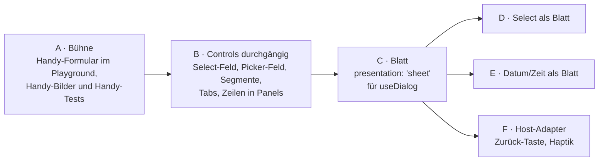

# Mobiler Ausbau der Library

Heute ändern sich unter `.coar-mobile` nur sieben Controls. Kein Overlay, kein Select, kein Picker hat eine Handy-Darstellung;
24 Komponentenseiten stehen am Handy auf `planned`. Nach diesem Plan lässt sich ein **ganzes Formular am Handy bedienen**:
Felder und Auswahl in Touch-Größe, Dialoge als Blatt von unten, Select und Datum/Zeit als Blatt statt als kleines Panel.

Die Zusage bleibt: **ohne Opt-in ändert sich nichts.** Maße kommen über `.coar-mobile`, andere Bedienung über eine Prop
`presentation`, deren Standard die heutige Ansicht ist.

## Was sich ändert

### Die Arbeitsteilung

Bisher (RFC, Abschnitt 9): Team baut Vorarbeiten, amZettel liefert die Komponenten als PR. Neu: **das Team baut die mobilen
Komponenten selbst**, amZettel Neo ist die Referenz-App, die nach Etappe E eine Beta pinnt. Das RFC wird
in Abschnitt 9 entsprechend nachgeführt.

### Der Weg



Jede Etappe ist ein PR (C eventuell zwei), `feat(ui)`, mit Preview-Badge für neue API. Eine Beta für amZettel gibt es nach E, wenn das
ganze Formular steht; sie startet nur auf dein Wort.

### A · Die Bühne: ein Handy-Formular, an dem man den Fortschritt sieht

Eine neue Playground-Ansicht `/mobile-form` (`apps/playground/src/views/MobileFormView.vue`): ein realistisches Formular
(Text, Zahl, Select, Mehrfach-Select, Datum, Datum/Zeit mit Zone, Segmente, Schalter, Speichern/Abbrechen, „Löschen“ mit
Bestätigung), global `.coar-mobile`. Sie ist der Maßstab jeder Etappe: Was dort noch nach Desktop aussieht, ist offen.

Dazu die Prüfmittel fürs Handy, die es heute nicht gibt:

- **Bilder in Handy-Breite:** Geschichten mit `"viewport": { "width": 390, "height": 844 }` in `stories.json`. Der Vergleich
  lässt heute keinen Viewport unter 1024×768 zu (`manifest.ts`); das zu öffnen ist eine Änderung am Vergleich selbst und
  braucht die Freigabe des Maintainers in einem eigenen PR (Schritt 4).
- **Touch-Tests in Handy-Größe:** ein drittes Playwright-Projekt `webkit-phone` (iPhone-Profil) in
  `apps/playground/playwright.config.ts`, das wie `webkit-tablet` nur `@touch`-Tests fährt. Die Datei gehört nicht zum
  Vergleich; die CI-Datei bleibt unberührt.

### B · Controls durchgängig (gleiche Bedienung, andere Maße)

Alles, was man in einem Formular antippt, bekommt unter `.coar-mobile` dieselbe Höhenskala (44/48/52/56 px) und 16 px Schrift
wie die sieben Controls heute. Der Mechanismus existiert schon; die meisten Komponenten haben ihn nur nicht eingeschaltet:

```vue
<!-- CoarSelect.vue, CoarMultiSelect.vue, CoarTagSelect.vue, die drei Picker: heute ohne, künftig mit -->
<CoarInputFrame mobile-sizing … />
```

| Komponente | Unter `.coar-mobile` neu |
| --- | --- |
| `CoarSelect`, `CoarMultiSelect`, `CoarTagSelect` (Feld) | Höhenskala, 16 px, Löschen-Ziel 44 px |
| Die drei Datums-Picker und `DateOrTime` (Feld) | dasselbe |
| `CoarSegmentedControl`, `CoarTabGroup`, `CoarOtpInput`, `CoarPagination` | Höhenskala bzw. Ziel ≥ 44 px |
| Zeilen in Panels: Select-Optionen, `CoarMenuItem`, `CoarListbox` | Zeilenhöhe ≥ 44 px über ein neues Token |
| `CoarTag` (Schließen), `CoarCheckboxGroup`, `CoarRadioGroup` | Ziel ≥ 44 px, Abstände |

Ein neues Token in `packages/ui/styles/tokens/mobile.css`, mit in `MOBILE_CONTEXT_TOKENS`, damit Overlays aus einem lokalen
Bereich es mitnehmen:

```css
.coar-mobile {
  --coar-control-row-min-height: 44px; /* Zeilen in Menüs, Optionslisten, Listbox */
}
```

Komponenten lesen es mit Rückfall auf den heutigen Wert (`min-height: var(--coar-control-row-min-height, auto)`), deshalb
bleibt jedes Standard-Bild gleich. Die `--mobile-`-Bilder von rund 15 Geschichten ändern sich – das ist der Zweck und
braucht keine Freigabe; der PR nennt sie.

### C · Das Blatt: `presentation: 'sheet'` für Dialoge

Die erste neue Bedienung. Ein Dialog öffnet auf Wunsch als Blatt von unten:

```ts
const dialog = useDialog();

dialog.open(EditContact, { title: 'Kontakt', presentation: 'sheet' });   // neu, Preview
dialog.confirm({ title: 'Löschen?', message: '…', presentation: 'sheet' });
dialog.open(EditContact, { title: 'Kontakt' });                          // wie heute: zentrierter Dialog
```

- **Wo:** `DialogConfig.presentation?: 'dialog' | 'sheet'` in `dialog-types.ts`, neue Hülle `CoarSheetShell.vue` neben
  `CoarDialogShell.vue`, neues `sheetPreset` in `overlay-presets.ts` (der virtuelle Anker `bottom` existiert bereits).
  Die Fokus-Falle zieht aus `CoarDialogShell.vue` in ein gemeinsames `useFocusTrap()` um – als eigener erster Commit ohne
  Verhaltensänderung.
- **Was das Blatt kann:** volle Breite, Höhe nach Inhalt bis knapp unter den oberen Rand, Kopf mit Titel und Schließen,
  Inhalt scrollt innen, Fuß bleibt stehen. Es weicht der Bildschirmtastatur aus (`visualViewport`), hält den unteren
  Sicherheitsabstand ein (`env(safe-area-inset-bottom)`), sperrt das Scrollen der Seite dahinter und lässt sich mit dem Finger
  nach unten wegziehen – nur vom Griff und vom Kopf aus, damit Ziehen nicht mit dem Scrollen des Inhalts streitet.
- **Keine Automatik:** Kein `'auto'`, keine Ableitung aus `.coar-mobile` oder der Fensterbreite (RFC 5.4). Die App entscheidet.
- **Auch der normale Dialog** bekommt unter `.coar-mobile` Maße fürs Handy (Ränder, Fußknöpfe in voller Breite), ohne seine
  Art zu ändern.

Die Entscheidungen zum Ziehen und zur Tastatur sind die riskanten; C bekommt deshalb vor dem Bau einen eigenen kurzen
Entwurf (eine Seite, API und Verhalten) zur Freigabe.

### D · Select als Blatt

`presentation?: 'dropdown' | 'sheet'` an `CoarSelect`, `CoarMultiSelect`, `CoarTagSelect`, Standard `'dropdown'`. Die Logik
liegt bereits getrennt in `select/useSelectBase.ts`; es kommt eine zweite Ansicht dazu, die das Blatt aus C nutzt: Titel aus
dem Label, Suchfeld oben, Zeilen ≥ 44 px, bei Mehrfachauswahl ein „Fertig“-Knopf statt Schließen bei jeder Wahl.

### E · Datum und Zeit als Blatt

`presentation?: 'popover' | 'sheet'` an den drei Pickern und `DateOrTime`. Für den Zonen-Picker steht der Kern seit #54
(`useZonedDateTimePicker()`); die beiden einfachen Picker bekommen ihren Kern auf dieselbe Art, jeweils als eigener
`refactor(ui)`-PR vor der neuen Ansicht (nie Umbau und Neues in einem Schritt). Die Blatt-Ansicht nutzt den scrollenden
Kalender in voller Breite, Zeit und Zeitzone als eigene Schritte statt nebeneinander.

Die Panels haben heute eine Breiten-Media-Query (`max-width: 540px`). Sie bleibt als Altbestand, die Blatt-Ansicht hängt
nicht davon ab.

### F · Host-Adapter (klein, nach C)

`createCoarHost({ back, haptics })` im Haupt-Export, alles optional, ohne Host keine Wirkung. Erster Nutzen: die
Zurück-Taste von Android schließt das oberste Blatt statt die Seite zu verlassen. `useInputCapabilities()` entsteht erst,
wenn eine Etappe es braucht – nicht auf Vorrat.

### Was jede Etappe abliefert

- Die Ansicht `/mobile-form` zeigt den Fortschritt; neue Zustände haben Geschichten in Handy-Breite, hell und dunkel.
- `@touch`-Tests in Chromium, `webkit-tablet` und `webkit-phone`.
- Doku: Seite der Komponente mit Preview-Badge und angepasster `devices`-Zeile, Tabelle „Supported controls“ in
  `apps/docs/guide/mobile.md`, `pnpm skill:sync`.
- **Kein `--default-`-Bild ändert sich.** Wird eines rot, ist es eine Regression.
- Eine Gegenprüfung je PR, höchstens eine Nachprüfung der Korrekturen.

`phone: ready` setzt eine Seite erst, wenn die Komponente im iOS-Simulator (Safari) geprüft wurde; bis dahin `partial`
mit Notiz.

## Schritte

Etappen A und B sind unten baureif. C, D, E und F bekommen je einen kurzen eigenen Plan, sobald die Etappe davor gemergt
ist – ihre API ist öffentlich und soll von dir gesehen werden, bevor sie gebaut wird.

**A · Bühne** (`test(playground)`, Branch `test/mobile-form-stage`)

- [x] 1. `MobileFormView.vue` mit Route `/mobile-form` anlegen: das Formular oben, global `.coar-mobile`, heutige Komponenten.
- [x] 2. Playwright-Projekt `webkit-phone` in `apps/playground/playwright.config.ts` ergänzen (nur `@touch`); prüfen, dass die
      bestehenden `@touch`-Specs dort grün sind, sonst je Spec begründet ausnehmen.
- [x] 3. `e2e/mobile-form.spec.ts`: jedes Feld per `tap()` bedienen, absenden; Ziele unter 44 px als erwartete Lücken
      (`test.fixme` mit Verweis auf Etappe B) festhalten.
- [ ] 4. Geschichte `mobile-form` in Handy-Breite. **Blockiert, braucht die Freigabe des Maintainers:**
      `src/visual/manifest.ts` lässt mit Absicht keinen Viewport unter 1024×768 und keine Wurzel unter 760 px zu
      (`viewportLimits`, `rootWidth`), damit eine Geschichte der Standard-Darstellung nicht ausweichen kann. Handy-Bilder
      brauchen also eine Änderung am Vergleich selbst, in einem eigenen PR. Vorschlag: schmale Viewports nur für
      Geschichten, die ausschließlich die Mobil-Darstellung fotografieren. Etappe A geht ohne Bilder in den PR.
- [x] 5. Prüfen, PR, CI. (#56; die Kerne der einfachen Picker aus Schritt 16 sind als #55 vorgezogen und gemergt.)

**Doku · Handy-Rahmen** (`docs`, eigener PR, parallel zu B)

- [ ] 5a. `PhoneFrame.vue` im Doku-Theme: ein iframe in Handy-Größe (390×844), in dem eine Demo als eigene Seite läuft –
      nur so docken Blätter am Rand des Rahmens an und bleiben teleportierte Overlays darin. Umschalter hell/dunkel,
      Link „in eigenem Tab“. Erste Demo: das Formular im Mobil-Leitfaden. Die Etappen B bis E zeigen ihre Ergebnisse darin.

**B · Controls durchgängig** (`feat(ui)`, Branch `feat/mobile-controls-everywhere`)

- [x] 6. Token `--coar-control-row-min-height` in `mobile.css` und `MOBILE_CONTEXT_TOKENS` (`overlay-types.ts`); der
      bestehende Test hält beide Listen gleich.
- [x] 7. `mobile-sizing` an den Feldern von `CoarSelect`, `CoarMultiSelect`, `CoarTagSelect`, `CoarPlainDatePicker`,
      `CoarPlainDateTimePicker`, `CoarZonedDateTimePicker`; Löschen- und Aufklapp-Ziele auf 44 px.
- [x] 8. Zeilenhöhe über das Token in `CoarSelectDropdownPanel.vue` (und den beiden anderen Panels), `CoarMenuItem.vue`,
      `CoarListbox.vue`.
- [x] 9. Höhenskala unter `.coar-mobile` für `CoarSegmentedControl`, `CoarTabGroup`/`CoarTab`, `CoarOtpInput`,
      `CoarPagination`; Schließen-Ziel von `CoarTag`.
- [x] 10. Unit-Tests je Komponente nach dem Muster der sieben Controls; `e2e/mobile-controls.spec.ts` um die neuen
      Komponenten erweitern (Geometrie ≥ 44 px, Schrift ≥ 16 px); die `test.fixme` aus Schritt 3 auflösen.
- [x] 11. Bilder: `visual.mjs` muss alle `--default-`-Bilder grün zeigen; geänderte `--mobile-`-Bilder mit `--update`
      übernehmen und im PR auflisten.
- [x] 12. Doku: „Supported controls“ in `guide/mobile.md`, `devices`-Zeilen und Notizen der betroffenen Seiten,
      `pnpm skill:sync`.
- [ ] 13. Prüfen, eine Gegenprüfung, PR, CI.

**C–F**

- [x] 14. C ist gebaut und gemergt (#61, #63). Die zusätzlichen Tastaturkorrekturen sind hostneutral implementiert
      und auf iOS-Host/Safari hoch, Pixel sowie Fire hoch/quer nativ nachgeprüft; sehr enge Hosts scrollen das
      ganze Blatt. Safari quer ohne sichtbare Seitenfläche bleibt eine Plattformgrenze. Produktreview,
      Gesamtsuite und abschließender Vollvisualvergleich (227/227) bestehen. Frühere Laufzeitfehler blockieren
      nicht mehr. Die Korrekturen gehören zum Keyboard-Fix-PR. Details im Plan
      `2026-11-14-mobile-sheet.md`.
- [ ] 15. Entwurf D (Select als Blatt), bauen, PR.
- [ ] 16. Kerne der einfachen Picker lösen (`refactor(ui)`), Entwurf E, bauen, PR, Prüfung im iOS-Simulator.
      Danach Beta für amZettel auf dein Wort.
- [ ] 17. Entwurf F (Host-Adapter), bauen, PR.
- [ ] 18. RFC im amZettel-Worktree nachführen (Abschnitt 9: neue Arbeitsteilung; neuer Abschnitt 16 mit dem Stand);
      dort nicht committen.

## Wie es geprüft wird

- [ ] `pnpm lint && pnpm typecheck && pnpm build` grün; `pnpm test` als Job grün (bekannt wacklig: `9drz`).
- [ ] `node apps/playground/scripts/visual.mjs`: jedes `--default-`-Bild unverändert, in jeder Etappe.
- [ ] `/mobile-form` im Handy-Profil: nach B kein antippbares Ziel unter 44 px, kein Eingabefeld unter 16 px (als Test,
      nicht als Augenschein).
- [ ] Nach C: Blatt öffnet, scrollt innen, weicht der Tastatur aus, schließt per Ziehen, Schließen-Knopf, Hintergrund und
      Escape; der Fokus kehrt zurück – als `@touch`-Tests in drei Projekten.
- [ ] Nach C und E: im iOS-Simulator (Safari) die Ansicht `/mobile-form` durchgehen: Tastatur, Sicherheitsabstände, Ziehen.

## Entscheidungen

| Entscheidung | Wahl | Warum |
| --- | --- | --- |
| Wer baut | Das Team; amZettel prüft an der App | Sonst warten wir auf PRs von außen |
| Prüfung am Gerät | iOS-Simulator am Mac nach C und E; kein Warten auf amZettel | Playwrights WebKit zeigt Tastatur und Sicherheitsabstände nicht |
| Beta | Eine, nach E | amZettel bekommt das ganze Formular auf einmal |
| Reihenfolge | Formular zuerst, Kalender/Listen/Navigation später | Jede App hat Formulare; der Kern für Picker steht |
| Neue Bedienung | Prop `presentation`, Standard = heute, kein `'auto'` | RFC 5.4; Web-Apps bleiben unberührt |
| Wo das Blatt liegt | Im Haupt-Export, als Option von `useDialog` | Der Dialog-Dienst muss es kennen; `@cocoar/vue-ui/mobile` bleibt für Gesten-Bausteine (Wisch-Zeile u. a.) |
| Grundlagen (`useInputCapabilities`, Host) | Erst, wenn eine Etappe sie braucht | Keine API ohne Nutzer |
| Pläne | Dieser Plan fürs Ganze, A und B baureif; C–F je ein kurzer Entwurf | Öffentliche API vorher sehen, ohne alles vorab festzulegen |

## Risiken

- **Ziehen gegen Scrollen im Blatt** ist die bekannte Falle (amZettel braucht dafür heute `holdGate.ts`). Begrenzt durch:
  Ziehen nur am Griff und Kopf, eigener Entwurf vor dem Bau, Tests mit `pointercancel` und verschachteltem Scroller.
- **Bildschirmtastatur:** `visualViewport` verhält sich in iOS Safari, Android Chrome und WebViews verschieden. Ohne Gerät
  nur teilweise prüfbar – deshalb der Simulator. Android bleibt bis zur Beta ungeprüft.
- **Mobil-Bilder ändern sich in B in großer Zahl.** Das ist beabsichtigt, verlangt aber Sorgfalt beim Durchsehen; der PR
  listet jedes geänderte Bild mit Grund.
- **Die bestehenden `@touch`-Specs** könnten im Handy-Profil an der Breite scheitern (das Touch-Lab ist für Tablet gebaut).
  Dann laufen sie dort begründet nicht; `mobile-form.spec.ts` ist der Handy-Maßstab.

## Nicht Teil dieses Plans

- Kalender (Tokens, Gesten, Wochenleiste), Listen (Wisch-Zeile, Ziehen zum Aktualisieren), Navigation (Tab-Leiste,
  App-Gerüst): der nächste Ausbauplan, wenn das Formular steht.
- Menü und Kontextmenü als Aktionsblatt, Popover, langer Druck: nach C möglich, hier nicht eingeplant.
- `CoarDataGrid`, `CoarTree`, Page-Builder, Script-Editor: bleiben am Handy `no`.
- Automatische Erkennung von Gerät oder Fensterbreite; ein iOS- oder Android-Look.
- Die offenen Fehler `v6jn`, `nv62` und die übrigen Tasks.
