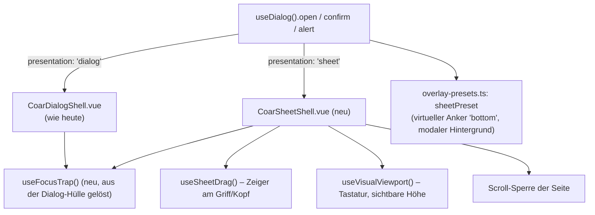

# Etappe C – Dialoge als Blatt von unten

Entwurf zu Etappe C des Ausbauplans (`2026-11-14-mobile-library-expansion.md`). Heute kennt die Library nur den zentrierten
Dialog; am Handy ist er klein, weit vom Daumen und wird von der Tastatur verdeckt. Danach wählt die App pro Aufruf ein Blatt,
das von unten kommt. Select (D) und die Picker (E) bauen später auf demselben Blatt auf.

## Was sich ändert

### Die API (Preview)

```ts
const dialog = useDialog();

dialog.open(EditContact, { title: 'Kontakt', presentation: 'sheet' });
dialog.confirm({ title: 'Eintrag löschen?', message: '…', confirmVariant: 'danger', presentation: 'sheet' });
dialog.alert('Gespeichert', '…', { presentation: 'sheet' });

dialog.open(EditContact, { title: 'Kontakt' }); // unverändert: zentrierter Dialog
```

```ts
// dialog-types.ts
export type DialogPresentation = 'dialog' | 'sheet';

export interface DialogConfig {
  // … wie heute
  /** **Preview.** How the dialog is presented. Default: 'dialog'. */
  presentation?: DialogPresentation;
  /** **Preview.** Sheet only: whether dragging it down closes it. Default: follows `closeOnBackdropClick`. */
  dragToClose?: boolean;
}
```

Mehr Optionen gibt es nicht: keine Rastpunkte, keine halbe Höhe, kein `'auto'`. `size` wirkt beim Blatt nicht (volle Breite,
ab 640 px Fensterbreite höchstens die Breite der Größe, mittig – damit ein Blatt am Tablet nicht über die ganze Breite läuft).

### Was das Blatt tut

| Verhalten | Regel |
| --- | --- |
| Lage | unten angedockt, obere Ecken rund, Höhe nach Inhalt, höchstens sichtbare Höhe minus 24 px |
| Aufbau | Griff, Kopf (Titel, Schließen), Inhalt scrollt innen, Fuß steht fest |
| Fuß | Knöpfe in voller Breite, der bestätigende oben; unterer Abstand `max(padding, env(safe-area-inset-bottom))` |
| Schließen | Schließen-Knopf, Tipp auf den Hintergrund, Escape, Ziehen nach unten – dieselben Schalter wie beim Dialog (`closeOnBackdropClick`, `closeOnEscape`, `showCloseButton`), dazu `dragToClose` |
| Ziehen | nur an Griff und Kopf, mit Finger, Stift oder Maus. Losgelassen nach mehr als 30 % der Höhe oder mit Schwung nach unten: schließt; sonst federt es zurück. `pointercancel` federt zurück |
| Tastatur am Bildschirm | das Blatt folgt `window.visualViewport`: es sitzt über der Tastatur, seine Höhe schrumpft mit, das fokussierte Feld wird in den sichtbaren Teil gescrollt |
| Seite dahinter | scrollt nicht, solange ein Blatt offen ist |
| Fokus | Falle und Rückgabe wie beim Dialog; `role="dialog"`, `aria-modal` |
| Bewegung | fährt von unten ein; bei `prefers-reduced-motion` ohne Animation |
| `.coar-mobile` | das Blatt hängt nicht davon ab. Es nimmt den Modus seines Aufrufers mit (Overlay-Scope-Vertrag), seine Knöpfe und Felder haben dann die Mobil-Maße |

Ziehen am Inhalt schließt bewusst **nicht**: das ist der Streit zwischen Scrollen und Ziehen, den amZettel heute mit
`holdGate.ts` löst. Griff und Kopf scrollen nie, dort gibt es keinen Streit.

### Wo es gebaut wird



- `dialog/CoarSheetShell.vue`, `dialog/useSheetDrag.ts`, `_internal/useFocusTrap.ts`, `_internal/useVisualViewport.ts`;
  `sheetPreset` in `overlay/overlay-presets.ts`; Tokens `--coar-sheet-*` (Radius, Griff, Abstände) mit festen Standardwerten.
- Die Scroll-Sperre ist neu und gilt **nur** für Blätter. Der zentrierte Dialog sperrt die Seite heute nicht; das bleibt so.
- Der zentrierte Dialog bekommt unter `.coar-mobile` Ränder zum Fensterrand und Fußknöpfe in voller Breite – nur dort,
  sein Standard-Bild bleibt gleich.

## Schritte

- [ ] 1. `refactor(ui)`-Commit: Fokus-Falle aus `CoarDialogShell.vue` nach `_internal/useFocusTrap.ts`, Verhalten und Tests
      unverändert, alle Bilder grün.
- [ ] 2. `DialogPresentation`, `presentation`, `dragToClose` in `dialog-types.ts`; `useDialog.ts` wählt Hülle und Preset;
      `sheetPreset`.
- [ ] 3. `CoarSheetShell.vue` mit Aufbau, Tokens, Sicherheitsabstand, Animation, Scroll-Sperre.
- [ ] 4. `useSheetDrag.ts` (Schwelle, Schwung, `pointercancel`, Zeiger-Capture) und `useVisualViewport.ts`.
- [ ] 5. Dialog-Maße unter `.coar-mobile`.
- [ ] 6. Unit-Tests: Wahl der Hülle, alle Schließwege mit Ergebnis des Promise, `dragToClose: false`, Zug-Folgen
      (kurz, lang, Schwung, abgebrochen), Fokus-Falle und Rückgabe, Sperre gesetzt und wieder gelöst – auch bei zwei Blättern.
- [ ] 7. `/mobile-form`: „Löschen“ als Blatt, dazu ein Bearbeiten-Formular im Blatt. `@touch`-Tests in drei Projekten
      (öffnen, innen scrollen, Seite scrollt nicht, wegziehen, zu kurz ziehen). Geschichten `sheet`, `sheet-form` in
      Handy-Breite, Standard und Mobil, hell und dunkel.
- [ ] 8. Doku: `apps/docs/components/dialog.md` (Abschnitt „Sheet“, Preview-Badge, Demo, `devices`), `guide/mobile.md`,
      `pnpm skill:sync`.
- [ ] 9. Prüfen, eine Gegenprüfung, PR `feat(ui): dialogs can open as a bottom sheet`.
- [ ] 10. iOS-Simulator (Safari): Tastatur über einem Feld im Blatt, Sicherheitsabstand am Gerät mit Home-Balken, Ziehen.

## Wie es geprüft wird

- [ ] Kein `--default-`-Bild ändert sich; `dialog--mobile-*` ändert sich (Schritt 5) und steht im PR.
- [ ] `pnpm lint && pnpm typecheck && pnpm build`, `pnpm test` grün.
- [ ] Im Simulator: ein fokussiertes Feld im Blatt ist nie von der Tastatur verdeckt; die Seite dahinter bewegt sich nicht.

## Entscheidungen

| Entscheidung | Wahl | Warum |
| --- | --- | --- |
| Rastpunkte (halb/voll) | nein | Höhe nach Inhalt deckt Formulare und Bestätigungen; Rastpunkte später, wenn eine App sie braucht |
| Ziehen am Inhalt | nein, nur Griff und Kopf | kein Streit mit dem Scrollen, kein `holdGate` |
| `dragToClose`-Standard | folgt `closeOnBackdropClick` | ein Blatt, das man nicht wegtippen darf, soll man auch nicht wegziehen können |
| Eigene Komponente `<CoarSheet>` | nein, nur über `useDialog` | Dialoge gibt es auch nur programmatisch; ein Weg statt zwei |
| Scroll-Sperre auch für Dialoge | nein | würde Web-Apps ändern |
| Zurück-Taste (Android) | Etappe F | braucht den Host-Adapter |

## Risiken

- **`visualViewport` in iOS Safari** meldet verzögert und verschiebt die Seite selbst. Nur im Simulator prüfbar; dafür ist
  Schritt 10 da. Android bleibt bis zur Beta ungeprüft.
- **Scroll-Sperre** auf iOS braucht mehr als `overflow: hidden` am `body`. Der Entwurf legt den Weg nicht fest; der Bau prüft
  ihn im Simulator, bevor die Tests geschrieben werden.

## Nicht Teil dieser Etappe

- Select und Picker als Blatt (D, E), Menüs als Aktionsblatt, Zurück-Taste und Haptik (F).
