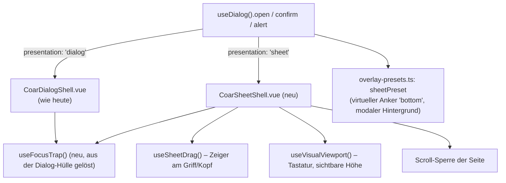

# Etappe C – Dialoge als Blatt von unten

Entwurf zu Etappe C des Ausbauplans (`2026-11-14-mobile-library-expansion.md`). Heute kennt die Library nur den zentrierten
Dialog; am Handy ist er klein, weit vom Daumen und wird von der Tastatur verdeckt. Danach wählt die App pro Aufruf ein Blatt,
das von unten kommt. Select (D) und die Picker (E) bauen später auf demselben Blatt auf.

## Was sich ändert

### Die API (Preview)

```ts
const dialog = useDialog();

dialog.open(EditContact, { title: 'Kontakt', presentation: 'sheet' });
dialog.confirm({ title: 'Eintrag löschen?', message: '…', confirmVariant: 'danger', presentation: 'sheet' });
dialog.alert('Gespeichert', '…', { presentation: 'sheet' });

dialog.open(EditContact, { title: 'Kontakt' }); // unverändert: zentrierter Dialog
```

```ts
// dialog-types.ts
export type DialogPresentation = 'dialog' | 'sheet';

export interface DialogConfig {
  // … wie heute
  /** **Preview.** How the dialog is presented. Default: 'dialog'. */
  presentation?: DialogPresentation;
  /** **Preview.** Sheet only: whether dragging it down closes it. Default: follows `closeOnBackdropClick`. */
  dragToClose?: boolean;
}
```

Mehr Optionen gibt es nicht: keine Rastpunkte, keine halbe Höhe, kein `'auto'`. `size` wirkt beim Blatt nicht (volle Breite,
ab 640 px Fensterbreite höchstens die Breite der Größe, mittig – damit ein Blatt am Tablet nicht über die ganze Breite läuft).

### Was das Blatt tut

| Verhalten | Regel |
| --- | --- |
| Lage | unten angedockt, obere Ecken rund, Höhe nach Inhalt, höchstens sichtbare Höhe minus obere Safe Area und 24 px |
| Aufbau | Griff, Kopf (Titel, Schließen), Inhalt scrollt innen, Fuß steht fest |
| Fuß | Knöpfe in voller Breite, der bestätigende oben; unterer Abstand `max(padding, env(safe-area-inset-bottom))` |
| Schließen | Schließen-Knopf, Tipp auf den Hintergrund, Escape, Ziehen nach unten – dieselben Schalter wie beim Dialog (`closeOnBackdropClick`, `closeOnEscape`, `showCloseButton`), dazu `dragToClose` |
| Ziehen | nur an Griff und Kopf, mit Finger, Stift oder Maus. Losgelassen nach mehr als 30 % der Höhe oder mit Schwung nach unten: schließt; sonst federt es zurück. `pointercancel` federt zurück |
| Tastatur am Bildschirm | das Blatt folgt `window.visualViewport` und einem optionalen generischen Host-Inset: es sitzt über der Tastatur, seine Höhe schrumpft mit, das fokussierte Feld wird in den sichtbaren Teil gescrollt; bei sehr wenig Resthöhe scrollt das ganze Blatt |
| Seite dahinter | scrollt nicht, solange ein Blatt offen ist |
| Fokus | Falle und Rückgabe wie beim Dialog; `role="dialog"`, `aria-modal` |
| Bewegung | fährt von unten ein; bei `prefers-reduced-motion` ohne Animation |
| `.coar-mobile` | das Blatt hängt nicht davon ab. Es nimmt den Modus seines Aufrufers mit (Overlay-Scope-Vertrag), seine Knöpfe und Felder haben dann die Mobil-Maße |

Ziehen am Inhalt schließt bewusst **nicht**: das ist der Streit zwischen Scrollen und Ziehen, den amZettel heute mit
`holdGate.ts` löst. Griff und Kopf scrollen nie, dort gibt es keinen Streit.

### Wo es gebaut wird



- `dialog/CoarSheetShell.vue`, `dialog/useSheetDrag.ts`, `_internal/useFocusTrap.ts`, `_internal/useVisualViewport.ts`;
  `sheetPreset` in `overlay/overlay-presets.ts`; Tokens `--coar-sheet-*` (Radius, Griff, Abstände) mit festen Standardwerten.
- Die Scroll-Sperre ist neu und gilt **nur** für Blätter. Der zentrierte Dialog sperrt die Seite heute nicht; das bleibt so.
- Der zentrierte Dialog bekommt unter `.coar-mobile` Ränder zum Fensterrand und Fußknöpfe in voller Breite – nur dort,
  sein Standard-Bild bleibt gleich.

## Schritte

- [x] 1. `refactor(ui)`-Commit: Fokus-Falle aus `CoarDialogShell.vue` nach `_internal/useFocusTrap.ts`, Verhalten und Tests
      unverändert, alle Bilder grün.
- [x] 2. `DialogPresentation`, `presentation`, `dragToClose` in `dialog-types.ts`; `useDialog.ts` wählt Hülle und Preset;
      `sheetPreset`.
- [x] 3. `CoarSheetShell.vue` mit Aufbau, Tokens, Sicherheitsabstand, Animation, Scroll-Sperre.
- [x] 4. `useSheetDrag.ts` (Schwelle, Schwung, `pointercancel`, Zeiger-Capture) und `useVisualViewport.ts`.
- [x] 5. Dialog-Maße unter `.coar-mobile`.
- [x] 6. Unit-Tests: Wahl der Hülle, alle Schließwege mit Ergebnis des Promise, `dragToClose: false`, Zug-Folgen
      (kurz, lang, Schwung, abgebrochen), Fokus-Falle und Rückgabe, Sperre gesetzt und wieder gelöst – auch bei zwei Blättern.
- [x] 7. `/mobile-form`: „Löschen“ als Blatt, dazu ein Bearbeiten-Formular im Blatt. `@touch`-Tests in drei Projekten
      (öffnen, innen scrollen, Seite scrollt nicht, wegziehen, zu kurz ziehen). Geschichten `sheet`, `sheet-form` in
      Handy-Breite, Standard und Mobil, hell und dunkel.
- [x] 8. Doku: `apps/docs/components/dialog.md` (Abschnitt „Sheet“, Preview-Badge, Demo, `devices`), `guide/mobile.md`,
      `pnpm skill:sync`.
- [x] 9. Prüfen, Gegenprüfung und PR: #61 implementiert das Blatt; #63 ergänzt den nativen Testhost und den oberen
      Safe-Area-Fix. Beide nach grüner CI gemergt; geprüfter Stand ist `3f114d9` / Beta `3.4.0-beta.21`.
- [x] 10. Native Nachprüfung: iOS-Simulator (Host und Safari hoch), Pixel und Fire-Tablet bestehen die
      Tastaturfälle. Bei sehr wenig Resthöhe scrollt das ganze Blatt. Safari quer ohne sichtbaren Seitenbereich
      bleibt eine dokumentierte Plattformgrenze; siehe unten. Produktgegenprüfung freigegeben, alle 227
      Prüfungen des abschließenden Vollvisualvergleichs bestanden. Integration über den Keyboard-Fix-PR.

## Wie es geprüft wird

- [x] Kein `--default-`-Bild ändert sich; `dialog--mobile-*` ändert sich (Schritt 5) und steht im PR.
- [x] `pnpm lint && pnpm typecheck && pnpm build`, `pnpm test` auf dem geprüften Stand grün (PR-/Beta-CI).
- [x] Bei nutzbarer Resthöhe bleibt das fokussierte Feld über der Tastatur; in sehr engem Querformat sind Feld und
      Fußknöpfe nacheinander durch Scrollen erreichbar. Native Hosts halten die Seite bei scrollY 0. Safari kann
      seinen Layout-Viewport zum Fokus verschieben und stellt ihn nach dem Schließen wieder her.

## Native Abnahme am 15. November 2026

**Die ursprünglichen Tastaturfehler sind korrigiert und nativ nachgeprüft.** Echte XCUITest-/ADB-Touches,
Swipes und Texteingabe bedienten die Bildschirmtastaturen; kein manuell gesetzter Inset ersetzte die native Prüfung.
Der Fix wurde auf Basis von `3f114d9` geprüft; Beta `3.4.0-beta.21` enthält ihn noch nicht.

| Gerät / Umgebung | Ergebnis |
| --- | --- |
| iPhone 18 Pro, iOS 27.0, NeoAstra-Host | Hoch: Layout 874, Tastatur 328 → Blatt 86–546, Notes 348–400, Save/Cancel 400/460. Quer: Blatt 24–178, kompakt; echte Swipes erreichen Save/Cancel bei 42/102. Rückrotation stellt den festen Fuß wieder her. |
| iOS Safari, gleiche mobile Doku | Phone hoch: gemessener fixed-Rahmen 714 bei innerHeight 553, VV 384/offsetTop 161 → bottom 169 statt 8. Save/Cancel nativ bei 310/370 frei über der Formularleiste. Notes, Wechsel, Schließen und Wiederöffnen bestehen. |
| Pixel 8a, nativer Host | Hoch: Tastatur 365 → Blatt bis 549, Phone/Notes über Fuß 413–549. Quer: Tastatur 276, nur 82 px Blatt-Resthöhe; fokussiertes Feld sichtbar, echte Swipes machen die Fußknöpfe einzeln erreichbar. |
| Fire-Tablet KFTUWI, FireOS 8 / Android 11, nativer Host | Quer: Tastatur 400 → Blatt 48–400, Phone 187–239, Notes 163–215, Fuß 240–400. Hoch: Blatt bis 880, Notes 643–695, Fuß 720–880. Breite weiterhin 560 px. |

- **Bestanden:** obere/untere Safe Areas, inneres Scrollen ohne Hintergrund-Scroll, feste Kopf-/Fußbereiche ohne
  Tastatur, Ziehen zum Schließen und Schließen-Knopf. Kurzes Ziehen federt auf iOS und Pixel zurück. Auf dem Fire
  bleibt das Blatt in beiden Ausrichtungen auf 560 px Breite begrenzt. Android gibt den Fokus an den Öffner zurück.
- **Nicht vollständig beurteilbar:** native Fokus-Rückgabe auf iOS bei Touch; WebKit fokussiert den angetippten
  Öffner-Button nicht. VoiceOver und eine externe Tastatur wurden nicht geprüft.
- **Header-Befund:** normales Scrollen lässt den iOS-App-Header stehen. Nativer Seiten-Bounce verschiebt ihn
  vorübergehend nach unten und federt zurück; ein dauerhafter Header-Verlust wurde nicht reproduziert. Im offenen
  Sheet bleibt der Kopf auch beim Überscrollen des Inhalts stehen.
- **Hostneutrale Korrektur:** `setCoarKeyboardInset()` meldet nur die tatsächlich verdeckte Unterkante des aktuellen
  Layout-Viewports in CSS-px; 0 bei WebView-Resize, Dismiss und Dispose. Browser-/Host-Inset werden nicht addiert.
  Nur der optionale Testhost übersetzt NeoAstras CSS/Event; Library und normale Browser-Doku kennen NeoAstra nicht.
- **Safari-Ursache:** `innerHeight` verkürzt sich beim Panning, obwohl der fixed-Layout-Rahmen gleich hoch bleibt.
  Der Hook misst den tatsächlichen Rahmen mit einer unsichtbaren fixed-Probe, statt `innerHeight`, `clientHeight`
  oder deren Maximum zu schätzen. Auf echtem Chrome blieb umgekehrt clientHeight bei 812, während innerHeight
  und der Rahmen mit versteckter URL-Leiste auf 868 wuchsen. Eine klassische horizontale Scrollbar ergibt
  wiederum innerHeight 700 bei Rahmen/VV 685. Alle drei Fälle sind durch Regressionstests abgesichert.
- **Enges Querformat:** Kopf/Fuß können mehr Höhe brauchen als oberhalb der Tastatur übrig ist. Dann scrollt das
  ganze Blatt; dessen innerer Viewport gibt Gesten weiter. `vScrollbar` aktualisiert dafür seine Overscroll-Option.
- **Plattformgrenze:** Safari quer meldet in dieser Simulator-Konfiguration VV-Höhen 0/16/−32; Browserleisten und
  Tastatur verdecken die Seite vollständig. Kein Blatt kann dort sichtbar bleiben. Tastatur schließen oder
  zurückdrehen stellt die nutzbare Fläche wieder her. Diese Grenze ist nicht als behobener Fehler ausgegeben.
- **Zusätzlicher Browser-Befund:** Chrome 157 auf dem Pixel kann seine native Autofill-Leiste über den Fuß legen,
  obwohl das Blatt am gemeldeten VisualViewport endet. Der Fall ist getrennt von den behobenen nativen Hosts
  dokumentiert; kein pauschaler Browser-/Host-Offset wurde eingebaut.
- **Finale lokale Prüfungen bestanden:** Lint/Typen/Build und Gesamtsuite bestanden (Playground 289 Fälle,
  sieben ausgenommen); Fixed-Frame-Produktreview freigegeben. Der zusätzliche Review-Fund an der neuen
  Testrezeptur ist korrigiert: Bereitschaft erst nach tatsächlichem Scroll und beobachtetem
  Sichtbar→Verborgen-Zyklus. Zehn schnelle Browserläufe und erneut 40 Docker-Bildvergleiche plus 30 Manifesttests
  bestehen. Nach einem Lauf mit 163 bestandenen Fällen und 64 Timeouts/Seitenabstürzen besteht der erneute
  unveränderte Vollvisualvergleich `job-ae78d907` mit **227/227** in 4 min 47 s. Keine parallele eigene Testlast,
  gebundenes `caffeinate -i`; die frühere Ursache (Last/Sperre vermutet) bleibt unbewiesen. Der Visual-Blocker
  ist aufgehoben. Bestehende Baselines, Harness, Story-Dateien und alle 48 bisherigen Rezepte bleiben
  unverändert. Integration über den Keyboard-Fix-PR; eine neue Veröffentlichung ist separat zu beauftragen.
  Details im Abnahmebericht.
- **Lokale Belege:** `tmp/native-c-037399/acceptance.md`, Android-Screenshots/Geometrie unter
  `tmp/native-c-keyboard-037399/`, iOS-XCTest-Screenshots unter `tmp/native-c-ios-keyboard-fix-037399/v2/evidence/`.
  Temporäre Forwardings/Proxy sind entfernt, Rotation/Tastatur-Einstellungen wiederhergestellt, iOS-Live-Host beendet.

## Entscheidungen

| Entscheidung | Wahl | Warum |
| --- | --- | --- |
| Rastpunkte (halb/voll) | nein | Höhe nach Inhalt deckt Formulare und Bestätigungen; Rastpunkte später, wenn eine App sie braucht |
| Ziehen am Inhalt | nein, nur Griff und Kopf | kein Streit mit dem Scrollen, kein `holdGate` |
| `dragToClose`-Standard | folgt `closeOnBackdropClick` | ein Blatt, das man nicht wegtippen darf, soll man auch nicht wegziehen können |
| Eigene Komponente `<CoarSheet>` | nein, nur über `useDialog` | Dialoge gibt es auch nur programmatisch; ein Weg statt zwei |
| Scroll-Sperre auch für Dialoge | nein | würde Web-Apps ändern |
| Zurück-Taste (Android) | Etappe F | braucht den Host-Adapter |

## Risiken

- **Tastatur und Viewport:** Overlay-Hosts brauchen den generischen Inset-Adapter; Browser-UI ohne gemeldete Geometrie
  bleibt eine Grenze. Eine reine Browser-Viewport-Verkleinerung bildet die nativen Fälle nicht vollständig ab.
- **Scroll-Sperre** auf iOS braucht mehr als `overflow: hidden` am `body`. Der Entwurf legt den Weg nicht fest; der Bau prüft
  ihn im Simulator, bevor die Tests geschrieben werden.

## Nicht Teil dieser Etappe

- Select und Picker als Blatt (D, E), Menüs als Aktionsblatt, Zurück-Taste und Haptik (F).
