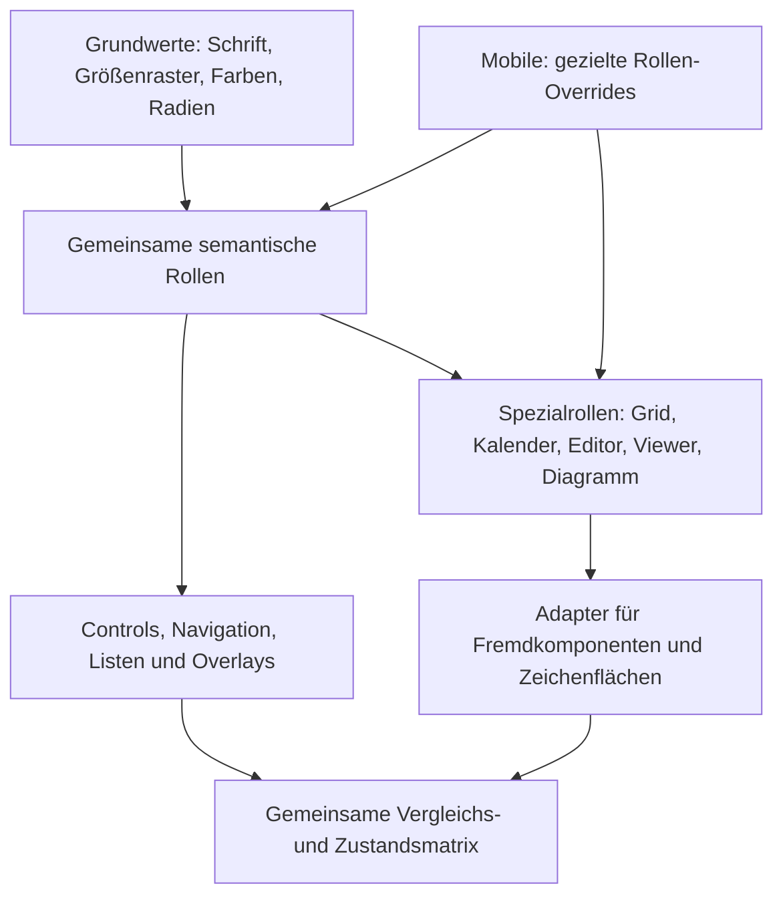

# Die gesamte Library kompakter und harmonisch gestalten

> [!IMPORTANT]
> Separater Harness-Vorbereitungsschritt am 16. November 2026 ausdrücklich freigegeben:
> Quell-Aliasse in `apps/playground/vite.visual.config.ts` und belastbare Renderer-Readiness für neue
> Builder-/Editor-Paket-Stories, ohne bestehende Stories, Zeitbudgets, Bildtoleranzen oder
> Alt-Baselines abzuschwächen. Der bisherige Vite-Resolver wählt für
> `@cocoar/vue-script-editor` aus dem Builder `packages/script-editor/dist/index.js`; Docker kopiert dieses
> ignorierte Build-Verzeichnis nicht und baut die Pakete vor dem Visual-Lauf nicht. Die Freigabe
> umfasst keine Komponentenänderungen, Abschwächung des Vergleichs oder Veröffentlichung.
>
> Der Einzelabgleich umfasst 418 Oberflächen. Nach dem aktuellen Quellenabgleich besteht
> `design-review --check`; 1672 Matrixprüfungen und weitere Zustandsnachweise sind noch offen.
> Die frühere Zahl 1243 stammt aus einem historischen Ledger-Kandidaten, nicht aus der aktuellen Revision.
> Das Inventar und dieser Plan sind ausdrücklich **nicht abgeschlossen**. Nach Behebung des
> Docker-Speicherengpasses bestanden alle 448 Bildfälle; der nachgeführte Schriftvergleich und sein
> begrenztes High-Review sind abgeschlossen. Der anschließende Builder-Kontrastfix und die regulär
> eingebundenen Kalender-State-Tests sind ebenfalls geprüft; der bestätigte Hover-Befund ist korrigiert.

> Am 17. November 2026 ist die begrenzte Opt-in-Beta für den Test in einer echten App beauftragt.
> Die vollständige Designabnahme bleibt offen. Compact wird dadurch nicht zum Standard.

Die ganze Library erhält eine ruhigere, dichtere und gut lesbare Designsprache: Schrift, Abstände, Größen, Farben und Formen passen zusammen — auf Desktop und Mobile. Das ist keine Sammlung lokaler CSS-Korrekturen und kein auf einige Komponenten begrenzter Versuch.

**Vorschlag:** eigener Branch `feat/compact-presentation`, mit vollständig durchgearbeitetem experimentellem Profil. Ein explizites Opt-in schützt bestehende Anwendungen während des Vergleichs; es begrenzt nicht den Umfang der Überarbeitung. Ob das Ergebnis später Standard wird, wird erst nach der Gesamtabnahme entschieden.

## Separater Builder-/Editor-Harness-Schritt

- [x] Fehlende Quell-Auflösung nachvollziehen und transitive Renderer-Pakete auf Quellen abbilden.
- [x] Explizite Readiness für tatsächliche Renderer-Ergebnisse, negative Vertragsfälle und Merge-Gate-Schutz ergänzen.
- [x] Neue, datenidentische Legacy-/Compact-Szenen mit echten Builder-, Monaco-, Markdown- und Mermaid-Renderern ergänzen; Komponenten und bestehende Rezepte unverändert lassen.
- [x] Neue Docker-Baselines prüfen, wiederholt pixelgenau vergleichen und vorhandene Legacy-/Compact-Referenzen gegenprüfen.
- [x] Separates High-Review abschließen und bestätigte Befunde mit Regressionstest korrigieren. Der Gesamtplan und die Beta bleiben bis zur weiteren Abnahme offen.
- [x] Begrenztes High-Review der zwei nachgeführten neuen Compact-Schriftreferenzen abschließen.

Die acht neuen, gesichteten Docker-Bilder bestanden vor dem Review zweimal getrennt den strengen
Vergleich mit jeweils 15 Fällen. Die schweren Bildfälle laufen innerhalb jeder Repeat-Gruppe geordnet
auf frischen Seiten; verschiedene Repeat-Gruppen und bestehende Fälle können weiterhin parallel laufen.
Vier Worker, Fristen, null Retries und der Pixelvergleich sind unverändert. Das High-Review fand
eine zu frühe Monaco-Readiness: sichtbarer Text genügte vor dem Laden des JSON-Modus.
Beide neuen Selektoren verlangen jetzt einen syntaxkolorierten numerischen Token. Ein echter
Regressionsfall hält den lazy JSON-Modus bis zur negativen Readiness-Prüfung zurück und verlangt
nach Freigabe den fertigen Renderer. Die Doku beschreibt die Parallelitätsgrenze und Guard-Dateien korrekt.
Zwölf Node-Vertragstests, 26 Merge-Gate-Tests und der gezielte Typ-/Lint-Abgleich bestehen nach der Korrektur.
Beide erneuten getrennten Docker-Vergleiche bestehen mit jeweils 16 Fällen, einschließlich des echten
JSON-Ladeverzögerungsfalls und aller acht Rendererbilder. Alle 432 vorhandenen und acht neuen Referenzbilder
sowie bestehende Story-Rezepte sind unverändert. Die Review-Korrekturen brauchen kein zweites Review.

Der erste gemischte Wiederholungslauf blieb mit 52 erfolgreichen und 34 an Lade-/Aufnahmefristen gescheiterten
Fällen rot, ohne gemeldete Pixelabweichung. Das betrifft auch bestehende Button-/Eingabefälle und ist
bereits in früheren Harness-Läufen belegt; Parallelität neuer Renderer erklärt die Fehler nicht vollständig.
Der Kontrolllauf derselben Auswahl ohne neue Renderer-Bildfälle scheitert ebenfalls: 43/70 bestehen,
27 scheitern an Lade-/Aufnahmefristen, ohne gemeldete Pixelabweichung. Sein Warm-up enthält weiterhin
alle Szenen; ein vollständig prä-Harness-Kontrolllauf ist das nicht. Die neuen Bildfälle sind jedoch
für die Reproduktion nicht erforderlich. Die erste isolierte Wegwerfcontainer-Diagnose zeigt
Browser-Abstürze, Frame-Verzögerungen bis 77 Sekunden, nahezu vollständig belegten Swap und
sechs gezählte OOM-Kills in der Docker-Umgebung (8 GB RAM). Ihre zusätzliche Font-Instrumentierung
scheiterte an einem eigenen `FontFaceSet`-Zugriff; deren Nullzähler sind kein verwertbarer Font-Nachweis.
Die korrigierte Diagnose ist ohne eigene JavaScript-Fehler ausgeführt: alle vier Button-Fälle scheitern,
die sieben Vertragsfälle bestehen. Der frische private Container zählt vorher null und danach einen
OOM-Kill; der globale Kernelzähler steigt gleichzeitig von 39 auf 40, Swap ist vollständig belegt.
Frame-Callbacks verzögern sich bis etwa 69 Sekunden; die Font-Readiness wird in den erfassten Fehlerseiten
noch nicht erreicht. Damit ist ein Speicherengpass der Prüfumgebung belegt, keine isolierte Fontursache.
Nach Rechnerneustart und ausdrücklicher Freigabe wurde ausschließlich das Docker-RAM-Budget von
8 auf 16 GiB erhöht. Die Engine meldet 15,60 GiB nutzbar; elf CPUs und die fünf zuvor laufenden
Container sind unverändert. Die Originaleinstellungen sind privat gesichert. Der produktive Vergleich
bleibt unverändert. Die erneute kanonische Prüfkette besteht mit 15/15 Button-Fällen und 88/88 gemischten
Wiederholungsfällen; im Gesamtvergleich bestehen 446/448 Fälle. Es gibt keine Timeouts oder OOM-Kills mehr.
Nur die zwei neuen Desktop-Referenzen von `compact-edge-selection` weichen beim Suchplatzhalter ab.
Ein isolierter Gegenversuch bestätigt Inter 13px und trifft mit temporären 14px beide alten Bilder exakt.
Das kleine Suchfeld folgt korrekt der bereits freigegebenen Schriftabstufung; Produktcode und Story
bleiben unverändert. Der normale Docker-Abgleich aktualisiert ausschließlich diese zwei noch
unversionierten Compact-Bilder: 381/387 Pixel im Rechteck x42–98/y236–247, identisch mit den ursprünglichen
Fehleraufnahmen. Alle anderen 438 Referenzdateien, darunter sämtliche getrackten Legacy-Bilder, bleiben
byteidentisch. Dieses Bilddelta gehört zur Compact-Featureintegration, nicht zum separaten Harness-PR.
Die dreifache Wiederholung mit den Builder-/Editor-Szenen besteht mit 60/60 Fällen, die anschließende
volle Matrix mit 448/448. Die abschließende Hash-/Pixelprüfung bestätigt dieselbe begrenzte Änderung.
Das begrenzte Bildreview durch `claude-code-mm:fable@high` ist ohne Befunde freigegeben; eine vollständige
Compact-Funktionsabnahme oder Beta-Freigabe folgt daraus nicht.
Nachweise: `tmp/builder-editor-harness-037399/verification/edge-font-resolution/`.

## Verbleibende Abnahmeblocker: Nachlauf vom 17. November

- [x] Builder-Kontrast nach dem Farbübergang reproduzieren: Dark-Tab 1,996:1 statt lesbarer Kleintextfarbe.
- [x] Compact-Auswahlrahmen und Typ-Tab an die gemeinsame Accent-Textrolle anbinden; Legacy-Fallback,
  dezente Auswahlflächen und Dokumentgeometrie unverändert lassen.
- [x] Finale strenge Builder-Browser-/Paket-/Bildprüfungen abschließen; nur die vier neuen Compact-Rendererreferenzen
  gezielt nachführen und alle anderen Referenzen unverändert bestätigen.
- [x] Repository-Gates und vollständige Tests erneut ausführen; WebKit-Navigationsfehler nicht umgehen.
- [x] Aktuelle Inventarzustände dieses Nachlaufs nur anhand tatsächlich erneuerter Nachweise schließen;
  die übrige Matrix bleibt offen.
- [x] Die bislang nur unter `tmp/` ausgeführten Kalender-State-Tests mit portablem eigenem Testhost
  in die reguläre E2E-Erkennung aufnehmen und erneut prüfen; historische 93/93 sind kein CI-Nachweis.
- [x] Neues begrenztes High-Review der Codeänderungen abschließen und den bestätigten Befund korrigieren.

Das High-Review bestätigt den übrigen Nachlauf, findet aber eine Lücke beim Auswahlrahmen:
Die spezifischere Hover-Regel ersetzt die Auswahlfarbe, solange der Zeiger auf dem Canvas-Node steht.
Eine eigene Regression wählt erst einen anderen Node und dann per echtem Canvas-Klick aus; sie reproduziert
den Befund. Die Zustandsfarbe wird nun am gemeinsamen privaten Hover-Wert aufgelöst:
Compact behält die Auswahl-Ink, Legacy seine bisherige neutrale Hover-Farbe. Unselektiertes Hover bleibt
unverändert. Die neue Regression besteht dreifach; Lint, Typen, Build und der vollständige Testlauf
(779 bestanden, sieben bestehende Skips) bestehen erneut. Auch Wiederholung60/60 und Bildmatrix448/448
sind grün, ohne zusätzliche Referenzänderung. Nach dem Quellenabgleich wurden ausschließlich die 14
gezielt gespeicherten Zustandsnachweise anhand dieser erneuten Prüfung bestätigt; die gesamte übrige
Matrix bleibt offen. Dieser reale Reviewfix braucht laut Reviewauftrag keine zweite Runde.

Der erste unveränderte Kontrasttest bestand zufällig, weil er die noch neutrale Farbe während des
120-ms-Übergangs messen konnte. Die verschärfte Messung wartet auf den Zielwert und reproduziert den Fehler.
Ausgewählter Kleintext muss jetzt 4,5:1 erfüllen, der Rahmen 3:1; Live-Brandwechsel werden mitgeprüft.
Auch vor der Idle-Platzhaltermessung muss der Hintergrundübergang nach dem Drag-Abbruch abgeschlossen sein.
Ein erster Fixversuch färbte unnötig große Auswahlflächen mit um; die Selbstprüfung hat das auf
Auswahlrahmen und Tab-Ink begrenzt. Keine bestehende Story, Vergleichsregel oder Legacy-Referenz geändert.
Die finalen Canvas-Kontrastfälle bestehen dreifach, Zonen-/Palette-Funktionen mit 8/8.
Der neue Bildvergleich besteht mit 60/60 Wiederholungsfällen inklusive unveränderter Zonenlisten-Story
und 448/448 Gesamtfällen. Genau vier neue Compact-Builderbilder zeigen die korrigierte Auswahl-Ink;
alle anderen 436 Referenzen und sämtliche getrackten Legacy-Bilder bleiben byteidentisch.
Der WebKit-Minimaltest ohne Anwendung besteht nach dem Rechnerneustart mit 100/100 Navigationen;
auch die vollständigen Tablet-/Phone-Folgen bestehen ohne geänderte Fristen, Retries oder Browserparameter.
Das beweist keine bestimmte OS-Ursache.
Lint, Typprüfung und Build bestehen. Der erste neue Gesamttestlauf war durch Wiederverwendung des
kurzlebigen Devservers einer parallelen Fokusprüfung gestört (Verbindungsfehler); er zählt nicht als
Produktnachweis. Die exklusive Wiederholung besteht mit 686 erfolgreichen Fällen und sieben bestehenden
Skips. Die anschließend regulär eingebundenen Kalenderfälle bestehen isoliert mit 93/93; der vollständige
aktuelle Lauf besteht mit 779 erfolgreichen Fällen und denselben sieben Skips (786 Fälle, alle 34 Test-Tasks).
Nach einer rein beschreibenden Titel-/Kommentarkorrektur bestehen die vier betroffenen Kalenderfälle erneut.
Vier Builder-/Stylesheet-Zustände und zehn Kalenderzustände sind gezielt mit aktuellen Nachweisen verknüpft;
Touch-Drag, Hover-only und andere nicht vollständig geprüfte Teilzustände bleiben separat offen.
`design-review --check` besteht; `--complete` scheitert weiterhin korrekt mit 1672 offenen Matrixprüfungen
und 872 offenen Zustandsnachweisen. Eine vollständige Compact-Abnahme folgt aus den grünen Tests nicht.
Nachweise: `tmp/compact-acceptance-037399/verification/`.

## Was sich ändert

### Architekturentscheidung: neues Gestaltungsfundament, keine zweite Library

**Ich empfehle, das Gestaltungsfundament innerhalb der bestehenden Pakete neu zu ordnen und die vorhandenen Komponenten einzeln darauf umzustellen. Keine parallel gestartete Komponenten-Library und kein zweites Repository.**

Damit übernehmen wir den guten Teil der Alternative: erst ein sauberes Fundament, dann eine Komponente nach der anderen bewusst integrieren. Wir vermeiden aber Kopien der Komponenten, ihrer Logik und Tests sowie eine spätere Migration sämtlicher Verbraucher auf neue Paketnamen oder Verträge.

Die Abhängigkeiten sind bereits eng: `page-builder`, `data-grid`, `calendar`, `markdown-editor` und `document-viewer` konsumieren UI-Komponenten; der Markdown-Editor nutzt auch `useOverlay`, `useDialog` und den FormField-Kontext. Eine neue Library müsste diese Verbindungen ebenfalls migrieren oder vorübergehend zwischen zwei Komponentenwelten vermitteln. Kopieren würde das Problem verschieben, nicht entfernen.

| Weg | Bewertung |
| --- | --- |
| Bestehende Styles punktuell überschreiben | Abgelehnt: bewahrt widersprüchliche Rollen und erzeugt weitere Sonderregeln |
| Zweite Library und Komponenten hinüberkopieren | Hier nicht empfohlen: doppelte Pflege, Paket-/Kontextmigration und mögliche CSS-/Theme-Kollisionen bei Mischbetrieb |
| Gemeinsames Fundament in bestehenden Paketen erneuern, Komponenten systematisch umstellen | Empfohlen: saubere Zielrollen, vorhandenes Verhalten und Tests bleiben nutzbar, kein Austausch der Verbraucher-API nötig |

Das neue Profil erhält eine klare gemeinsame Tokenquelle, keine zweite parallele Berechnung in jeder Komponente. Die bisherigen Werte liegen an einer abgegrenzten Kompatibilitätsgrenze; sie sollen nicht die neue Gestaltung mit Kompromissen verzerren. Nötige interne Komponentenumbauten sind erlaubt, aber keine Neuentwicklung funktionierender Interaktionslogik allein wegen neuer Maße.

Das Opt-in dient dem Experiment und einem sicheren Vergleich, nicht der Vorentscheidung, dauerhaft zwei gleichberechtigte Designsysteme zu pflegen. Ein späterer Standardwechsel samt Ablösung alter Gestaltung ist eine eigene Entscheidung.

### 1. Eine klare visuelle Richtung

Inter ist mein erster Font-Kandidat, tatsächlich geladen und selbst gehostet, nicht nur im Fallback-Stack genannt. Im Vergleich stehen Poppins, die Systemschrift als Referenz und Inter. Kleine UI-Texte, Ziffern, Umlaute, lange deutsche Beschriftungen und längere Lesetexte entscheiden über die Auswahl — nicht eine einzelne attraktive Überschrift.

**Im Review freigegebene Leitplanke:** Die Schriftwahl ist offen und wird anhand des sichtbaren Vergleichs entschieden. Gute Lesbarkeit bei kleineren Texten hat Vorrang; große oder überall fette Schrift soll nicht als pauschaler Ersatz dafür dienen. Die überarbeitete TimeToDo-Version ist dafür die positive Referenz. Dass die ursprüngliche Version ihre größeren/fetteren Texte wegen schlechterer Lesbarkeit benötigte, ist eine Vermutung des Benutzers, kein bestätigter Befund.

Als Gewichts-Ausgangspunkt dienen 400 für Lesetext, 400/500 für UI-Text und gezielt 600 für Hierarchie oder Betonung. Schriftgröße, Gewicht, Zeilenhöhe und Kontrast werden gemeinsam getestet. Inhaltliche Hervorhebungen bleiben möglich; weder pauschales Fettsetzen noch pauschales Entfernen aller Betonung ist das Ziel. Die konkrete Font- und Gewichtswahl trifft der umsetzende Agent anhand der Vergleiche und hält die Entscheidung mit Beispielen fest.

Diese Werte sind **konkrete Ausgangswerte für die Abstimmung**, kein ungeprüftes Endergebnis:

| Rolle | Desktop | Mobile |
| --- | --- | --- |
| Grund-/Lesetext | 14 px, Zeilenhöhe etwa 1,5 | 14–15 px |
| UI-Text, Navigation, Action-Labels | 13 px | 14 px |
| Sekundärtext / Hilfetext | 12 px | 12–13 px |
| Eingabetext | 14 px | zunächst 16 px; gesondert mit nativer Tastatur prüfen |
| Seitentitel / Abschnitt / Unterabschnitt | 24 / 18 / 16 px | gleiche Hierarchie, passend zum Platzangebot |
| Controls `xs / s / m / l` | 24 / 32 / 36 / 44 px | 44 / 44 / 44 / 48 px als erster Vergleich |
| Interaktive Listenzeile / Grid-Zeile | jeweils 36 px als Ausgangspunkt, getrennte Rollen | interaktive Auswahl zunächst 44 px; Dateninhalt separat abstimmen |
| Control-Radius | 6 px | 6 px |
| Panel / Dialog / Sheet | 8 / 12 / 16 px als Ausgangspunkt | gleiche Rollen; Sheet ausdrücklich mitprüfen |
| Abstände | Grundraster 4 px, gezielte 2-px-Zwischenstufen | gleicher Rhythmus, mit bedienungsabhängigen Abständen |

Kleinere Controls dürfen bei mehrzeiligem Inhalt wachsen. Die Staffelung der Mobile-Größen ist bewusst nicht einfach die Desktop-Skala plus acht Pixel. Ein Icon kann kleiner aussehen als seine anklickbare Fläche; das wird nur mit eindeutigem Layout und ohne überlappende Trefferflächen eingesetzt.

Visuell: weiße Inhaltsflächen, leicht kühl getönte Strukturflächen statt dominantem Neutralgrau, dunkler klarer Text, zurückhaltende Rahmen und Schatten. Als Light-Ausgangspunkt dienen beispielsweise `#f6f8fb` für Strukturflächen und `#292f3b` für primären Text. Dark Mode erhält eine eigene abgestimmte Palette. Accent und alle semantischen Farben bleiben konfigurierbar; Erfolg, Warnung, Fehler und Info werden ebenso vollständig abgestimmt wie Neutrale.

**Slate bleibt die bevorzugte Farbrichtung des neuen Profils.** Die Slate-Töne und Farbbeziehungen von TimeToDo und dem Design-Mockup dienen als verbindliche Gestaltungsreferenz, auch für primäre Aktionen und Auswahlzustände. Ihre konkreten Werte werden mit den vorhandenen Messungen abgeglichen und für Lesbarkeit sowie Light/Dark abgestimmt, nicht durch eine beliebige andere Standardpalette ersetzt. Verbraucher können Accent und Semantikfarben weiterhin bewusst überschreiben; bestehende Profile ändern sich dadurch nicht.

Die TimeToDo-Referenzen sind bewusst Desktop-only. Sie liefern die gestalterische Richtung, keine Anforderungen an ein responsives TimeToDo-Layout.

### 2. Tokens nach Bedeutung verbinden, nicht nach zufällig gleicher Zahl

Die bestehende Struktur in `packages/ui/styles/tokens/` bleibt die Grundlage. Vorhandene Rollen werden wiederverwendet und widersprüchliche Quellen bereinigt. Nicht für jede Eigenschaft einen neuen Token erfinden, aber auch nicht verschiedene Aufgaben in einen globalen Dichtefaktor pressen.



| Gemeinsam, wenn die Aufgabe gleich ist | Eigene Rolle, wenn sie unabhängig steuerbar sein muss |
| --- | --- |
| UI-Schrift, Gewicht, Zeilenhöhe und Icon-Text-Abstand | Lesetext, Eingabetext und Code-Schrift |
| Control-Höhe für Button, Input und Select derselben Größenstufe | Grid-Zeile, Kalender-Zeitslot, Editor-Zeile |
| Zeilenrhythmus für Menüs, Auswahl und Navigation | Mehrzeilige Datenkarte oder mehrzeiliger Termin |
| Fokus, Auswahl, Disabled und semantische Zustandsfarben | Syntaxfarben, Ereignisfarben, Annotationen und Karten-Layer |
| Rollen für Fläche, Rahmen, Schatten und Radius | Unterschiedliche Control-, Panel-, Dialog- und Sheet-Form |

**Beispiel der Zielstruktur, Namen noch Arbeitsnamen:**

```css
/* Innerhalb des experimentellen Profils, nach Auflösung des Farbschemas. */
.coar-compact {
  --coar-ui-font-size: 13px;
  --coar-component-m-height: 36px;
  --coar-row-height: 36px;
  --coar-grid-row-height: var(--coar-row-height);
  --coar-field-font-size: 14px;
}

.coar-compact.coar-mobile {
  --coar-ui-font-size: 14px;
  --coar-component-m-height: 44px;
  --coar-field-font-size: 16px;
}

/* Der Grid-Adapter konsumiert die Library-Rolle statt eine zweite Zahl. */
.coar-compact .ag-theme-cocoar {
  --ag-row-height: var(--coar-grid-row-height);
}
```

`--coar-grid-row-height` darf zunächst vom gemeinsamen Zeilenrhythmus abhängen und später bewusst abweichen. Ein Kalender-Zeitslot soll dagegen nicht von der Button-Höhe abhängen, nur weil beide zufällig 36 px messen.

Die Umsetzung muss auch verschachtelte Mobile-/Appearance-Scopes unterstützen; der kurze CSS-Ausschnitt zeigt keine vollständige Scope-Implementierung. Abgeleitete Variablen müssen im richtigen Scope neu aufgelöst werden. Tests prüfen berechnete Werte und sichtbare Geometrie, nicht nur das Vorkommen eines Tokennamens.

### 3. Vollständigkeit wird nachgewiesen, nicht behauptet

Zu Beginn entsteht `apps/playground/src/design-review/inventory.json`: mit allen Paketquellen und öffentlichen Exports abgeglichen, einschließlich rekursiv verschachtelter Komponenten, separater `styles/`-Ordner, SVG-/Icon-Erzeugung und in TypeScript erzeugter Styles. Generierte `dist/`-Dateien sind keine eigenen Implementierungspunkte. Keine Ableitung nur aus Docs-Seiten oder den vorhandenen Visual-Stories.

Jede sichtbare Oberfläche bekommt einen Datensatz: Quellpfad, Varianten/Zustände, Tokenquellen, Desktop-/Mobile-Beurteilung, Light-/Dark-Beurteilung, Beispielszenario und Prüfnachweis. Interne Dropdown-Panels, Tooltips, Kontextmenüs und Dialoge sind eigene Prüfpunkte, nicht implizit durch ihre Eltern „erledigt“.

```json
{
  "source": "packages/ui/src/components/select/CoarSelectDropdownPanel.vue",
  "decision": "pending",
  "tokenRoles": ["ui-text", "interactive-row", "selection-surface"],
  "checks": {
    "desktop": "pending",
    "mobile": "pending",
    "light": "pending",
    "dark": "pending"
  },
  "evidence": []
}
```

Ein kleiner Abgleich unter `apps/playground/scripts/` meldet fehlende und verwaiste Einträge. Ein Eintrag ist erst abgeschlossen mit Umsetzung **oder** konkret begründetem „geprüft, unverändert richtig“, jeweils mit Nachweis. Nicht anwendbare Zustände werden einzeln begründet. „Erbt schon irgendwie“ und unbelegte Sammelfreigaben zählen nicht.

Die vorhandenen Token-Graph-Helfer unter `packages/ui/src/components/theme-editor/internal/token-graph/` können beim Zuordnen helfen. Die aktuelle `TokenGraphView.vue` erfasst mit ihrem flachen Glob aber nicht sämtliche verschachtelten oder paketfremden Komponenten; sie ist kein Vollständigkeitsnachweis.

### 4. Kein Paket und keine Komponentenfamilie bleibt außen vor

| Prüfbereich | Enthaltene Oberflächen |
| --- | --- |
| UI-Grundlagen und kleine Anzeigen | Gesamte Typografie, Icons, Avatar, Badge, Tag, Link, Divider, Spinner, Progress, CodeBlock, Fokus, Motion, Schatten, Scrollbars und Theme-Editor |
| Sämtliche Formulare | FormField inklusive Meldungen/Statuspanel, InputFrame und Innenbuttons, Text/Passwort/Zahl/OTP, Checkbox/-Group, Radio, Switch, Select/MultiSelect/TagSelect samt Panels |
| Navigation und Auswahl | Navbar, Sidebar samt Flyouts, Breadcrumb, Tabs, SegmentedControl, Pagination, Wizard, Tree, Listbox, DualListbox, DataList und Toolbar; virtuelle Listen, Drag-/Drop-Marker und Umbenennungs-/Erstellzustände |
| Container und Rückmeldungen | Card, Note, Notice, Table, PanelLayout/SplitPane/Divider, Menü/Untermenü/Kontextmenü, Tooltip, Popover, Popconfirm, Dialog/Footer/Sheet, Toast und Overlay-Infrastruktur |
| Datum und Kalender | Alle Date-/Time-/Zoned-/OrDate-Picker und Views, MonthList/ScrollableCalendar; `calendar` mit allen Ansichten, Headern, Terminen, Mini-Anzeigen, Drag-/Resize-/Auswahlzuständen |
| Datenraster | `data-grid`: Zellen, Renderer/Editoren, Filter, Header, Auswahl, Gruppen, Menüs, Leer-/Ladezustände und AG-Grid-Adapter |
| Texte und Bearbeitung | `markdown`, `markdown-editor`, `markdown-form`, `script-editor`: Lesedarstellung, Toolbars, Dialoge, Vorschau, eingebettete Controls und Editor-Themes |
| Weitere komplexe Oberflächen | `page-builder`: Renderer, Builder, Inspector und alle internen Editoren; `document-viewer`: Toolbar, Thumbnails, Annotationen, Suche; `map`: Controls, Panels, Marker/Popups und Bearbeitung |
| Diagramme und visuell indirekte Pakete | `mermaid`, `markdown-mermaid`, `markdown-core`, `file-explorer-core`, `icons`, `localization`, `fragment-parser`: eigene bzw. erzeugte Styles und alle sichtbaren Integrationspfade prüfen; fehlende eigene Oberfläche ausdrücklich belegen |

Die Tabelle gruppiert nur die Arbeit. Das Inventar führt die konkreten Einzeldateien und Zustände. Drittanbieter-UI, Canvas/SVG und dynamisch eingefügtes HTML werden über ihre realen Styling-/Theme-APIs angebunden, nicht mit der Annahme, CSS-Vererbung erreiche alles.

„Alles prüfen“ bedeutet nicht „alles zwanghaft ändern“: Dokumentseiten, Kartengeometrie, Diagrammkoordinaten oder bereits sehr kleine Kalendertexte werden nicht pauschal mitgeschrumpft. Library-eigene Bedienoberflächen darum herum gehören vollständig zum Designauftrag. Fehlende Mobile-Funktionalität wird benannt; ein neues Produktfeature entsteht daraus nicht automatisch.

Konkrete Befunde, die das neue Fundament berücksichtigen muss:

- `data-grid/src/theme/ag-theme-cocoar.css` und `data-grid/src/theme/cocoar-theme.ts` enthalten parallele Maß-/Farbzuordnungen. Für das neue Profil brauchen sie eine verbindliche gemeinsame Rollenquelle statt zwei unabhängig gepflegter Sätze.
- Der Script-Editor registriert feste Monaco-Farben in `script-editor/src/theme.ts` und schaltet sie über `monaco.editor.setTheme`; Mermaid hat bereits eine eigene Bridge in `mermaid/src/internal/theme-bridge.ts`. Beide brauchen geprüfte Adapter. Wo der Renderer nur globale Themes erlaubt, erfolgt der Alt-/Neu-Vergleich in getrennten Dokumenten/Frames statt mit einer unbelegten Zusage unabhängiger lokaler Editor-Themes.
- Viewer und Markdown-Form enthalten eigene Farb-/Maß-Fallbacks. Fehlende oder widersprüchliche Rollen werden im neuen Profil korrekt angebunden, nicht durch globale neue Definitionen mit unbeabsichtigter Wirkung auf bestehende Ansichten.
- Beim Page-Builder bleiben Autorenoberfläche und bearbeiteter Seiteninhalt getrennte Kontexte. Gespeicherte Layoutwerte, PDF-Inhalte, vom Verbraucher gesetzte Terminfarben und Kartenkoordinaten sind keine neutralen UI-Tokens.
- Für mehrere komplexe Pakete fehlt bisher eine eigene Visual-Story. Die bisherige grüne Bildprüfung ist deshalb kein Nachweis, dass diese Pakete bereits gestalterisch abgedeckt sind.

### 5. Eine Vergleichsgalerie und echte Gesamtansichten

Neue Playground-Seiten zeigen Alt und Neu mit denselben synthetischen Daten, einschließlich aller Inventar-Einträge. Für global themende Fremd-Renderer werden getrennte Dokumente/Frames verwendet. Zusätzlich verbinden Gesamtansichten Navigation, Toolbar, Formular, Grid/Kalender, Editor und geöffnete Overlays. So werden nicht nur Einzelteile, sondern auch gemeinsame Ausrichtung, Rhythmus und Hierarchie beurteilt.

Prüfmatrix: bisheriges Desktop, bisheriges Mobile, neues Desktop und neues Mobile; jeweils Light/Dark. Hinzu kommen repräsentative Accent-Farben und sämtliche semantischen Varianten. Pro Komponente alle anwendbaren Größen, Zustände und Interaktionen: Hover, Active, Selected, Focus, Invalid, Readonly, Disabled, Loading, Empty und mehrzeilige/lange Inhalte. Keine blinde kartesische Kombination ohne Mehrwert, aber jeder anwendbare Fall erhält einen benannten Nachweis.

### 6. Experiment isolieren, bestehende Verträge erhalten

Arbeitstitel des Profils ist `.coar-compact`; die endgültige öffentliche API wird erst nach der Sichtprüfung festgelegt. Die vorhandenen Theme-/Mobile-Verträge werden erweitert, kein zweiter Theme-Provider aufgebaut.

`CoarOverlayOutlet.vue` kennt heute die Weitergabe von Theme-Overrides und Mobile-Tokens. Der Appearance-Kontext muss deshalb explizit bis zu teleportierten, verschachtelten und virtuell verankerten Panels gelangen. Lokale Scopes, `CoarThemeScope`, `.coar-theme-none`, Moduswechsel, benachbarte alte/neue UI-Bereiche und Runtime-Änderungen werden mitgeprüft. Kein pauschales Kopieren sämtlicher berechneter CSS-Eigenschaften. Einschränkungen globaler Fremd-Themes werden gesondert ausgewiesen, nicht durch CSS-Vererbung als gelöst betrachtet.

Außerhalb des Opt-ins bleiben bisheriges Desktop und Mobile unverändert. Auch zusätzliche Inter-Gewichte werden nur im Versuch geladen, damit sie den bisherigen Font-Mix nicht nebenbei ändern. Öffentliche Props, Emits, Datenformate und gespeicherte Inhalte bleiben kompatibel; notwendige Abweichungen werden vorab zur Entscheidung gestellt.

## Schritte

- [x] 1. Sauberen Ausgangsvergleich dokumentieren, vorhandene Nutzeränderungen erhalten und Experimentbranch `feat/compact-presentation` vom aktuellen `develop` anlegen. Noch keine Standardumstellung.
  Ausgang: `cf85a8c` entspricht nach Fetch `origin/develop`; nur vorbestehende untracked Nutzerdateien neben diesem Plan. Die letzte abgeschlossene Prüfung dieses Ausgangsstands war grün (vollständige E2E- und Visual-Prüfung aus der Keyboard-Arbeit). Ein isolierter erneuter Visual-Vergleich wird für den Versuch separat protokolliert.
- [ ] 2. Vollständiges Quellen-/Exportinventar aller Pakete und internen Oberflächen erstellen; Prüfzustände und Nachweise pro Eintrag anlegen. Abgleichskript gegen die realen Quellen ergänzen.
- [ ] 3. Sämtliche Stylingquellen durchgehen: CSS/SFC, Inline-/TS-Styles, SVG/Canvas, Drittanbieter-Themes, Token-Fallbacks und native Controls. Jeden relevanten Festwert einer gemeinsamen Rolle, einer Spezialrolle oder einer begründeten geometrischen Konstante zuordnen. Noch ungeschützte Oberflächen vor ihrer Änderung mit reproduzierbaren Alt-Szenarien erfassen.
- [ ] 4. Neues gemeinsames Gestaltungsfundament und Abhängigkeiten in den bestehenden Paketen ordnen; bestehende Namen/API erhalten, nötige Alias-/Adapterrollen ergänzen. Heutige Werte an der Kompatibilitätsgrenze erhalten und unverändertes Alt-Aussehen verifizieren; keine Komponenten-Kopien und keine unkontrollierten globalen Token-Definitionen.
- [ ] 5. Font-/Farb-/Dichtevergleich und Galerie mit identischen synthetischen Beispielen aufbauen; Ausgangswerte für Desktop und Mobile gemeinsam sichtbar machen.
- [ ] 6. Alle UI-Familien aus der Umfangstabelle vollständig abstimmen, inklusive interner Panels, Zustände, Scrollbars und Theme-Editor. Appearance-/Mobile-/Overlay-Kontext samt Reset und Verschachtelung absichern.
- [ ] 7. Alle Datum-/Zeit-Picker und das gesamte `calendar`-Paket abstimmen; jede Ansicht und ihre Auswahl-/Bearbeitungszustände prüfen.
- [ ] 8. Gesamtes `data-grid` samt Renderern, Editoren, Filtern und Drittanbieter-Theme anbinden und im Zusammenspiel mit Formularen prüfen.
- [ ] 9. Sämtliche Markdown-/Form-/Diagramm- und Script-Editor-Oberflächen durchgehen, einschließlich erzeugter Inhalte, Code- und Syntaxrollen sowie aller Dialoge.
- [ ] 10. `page-builder`, `document-viewer` und `map` vollständig bearbeiten; alle verbleibenden Pakete und Integrationspfade prüfen und im Inventar begründet abschließen.
- [ ] 11. Paketübergreifende Gesamtansichten und jeden Inventar-Eintrag mit den gewählten Werten nachprüfen; auch nach spät geänderten gemeinsamen Tokens betroffene frühere Bereiche erneut prüfen.
- [ ] 12. Docs-Grundlagen, betroffene Komponenten-/Paketbeschreibungen und Demos aktualisieren; Geräte-Matrix ehrlich halten, experimentelle API als Preview kennzeichnen; `pnpm skill:sync` ausführen.
- [ ] 13. Vollständige Tests und sichtbare Gesamtabnahme mit dem Benutzer durchführen. Erst bei abgeschlossenem Inventar gilt das Experiment als fertig. Standardumstellung, Beta und TimeToDo-Integration bleiben getrennte Entscheidungen.

Diese Reihenfolge ist eine Arbeitsorganisation, keine Aufteilung in „wichtig“ und „später vielleicht“. Die erste Font-/Galeriesichtung ist eine Zwischenentscheidung zur Vermeidung unnötiger Nacharbeit, keine Abnahme einer Teil-Library.

## Wie es verifiziert wird

- [ ] Der neue Inventarabgleich findet jede relevante Quelldatei und jeden Export. Kein offener Eintrag, kein unbegründetes „nicht anwendbar“, keine fehlenden Zustands-/Ansichtsnachweise bei Abschluss.
- [ ] Für jede gemeinsame Rolle zeigen gezielte Änderungen in Browser-Tests, dass alle registrierten Konsumenten folgen; Spezialrollen können unabhängig geändert werden. Alt-Scopes bleiben unbeeinflusst.
- [ ] Tests prüfen tatsächlich geladene Fonts, berechnete Typografie, Geometrie und Layout. Keine abgeschnittenen Beschriftungen, kollidierenden Innenbuttons oder unlesbaren kleinen Kalender-/Badge-/Editor-Texte.
- [ ] Schriftfamilie und Gewichte bei identischen kleinen Texten, Tabellenzahlen, Formularen und längeren Absätzen vergleichen; Auswahl mit sichtbaren Beispielen begründen. Der neue Look darf seine Lesbarkeit nicht nur durch pauschal größere oder fettere Texte erreichen. Slate-Farbbeziehungen gegen TimeToDo/Mockup prüfen und notwendige Kontrastanpassungen begründen.
- [ ] Bestehende Unit-/E2E-Tests grün halten, neue Fälle bei ihren Komponenten und in `apps/playground/e2e` ergänzen. Paketübergreifende, lokale und verschachtelte Overlays behalten das richtige Profil bei Wechseln und im geöffneten Zustand.
- [ ] Neue Visual-Stories und neue Manifest-Einträge decken alle sichtbaren Inventar-Einträge ab; geteilte Szenen sind erlaubt, wenn nichts verdeckt ist. Alte Stories, bestehende Manifest-Einträge, Harness und Baselines bleiben unverändert. Keine Snapshot-Aktualisierung zum Kaschieren von Regressionen.
- [ ] Komplexe Testdaten sind lokal und deterministisch: feste Kalenderdaten, lokale PDF-Datei, kontrolliertes Mermaid-Diagramm, feste Grid-Daten und Kartenansicht ohne externe Tiles. Echte Library-Renderer bleiben aktiv; Fonts, Worker und Layout müssen beobachtbar bereit sein. Netzwerk-/Fremd-Renderer-Probleme nicht durch Auslassen der Komponente umgehen.
- [x] `node apps/playground/scripts/visual.mjs` vergleicht alle alten und neuen Bilder in Docker. Neue profilaktivierte Stories nutzen die bestehenden Default-/Mobile-Modi, keine neue Harness-Dimension. Neue Baselines gezielt erzeugen und mit `--repeat` auf Stabilität prüfen. Nach dem Builder-Kontrastfix 448/448 grün; dreifache Renderer-/Zonenlisten-Wiederholung 60/60 grün.
- [ ] Kleintext gegen seine tatsächlichen Flächen auf mindestens 4,5:1 prüfen; notwendige nichttextliche Erkennungsmerkmale auf 3:1, unter Beachtung der jeweiligen Ausnahmen. Alle verwendeten Accent-/Semantik-Zustände prüfen.[^contrast][^nontext]
- [ ] Touch-Flächen, Abstand und Bedienbarkeit pro Interaktion prüfen. Für normale Mobile-Actions ist 44 px das Versuchsziel, keine behauptete pauschale AA-Pflicht; WCAG 2.5.8 verlangt 24 px mit Ausnahmen.[^targets] Keine überlappenden erweiterten Trefferflächen.
- [ ] Tastatur, Fokus, Textzoom 200 Prozent, enge Container, lange deutsche Texte und echte Font-Fallbacks prüfen. Cross-Platform-Sichtprüfung auf macOS, Windows, iOS und Android protokollieren; fehlende Geräte explizit als offene Verifikation behandeln, nicht durch Emulation als erledigt erklären.
- [ ] Native Mobile-Ansichten mit Tastatur, Safe Areas, Sheets und Scrollen prüfen; bestehende Keyboard-Fixes dürfen nicht regressieren.
- [ ] `pnpm lint && pnpm typecheck && pnpm build`, `pnpm skill:check` sowie vollständiges `pnpm test` als Hintergrundjob erfolgreich abschließen. Anschließend Inventar und Restdiff gegen die Abnahmekriterien überprüfen.

## Entscheidungen

| Entscheidung | Vorschlag | Grund |
| --- | --- | --- |
| Architektur | Neues Gestaltungsfundament in bestehenden Paketen, keine zweite Library | Einzelne Komponenten bewusst umstellen, ohne Verhalten und Paketverbindungen zu duplizieren |
| Umfang | Alle Pakete und internen Oberflächen | Kein harmonisches Gesamtergebnis durch Stichproben |
| Token-Wiederverwendung | Gleiche Bedeutung verbinden; Spezialrollen mit sinnvollen Defaults | Gleiche Werte allein sind kein ausreichender Kopplungsgrund |
| Farbrichtung | Slate und die TimeToDo-/Mockup-Farbbeziehungen bevorzugen | Im Review ausdrücklich gewünscht; Lesbarkeit und Light/Dark gemeinsam abstimmen |
| Schrift | Wahl offen; Inter zuerst wirklich laden und vergleichen, Entscheidung anhand kleiner Texte dokumentieren | Benutzer delegiert Auswahl und Tests; nicht durch pauschal große/fette Schrift kompensieren |
| Mobile | Gemeinsame Designsprache, gezielte Touch-/Feldrollen | Weder alte Maße einfrieren noch Desktop blind verkleinern |
| Sicherheit des Versuchs | Explizites Profil auf eigenem Branch | Gesamte Neugestaltung sichtbar, bestehende Apps bleiben stabil |
| Definition von fertig | Inventar vollständig geprüft und Gesamtsicht abgenommen | Keine unbemerkten Restkomponenten oder ungeprüften Erbfälle |
| Spätere Standardumstellung | Nicht Bestandteil dieser Freigabe | Gesonderte visuelle Freigabe und Migrationsentscheidung nötig |

## Risiken und Grenzen

- Breiter Umfang mit vielen Abhängigkeiten: gemeinsame Tokens zuerst ordnen, Änderungen schrittweise prüfen und nach jedem Rollenwechsel rückwirkend nachprüfen. Keine pauschale Komplettumstellung durch Suchen/Ersetzen.
- Fremd-Renderer, verschachtelte Scopes und CSS-Variablenauflösung können gemeinsame Rollen umgehen. Dafür braucht es konkrete Integrationsnachweise, nicht nur statische CSS-Suche.
- Globale Editor-Themes können unabhängige lokale Alt-/Neu-Profile im selben Dokument begrenzen. Der Versuch isoliert diese Vergleiche; er führt nicht nebenbei eine neue Editor-Engine oder einen produktiven Iframe-Wrapper ein. Die Integrationsgrenze wird vor einer öffentlichen Profil-API dokumentiert.
- Manche Mobile-Fähigkeiten sind heute eingeschränkt. Der Designversuch bewertet und dokumentiert sie, verspricht aber nicht nebenbei neue Kalender-, Editor- oder Kartenfunktionen.
- Vorhandene Default-Baselines und geschützte Visual-Dateien dürfen nur nach separater ausdrücklicher Maintainer-Freigabe geändert werden. Falls der Versuch eine Harness-Erweiterung tatsächlich braucht, diese vorab separat planen/reviewen, nicht zusammen mit Komponentenänderungen verstecken.

## Nicht Teil dieses Plans

- Änderungen am TimeToDo-Repository, seinen Layouts oder Benutzerdaten; private Referenzscreenshots werden nicht committed.
- Neue fachliche Komponentenfunktionen, Datenmigrationen, Release, Push/Merge oder Änderung des Standard-Looks ohne weiteren Auftrag.
- Erzwungene Änderungen ohne gestalterischen Grund: „geprüft und bewusst richtig belassen“ ist ein Ergebnis, „wird schon passen“ nicht.

<details>
<summary>Untersuchungsstand und Quellen</summary>

Die Desktop-Messungen der Referenzen zeigen unter anderem 16 → 14 px Grundschrift und 40 → 36 px Grid-Zeilen. Die HTML-Studie nennt Inter, hatte im untersuchten Browser aber keine geladene Inter-Font; der Eindruck beruhte auf dem System-Fallback. Die lokalen Button-/Input-Radien gingen von 2 auf 6 px — „feiner“ bedeutet hier nicht überall numerisch kleiner.

Die bisherige Untersuchung umfasst Referenzmessungen, Token-/UI-Audit und paketübergreifende Strukturprüfung. Sie ist **noch kein abgeschlossener Detailaudit jeder Komponente**. Genau diesen verbindlichen Detaildurchgang und seine überprüfbare Vollständigkeit verlangt der erste Umsetzungsteil.

Relevante Ausgangsstellen: `packages/ui/styles/tokens/components-shared.css`, `mobile.css`, `type-primitives.css`, `colors-usage.css`; `packages/ui/src/fonts.ts`; `packages/ui/src/components/overlay/CoarOverlayOutlet.vue`; `apps/playground/src/views/TokenGraphView.vue`.

Inter bietet Text-/Display-Ausprägungen; Auswahl und tatsächliche geladene Dateien müssen zusammenpassen.[^inter] Vorgeschlagene Schriftgrößen und Radien sind Designentscheidungen, keine aus einer Norm abgeleiteten Pflichtwerte.

[^inter]: Offizielle Inter-Dokumentation: https://rsms.me/inter/
[^targets]: W3C, Understanding SC 2.5.8 Target Size (Minimum): https://www.w3.org/WAI/WCAG22/Understanding/target-size-minimum
[^contrast]: W3C, Understanding SC 1.4.3 Contrast (Minimum): https://www.w3.org/WAI/WCAG22/Understanding/contrast-minimum.html
[^nontext]: W3C, Understanding SC 1.4.11 Non-text Contrast: https://www.w3.org/WAI/WCAG22/Understanding/non-text-contrast

</details>
