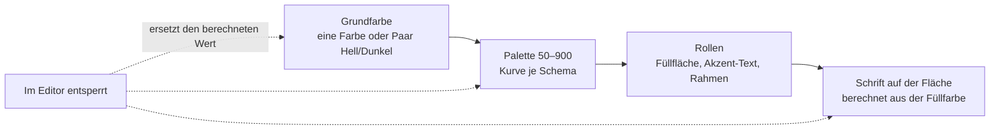

# Ein Farbmodell für jedes Theme – Hell und Dunkel getrennt, Schriftfarbe je Grundfarbe

Heute gibt es eine Grundfarbe für beide Farbschemata, eine einzige weiße Schriftfarbe für alle Farbflächen, und ein Teil des Theme Editors erscheint nur bei Compact. Nach dieser Arbeit gilt für jedes Preset dasselbe: **Jede Farbe ist berechnet, bis man sie setzt; man kann sie für Hell und für Dunkel getrennt setzen; und zu Akzent, Erfolg, Fehler, Warnung und Info gehört je eine Schriftfarbe.** Apps ohne Theme sehen aus wie bisher.

## Was sich ändert

### Das Farbmodell

Vier Ebenen, in jedem Theme dieselben. Die rechte Spalte ist neu.

| Ebene | Standard (im Editor „gesperrt") | Überschreibbar |
| --- | --- | --- |
| **Grundfarbe** (Akzent, Erfolg, Fehler, Warnung, Info) | Dunkel = dieselbe Farbe wie Hell | je Schema eine eigene Farbe |
| **Palette** (Stufen 50–900 je Grundfarbe) | aus der Grundfarbe, mit einer Kurve für Hell und einer für Dunkel | je Schema Helligkeit und Sättigung einer Stufe |
| **Schrift auf der Farbfläche** (neu, je Grundfarbe) | aus der Füllfarbe berechnet: hell auf dunklen, dunkel auf hellen Flächen | je Schema eine eigene Farbe |
| **Flächen, Text, Linien** (neutral) | Werte des Presets, je ein Paar Hell/Dunkel | je Schema, wie heute bei Compact |



### Im CSS: „berechnet, solange nichts gesetzt ist"

Es gibt keinen Schalter. Zwei Mittel, beide heute schon im Vertrag vorhanden:

**Ein Farbwert ist eine Farbe oder ein Paar.** Compact schreibt seine Flächen bereits als `light-dark(<hell>, <dunkel>)`. Dasselbe gilt künftig für die Grundfarben. Eine einzelne Farbe gilt für beide Schemata (das ist „berechnet"), ein Paar trennt sie:

```css
.coar-theme--acme {
  --coar-theme-accent: #1183cd;                       /* Hell und Dunkel gleich */
  --coar-theme-accent: light-dark(#1183cd, #facc15);  /* Dunkel entsperrt */
}
```

Die Ableitungen in `packages/ui/styles/tokens/derived.css` lesen die Grundfarbe unverändert als `oklch(from var(--coar-d-accent) …)`; ein Paar als Ausgangsfarbe funktioniert (in Chromium 148 und WebKit 26.4 gemessen, siehe unten).

**Die Kurven sind schon Eingaben je Schema.** `--coar-color-accent-600-lc` und `--coar-color-accent-600-lc-dark` gibt es bereits. Eine Palettenstufe für Dunkel zu ändern heißt, den `-lc-dark`-Wert zu setzen, statt wie heute die Stufe als feste Farbe für beide Schemata zu überschreiben. Die vier Statuspaletten bekommen dieselben Eingaben wie der Akzent.

Die Statusgrundfarben bekommen einen Theme-Eingang wie der Akzent (`--coar-theme-success` …, Rückfall auf `--coar-success`). Vermuteter Grund, im ersten Schritt per Test zu belegen: `.light-mode` deklariert `--coar-success` neu und setzt damit an jeder verschachtelten Grenze die Farbe des Themes zurück – so wie es der Kommentar in `derived.css` für `--coar-accent` beschreibt.

Bestehende Overrides bleiben gültig: Die alten Namen (`--coar-accent`, `--coar-success`, `--coar-text-on-bold`, einzelne `--coar-color-accent-*`) behalten Bedeutung und Vorrang. Exportierte Themes von heute enthalten nur einzelne Farben und verhalten sich unverändert.

### Schrift auf Farbflächen

**Was einstellbar wird und was nicht.** Die neue Schriftfarbe gilt nur für Schrift und Zeichen *auf einer satt gefüllten Fläche*: primärer Button, gefüllte Badges, Haken, Switch-Knopf, aktives Segment, gewählter Tag. Farbe *aus* einer Grundfarbe auf neutralem oder zart getöntem Grund (Note, Toast, Fehlermeldungen, Links, Akzent-Text in Menüs) kommt weiter automatisch aus der Palette, mit der Kurve je Schema; daran ändert dieser Plan nichts.

- **Ein Wert je Grundfarbe, keine Abstufungen.** Bei Hover und Gedrückt ändert sich die Fläche, die Schrift darauf bleibt, wie heute das Weiß.
- **Gesperrt:** APCA wählt Weiß oder Schwarz aus der tatsächlichen Füllfarbe. Die Berechnung schaut auf die Fläche, nicht auf das Schema: Ein anderer Akzent für Dunkel bekommt von selbst die passende Schrift.
- **Entsperrt:** eine beliebige Farbe, als ein Wert oder als Paar Hell/Dunkel, auch Dunkelblau auf Blau. APCA rechnet dann nichts mehr um; es liefert nur die Kontrastanzeige im Editor, die bei niedrigem Wert warnt und die Wahl nicht verhindert.

Fünf neue Rollen: `--coar-text-on-accent`, `--coar-text-on-success`, `--coar-text-on-error`, `--coar-text-on-warning`, `--coar-text-on-info`. Der Name `--coar-text-on-accent` steht schon als Rückfall in Kalender, Wizard und Data List, ist aber nirgends definiert.

```css
/* Überall gleich, mit und ohne Theme: Weiß oder Schwarz nach APCA, aus der Füllfarbe.
   Y ist die Leuchtdichte der Fläche; unter der Schwelle liest sich Weiß besser. */
--coar-text-on-accent: color(from var(--coar-background-accent-primary) srgb-linear
  clamp(0, (var(--coar-text-on-threshold) - (0.2126 * r + 0.7152 * g + 0.0722 * b)) * 1000, 1) …);
```

Die Wahl zwischen Weiß und Schwarz folgt APCA, wie in eurer App: Ob Weiß oder Schwarz den höheren APCA-Kontrast hat, hängt nur von der Leuchtdichte der Fläche ab, also genügt in CSS eine Schwelle auf dieser Leuchtdichte. Die Schwelle wird aus der APCA-Formel berechnet (nicht geschätzt) und steht als ein Token im Vertrag. Das Enterprise-Blau liegt deutlich darunter und behält weiße Schrift, ohne Sonderband.

Die Berechnung gilt auch für Apps ohne Theme (so entschieden). Mit den Farben der Bibliothek ergibt sie überall Weiß, die Baselines bleiben gleich. Eine App mit hellem Akzent bekommt dunkle statt weißer Schrift. Ein Theme oder eine App, die die Rolle selbst setzt (eine Farbe oder ein Paar), ersetzt die Berechnung.

**Wer die Rollen liest.** Jede Stelle nimmt die Rolle ihrer Füllfarbe statt des gemeinsamen `--coar-text-on-bold`:

| Rolle | Komponenten |
| --- | --- |
| `--coar-text-on-accent` | Button (primär), Badge (primär), Checkbox und Tree-Checkbox (Haken), Switch (Knopf im eingeschalteten Zustand), Segmented Control (aktiv), Kalender im Picker (gewählter Tag), Multi-Select (Haken), Pagination (aktive Seite), Wizard (Marker), Data List (Zähler), Avatar, Kalender-Paket (`--coar-calendar-on-accent`), Page Builder (`--coar-page-builder-on-accent`, `styleMapping.ts`), Knopf des Theme Editors |
| `--coar-text-on-error` | Button (Danger), Badge (Fehler), Checkbox im Fehlerzustand |
| `--coar-text-on-success` / `-warning` / `-info` | Badge der jeweiligen Art |

**Die Garantie, die die Beta-Dämpfung ersetzt:** Auf jeder Füllfläche steht die nach APCA besser lesbare der beiden Schriftfarben, egal welche Farbe man wählt, solange man die Schriftfarbe nicht selbst setzt. Der bestehende Test `representative consumer theme hues retain text and focus contrast` (`apps/playground/e2e/compact-presentation.spec.ts`) misst die Füllfläche künftig mit APCA statt mit dem WCAG-Verhältnis 4,5, läuft für jedes Preset und ohne Theme, und hält den kleinsten gemessenen Wert als Untergrenze fest. Gelb bekommt dunkle Schrift statt Weiß.

### Jedes Preset ist ein vollständiger Wertesatz

**Warum es „nur bei Compact" gibt:** Die Regler im Abschnitt „Values of this theme" setzen Eingaben wie `--coar-ui-font-size`, die erst die gemeinsame Ableitung auf die Komponenten verteilt. Die Ableitung ist nur aktiv, wenn ein Theme `--coar-role-derivation` setzt, und das tut heute allein Compact. Enterprise, Modern SaaS, Playful und Minimal sind Abweichungen von fest deklarierten Tokens; dort hätten die Regler keine Wirkung. Dasselbe gilt für den vollständigen Export und die Farbpaare.

**Die Auflösung:** Enterprise wird der Standard-Look, in Werten ausgedrückt (`packages/ui/src/theme/enterprise-theme.ts`, neben `compact-theme.ts`). Modern SaaS, Playful und Minimal sind Enterprise mit ihren heutigen Abweichungen. Danach lädt jede Preset-Karte einen Wertesatz, und jeder Regler, jeder Export und jedes Farbpaar gilt für alle.

Der Standard-Look selbst bleibt, wie er ist: Die statischen Token-Dateien werden nicht umgebaut, eine App ohne Theme durchläuft die Ableitung weiterhin nicht.

**Was das kostet:** Von 173 abgeleiteten Rollen haben 121 im Standard-Look einen anderen Ausdruck als in der Ableitung (z. B. Akzent-Text Stufe 600 statt 700, Menü-Hintergrund im Dunkeln ein eigenes Grau, Schriftgröße S 13 px und M 14 px statt einer gemeinsamen). Die Formeln bleiben unverändert, damit Compact Pixel für Pixel gleich bleibt. Enterprise bringt die abweichenden Rollen als Werte mit:

```ts
export interface CoarRoleTheme {
  tokens: Record<string, string>;        // Eingaben, wie heute
  mobileTokens: Record<string, string>;  // wie heute
  /** Rollen, die das Theme selbst festlegt statt sie ableiten zu lassen. */
  roles?: Record<string, string>;
}
```

`serializeRoleTheme` schreibt `roles` auf den Scope und jede Grenze darin. Das ist der Weg, den der Editor heute schon für bearbeitete abgeleitete Tokens nimmt (`derivedOverrides` in `theme-editor-state.ts`), nur als Teil des Themes.

**Der Beweis:** ein Paritätstest wie `compact-preset-parity.spec.ts`: jede Review-Seite ohne Theme gegen dieselbe Seite mit `.coar-theme--enterprise`, in Hell und Dunkel, mit und ohne `.coar-mobile`, Pixel für Pixel. Zusätzlich bleiben alle 228 Baselines ohne Compact unverändert.

### Der Theme Editor

- **Welches Schema man bearbeitet.** Der Schalter Light/Dark steht oben im Abschnitt „Brand & Colors" und bestimmt Vorschau und bearbeitetes Schema zugleich. Bei Light bearbeitet man die Farben selbst.
- **Gesperrt.** Bei Dark zeigt jede Farbe ihren berechneten Wert mit einem Schloss: Grundfarben, Palettenstufen und Schriftfarben. Flächen und Text des Presets sind schon heute je Schema gesetzt und bleiben frei.
- **Entsperren.** Ein Klick auf das Schloss macht das Feld editierbar, mit dem berechneten Wert als Start. Erneutes Sperren verwirft den eigenen Wert.
- **Schriftfarben.** Unter jeder Grundfarbe steht ihre Schriftfarbe als Muster „Aa" auf der Füllfläche, daneben der gemessene Kontrast. Sie ist in beiden Schemata gesperrt, bis man sie entsperrt.
- **Alles für jedes Preset.** „Values of this theme" verliert sein `v-if="roleTheme"`. Der Editor bearbeitet immer einen Wertesatz: Enterprise, solange keine Karte gewählt ist, Compact in einem `.coar-compact`-Bereich. Damit entfällt auch der Sonderweg `_compactTarget` für die Farben.
- **Palette und „Semantic colors".** Eine Änderung gilt für das gewählte Schema und schreibt die Kurven-Eingabe dieses Schemas. Das schließt Aufgabe `j5rt`.

Der Export enthält nur, was gesetzt wurde:

```css
@layer cocoar.tokens {
.coar-theme--acme {
  --coar-role-derivation: ;
  --coar-theme-accent: light-dark(#1183cd, #facc15);  /* Dunkel entsperrt */
  --coar-theme-success: #1e8f48;                      /* Dunkel berechnet */
  --coar-color-accent-600-lc-dark: 0.72 0.12;         /* eine Stufe, nur Dunkel */
  /* --coar-text-on-accent fehlt: berechnet */
}
}
```

### Aufteilung in Pull Requests

Der Branch `alta/stellar-loon-rws2` enthält vier Zwecke. Die Commits sind getrennt und werden auf vier Branches von `origin/develop` verteilt; danach folgen vier neue.

**Fortschritt und Bündelung (18. November):** PR 1 ist als #70 gemergt. Der zusätzliche CI-PR #71 teilt die Browser-Prüfungen auf vier parallele Jobs auf und ist ebenfalls gemergt; #70 bestand damit alle GitHub-Prüfungen. Auf Wunsch nach weniger CI-Läufen werden die Schrift-Schritte 2 und 3 gemeinsam geprüft und als ein Schrift-PR geöffnet. Die unabhängigen Doku-Demos (4) bleiben vorerst zurückgestellt. Die Farbmodell-Schritte 5–8 bleiben eine aufeinander aufbauende Implementierungsfolge; die Bildfreigabe vor dem Commit geänderter Compact-Baselines gilt weiterhin.

| # | Titel | Inhalt | Baselines |
| --- | --- | --- | --- |
| 1 | `feat(ui): Compact is a Theme Editor preset on a shared token contract` | `b393542` … `55449f8`, `0636c1a`, `6955547` | 8 Editor-Bilder, bereits freigegeben |
| 2 | `feat(ui): ship Onest as a font entry of its own` | `3d71978`, `ba289d0`, `c9cd5d2` | keine erwartet |
| 3 | `feat(ui): type any font in the Theme Editor and preview it from Google Fonts` | `739f5ce`, `759da55` | Editor-Bilder möglich |
| 4 | `docs(docs): demos give components what an application's body gives them` | `66e7b79`, `6424f38` | keine (Doku) |
| 5 | `feat(ui): a text colour of its own for every base colour` | Rollen, Komponenten, Kontrasttest | keine dürfen sich ändern |
| 6 | `feat(ui): base colours per colour scheme; Compact shows the accent as chosen` | Vertrag je Schema, offene Änderung | Compact-Bilder (212, davon 104 `--default-`) |
| 7 | `refactor(ui): every Theme Editor preset is a complete value set` | Enterprise-Wertesatz, `roles`, Parität | Editor-Bilder möglich |
| 8 | `feat(ui): edit colours per colour scheme in the Theme Editor` | Schema-Wahl, Sperren, Schriftfarben, Export | Editor-Bilder |

**Die offene Änderung im Arbeitsbaum** („Akzent wie gewählt") kommt nicht in PR 1. Compact bleibt dort wie in der Beta, und alle Tests sind grün. Der Farbteil der Änderung (`compact-theme.ts`, `compact.css`, ein Satz in `compact-presentation.md`) wird der erste Commit von PR 6; dort macht die berechnete Schriftfarbe aus PR 5 den Kontrasttest wieder grün. Commit `7ea8447` (Schalter Muted/Vivid) kommt in keinen Pull Request.

## Schritte

**Aufteilen (PR 1–4)**

- [x] 1. Farbteil der offenen Änderung als Patch sichern: `git diff -- packages/ui/src/theme/compact-theme.ts packages/ui/styles/tokens/compact.css apps/docs/foundations/compact-presentation.md`. Den Rest des Arbeitsbaums verwerfen (er macht nur `7ea8447` rückgängig).
- [x] 2. Vier Branches von `origin/develop` bilden und die Commits der Tabelle übernehmen: `feat/compact-preset`, darauf `feat/onest-font-entry`, darauf `feat/font-preview`; `docs/demos-like-an-app` auf `feat/compact-preset`. `pnpm skill:sync` je Branch, wenn Doku enthalten ist.
- [ ] 3. Je Branch `pnpm lint && pnpm typecheck && pnpm build`, `pnpm test`, `node apps/playground/scripts/visual.mjs`; Pull Requests in der Reihenfolge 1, 2, 3, 4 mit Skill `cocoar-pr`.

**Schrift auf Farbflächen (PR 5)**

- [x] 4. Die Schwelle aus der APCA-Formel berechnen (Leuchtdichte, bei der Weiß und Schwarz gleich gut sind) und als `--coar-text-on-threshold` ablegen. Die fünf Rollen berechnet in `colors-usage.css` (Hell und Dunkel), in `derived.css` und in `theme-none.css` deklarieren; `ROLE_DERIVED_TOKENS` und dessen Test ergänzen.
- [x] 5. Die Komponenten der Tabelle auf die Rolle ihrer Füllfarbe umstellen, einschließlich der weißen Literale (`CoarTimelineView.vue`, Knopf in `CoarThemeEditor.vue`) und der Paket-Rollen von Kalender und Page Builder. `--coar-text-on-bold` bleibt als Name und Rückfall.
- [x] 6. Compact: `--coar-text-on-bold` und `--coar-text-on-brand-primary` bleiben Weiß; die neuen Rollen werden nicht gesetzt (berechnet).
- [x] 7. Kontrasttest erweitern: APCA-Messung der Füllflächen; die vier Farbtöne des bestehenden Tests plus `#1183cd`, für alle fünf Grundfarben, in Hell und Dunkel, mit jedem Preset und ohne Theme; die gewählte Schrift ist jeweils die nach APCA bessere.
- [x] 8. Doku: `apps/docs/foundations/theming.md` und `colors.md` um die Rollen ergänzen, Hinweis in `apps/docs/guide/migration*.md`, `pnpm skill:sync`.

**Grundfarben je Schema (PR 6)**

- [x] 9. Test, der belegt, ob eine Statusgrundfarbe eines Themes an einer verschachtelten `.light-mode`-Grenze erhalten bleibt; danach `--coar-theme-success|error|warning|info` als Eingänge in `derived.css` und `role-theme.ts`.
- [x] 10. Statuspaletten in `derived.css` wie den Akzent ableiten (`-lc` und `-lc-dark` je Stufe); Compact bekommt die Kurven, die seine heutigen Statusrollen treffen, sodass sich an Compact kein Pixel ändert.
- [x] 11. Unit- und Browsertest: eine Grundfarbe als `light-dark()`-Paar ergibt in Hell und Dunkel die jeweilige Palette, auch in verschachtelten Scopes und in Overlays (`useCompactPresentationContext.ts` kopiert die Eingaben).
- [x] 12. Den gesicherten Patch anwenden (Akzent wie gewählt), die vier Erwartungen des Paletten-Editor-Tests auf die neuen Stufenwerte setzen, Compact-Baselines neu erzeugen, **dem Maintainer vor dem Commit vorlegen** (alt und neu nebeneinander) und nach seinem OK im Pull Request auflisten. Lokal gesichert; die 160 Bilder und ihre Freigabe werden im gebündelten Farbmodell-PR aufgelistet.
- [x] 13. Doku: Farbpaar für Grundfarben, Beispiel mit zwei verschiedenen Akzenten; Hinweis in `compact-presentation.md`, dass Compact den Akzent nicht mehr dämpft.

**Bildfreigabe erteilt (18. November):** Der Schema-Vertrag ist geprüft und lokal gesichert. Die Akzentänderung
einschließlich der Review-Korrektur für dunkles Hover/Pressed ist implementiert; Dokumentation und
Agent Skill sind synchronisiert. Der Docker-Vergleich zeigt 160 geänderte Compact-Bilder
(78 Default, 82 Mobile), alle 228 Bilder ohne Compact bleiben unverändert. Die tatsächlichen
Alt/Neu-Aufnahmen sind im Browser als Galerie vorgelegt. Die gemeinsame Kurve erzeugt auch
aus dem Slate-Standard teils gesättigte blaue Akzentstufen. Der Maintainer hat diese Wirkung und
genau diese 160 Baselines ausdrücklich freigegeben. Die vorgelegten Docker-Aufnahmen sind
unverändert übernommen; der anschließende Docker-Vergleich bestand alle 448 Prüfungen.
Die geprüfte Compact-Phase ist lokal als `447899a` gesichert.
Die Korrekturprüfung bestand Lint, Typecheck und 2129 UI-Tests; Chromium hatte einen
29-Pixel-Paritätsausreißer, dessen isolierte fünf Wiederholungen bestanden. Alle 20 WebKit-Fälle bestanden.

**Jedes Preset ein Wertesatz (PR 7)**

- [x] 14. `roles` in `CoarRoleTheme` und `serializeRoleTheme`; `themeCss` nutzt denselben Weg für bearbeitete Rollen. Nach 2135 Unit- und 43 Browserprüfungen ohne Befund freigegeben und lokal als `282268a` gesichert.
- [x] 14a. Nachgewiesene Vertragslücke bei den Paketadaptern schließen: Paket-eigene Standardwerte müssen als optionale öffentliche Eingaben Vorrang vor gemeinsamen UI-Rollen bekommen können. Beispiel: AG-Grid-Header bisher Gewicht 600 und `#1a1a1a`, nach Aktivierung der Ableitung sonst UI-Gewicht 400 und sekundäre Textfarbe. Keine privaten Ableitungen überschreiben; Compact und Apps ohne Theme behalten ihre bisherigen Rückfälle. Der neue strikte Paritätstest belegt die benötigten Werte paketweise.
- [x] 14b. Paket-Eingaben an Preset-Grenzen isolieren: ungesetzte optionale Eingaben eines inneren Presets dürfen nicht vom äußeren Preset stammen. Nachweis im Browser: Compact in Enterprise bekommt bislang Viewer-Kleintext 12 statt 13 px und Code-Beschriftung 11 statt des eigenen Rückfalls. Den gemeinsamen Eingabevertrag vervollständigen und dies in beiden Verschachtelungsrichtungen testen; keine Sonderregel für Enterprise.
- [x] 15. `enterprise-theme.ts`: Eingaben und Rollen so, dass jede Review-Seite pixelgleich zum Standard-Look ist, außer den unten ausdrücklich freigegebenen Enterprise-Abweichungen; Rollenfamilie für Rollenfamilie, jeweils mit dem Paritätstest. Mobile-Werte in `mobileTokens`.
- [x] 16. Paritätstest „ohne Theme gegen `.coar-theme--enterprise`" (alle Review-Seiten, Hell/Dunkel, mit und ohne `.coar-mobile`). Die unten freigegebenen Abweichungen gezielt als erwartete Darstellung absichern, ohne andere Vergleiche abzuschalten oder Pixeltoleranzen zu erhöhen.

**Enterprise-Freigabe vom 18. November 2026:** Der Maintainer hat mit „Für mich all diese
Änderungen ok!“ alle 16 vorgelegten Vergleiche akzeptiert: `data-grid` (Checkbox-Ränder),
`data-grid-tree` (Gruppenzähler und Unterstreichungen), `data-grid-states` (Filterfelder
und Icons, Paging, Ladeschatten und Scene-Knopf) und `composition` (Filterfeldrand und
Icon), jeweils hell/dunkel und mit/ohne `.coar-mobile`. Maßgeblich sind die vorgelegten
Aufnahmen aus dem Lauf `coar-enterprise-after-calendar-data-results-66c41c`.
Diese Unterschiede müssen nicht zurückgebaut werden. Die Freigabe gilt nicht für
weitere Abweichungen, Änderungen am geschützten Vergleich oder beliebige
Default-Baselines. Die technische Absicherung erzeugt die erwartete Aufnahme aus
der tatsächlichen Seite ohne Theme plus festen, unabhängigen CSS-Werten für genau
diese vier Szenen. Beim Baumzähler betrifft dies konkret den Wechsel von 11,9 auf 12 px, nicht
eine geänderte Schriftfarbe. Alle PNG-Bytes werden weiter exakt verglichen; es gibt
keine Masken, höheren Toleranzen oder aus dem getesteten Theme gelesenen Sollwerte.
Der vollständige Enterprise-/Eingabe-/Compact-/Rollenlauf bestand 293/293 Fälle.
Der unveränderte vollständige Docker-Bildvergleich bestand ebenfalls mit 448/448;
keine Baseline und kein geschützter Vergleich wurde geändert.
Das erste Adaptive Review der beiden geänderten Testdateien wurde ohne Befund
freigegeben. Das anschließende Review aller Enterprise-Adapter und der Isolation
fand zwei Lücken im Default-Generator: gruppierte Root-Regeln und schemabhängige
Scrollbalkenfarben. Beide sind korrigiert; 18 fokussierte Unit-Tests und zwölf
Chromium-/WebKit-Farbnachweise bestanden. Die vorherigen vier Composition- und
18 mobilen Compact-Abweichungen sind ebenfalls gezielt behoben: acht Browserfälle,
51 Unit-Tests, 108 Preset-/Overlay-Fälle und 43 Prüfungen der sieben betroffenen
Compact-Stories bestanden ohne Baseline-Änderung. Das ist kein neuer Gesamtlauf;
der folgt auf Wunsch erst nach vollständiger Umsetzung.

**Freigegebene Kompatibilitätsgrenze für 14b:** Ein zusätzlicher roter Browsertest
belegt das Eingabe-Leck. Äußere `roles`-Regeln greifen auch unter einem inneren
Preset erneut an Scheme-/Mobile-/Reset-Grenzen; ein Root-Reset allein reicht
deshalb nicht. Der Maintainer hat die dokumentierte Einschränkung ausdrücklich
akzeptiert: Nur unterschiedliche ineinander verschachtelte Presets benötigen
native CSS-Scopes; die bisherige Browserbasis für einzelne Presets bleibt bestehen.
Die Implementierung ergänzt den vollständigen Eingabevertrag und begrenzt Regeln
mit `@scope` am nächsten Preset. Unbegrenzte Regeln bleiben als Legacy-Fallback.
Root-Werte und innere Rollen sind getrennt, damit Compacts bisherige Scheme-Farben
nicht versehentlich durch seine Root-Farben ersetzt werden. Die 60 Prüfungen für
Isolation, Legacy-Pixelgleichheit und Rollen bestanden in Chromium und WebKit
(Tablet und Telefon). Der zusätzliche Overlay-Nachweis bestand ebenfalls in allen
drei Projekten. Die abschließenden gezielten Prüfungen und das Review dieses
Abschnitts stehen noch aus. Auf Wunsch des Maintainers folgt ein erneuter
Gesamtlauf erst nach vollständiger Umsetzung, nicht vor jedem Zwischencommit.
Die allgemeine Unterstützung bleibt Firefox 128+, verschachtelte Isolation
benötigt Firefox 146+. Safari 26.0–26.3 ignoriert scoped Deklarationen auf nativen
Input-/Textarea-Elementen; deshalb gehören Preset-/Mode-Klassen auf Container.
Das sind dokumentierte Grenzen, keine pauschale Anhebung der Browseranforderungen.

Zwischenstand Paketadapter: Der abgeschlossene Lese-Audit bestätigt, dass lokale
Paketrollen geerbte Scope-Werte verdecken. Markdown, Markdown Editor und Markdown
Form lesen deshalb optionale öffentliche `--coar-theme-markdown-*`-Eingaben vor
den gemeinsamen Rollen. Enterprise liefert die bisherigen Dokumentwerte; die
41 gemeinsamen Ableitungsrückfälle bleiben bei ungesetzter Eingabe unverändert.
Auch Codeblock-Beschriftungen (11 px) und die bisher helle Browserdarstellung
nativer Formfelder sind explizite Eingaben statt Änderungen am globalen Theme.
45 Chromium-Prüfungen bestanden: 44 strikt pixelgleiche Core-/Dokumentfälle und
ein Test für geerbte Eingaben, verschachtelte Farbschemata und lokale Overrides.
Sechs bestehende Compact-Paritätsfälle bestanden ebenfalls. Die vollständige
Paketparität ist noch nicht grün; Enterprise bleibt ungeprüft und uncommitted.
Lint, Typecheck, Build und alle 2244 Unit-Tests der vier betroffenen Pakete bestanden.
Mermaids drei Chrome-Eingaben bestanden alle zwölf strikten Varianten; seine
effektiven Diagrammfarben waren bereits gleich. Monaco erhält 25 gemessene
Hell-/Dunkel-Paare einschließlich Widgets und Diagnosen sowie seinen bisherigen
Radius. Alle zwölf Wiederholungen der strikten Monaco-Varianten bestanden nach
expliziter Bereitschaft der Syntaxdarstellung. Alle 15 Mermaid-/Integrations-/
Eingabe- und CSS-Farbfälle sowie vier bestehende Compact-Rendererfälle bestanden.
Lint, Typecheck, Build und 2274 UI-/Renderer-Unit-Tests bestanden.
Der letzte Lauf der bisherigen 124 strikten Fälle hatte 108 bestandene und
16 fehlgeschlagene Fälle: zwölf Data-Grid- und vier Composition-Fälle.
Alle elf Paket-Eingabetests und der bestehende Compact-/Rollenlauf mit 102/102
bestanden. Das zuvor erhaltene Monaco-Bildpaar
unterscheidet sich an 5586 Syntax-Pixeln, nicht nur an Rasterkanten; die
Readiness-Prüfung fordert jetzt zusätzlich die tatsächlichen ursprünglichen
Syntaxfarben vor der zweiten Aufnahme. Damit bestanden 20 strikte Wiederholungen
und beide Tests der tatsächlichen Monaco-CSS-Farben; auch der folgende volle
Lauf hatte keinen Monaco-Fehler mehr.
Der neue Test übernimmt jetzt zusätzlich die zwölf vorhandenen unveränderten
Kalender-Defaultstories mit deren Uhrzeit und Viewport: 48 weitere strikte Fälle,
insgesamt 172. Die erste Messung fand in allen 48 neuen Fällen Pixelabweichungen;
keiner scheiterte an Readiness oder einem unruhigen Bild. Zwölf
ResizeObserver-Meldungen im Lauf sind bei der Adapterarbeit mitzuprüfen.
Kalenderadapter und Eingabeisolation bleiben offen.
Der Kalenderadapter hat jetzt 70 optionale Eingaben für Geometrie, Farbdefaults
und die unterschiedlichen Typografie-/Ansichtsvarianten. Seine ursprünglichen
Ableitungs-Fallbacks bleiben unverändert. Der letzte breite Kalenderlauf bestand
alle 48 strikten Paritätsfälle, alle zwölf Compact-Fälle und beide
Eingabe-/Override-Fälle. Kalender-Lint, Typecheck, Unit-Tests und Build sowie vier
Enterprise-Modultests und UI-Typecheck bestanden beim Varianten-Prüflauf.
Die verbliebenen Unterschiede wurden weiter eingegrenzt. Beim kontinuierlichen
Monatsraster können zwei identische Bilder entstehen, bevor die übrigen Monate
fertig gerendert sind. Nach vollständiger Materialisierung waren in 24
Diagnosekombinationen beide Referenzvergleiche und Enterprise exakt gleich.
Der neue Enterprise-Test wartet deshalb vor beiden Bildern auf vorhandene
Monatssektionen und null Platzhalter. Der formale Lauf bestand mit 62/62.
Der unveränderte Docker-Vergleich der zwölf Default-Kalenderstories bestand:
48 Bilder und sieben Manifestprüfungen, insgesamt 55/55. Keine Baseline geändert.
Die Dauerfarbe eines Zeitachsenmarkers bleibt jetzt je Draft auswertbar:
`currentColor` als gewöhnlicher Eingabewert nutzt den lokalen Farbkontext.
Zwei neue Browserfälle scheiterten vorher nachweislich an der gemeinsamen
Akzentfarbe; danach bestanden sie einschließlich Pixelgleichheit, Live-Daten,
Eingabe-/öffentlichen Overrides und Compact-Wechsel. Der Kalenderlauf bestand
64/64, dazu 91 Vertragstests, vier Enterprise-Tests sowie Lint/Typecheck.
Die Selektionsränder werten ihren lokalen Farbwert mit der ursprünglichen
55-Prozent-Mischung aus; die beiden neuen Fälle scheiterten vorher am gemeinsamen
Akzent und bestehen danach. Der gemeinsame Kalenderlauf bestand mit 66/66.
Auch Assignee-Hintergründe und tatsächliche Schriftfarben haben jetzt getrennte
lokale Farbkontexte. Zwei neue Fälle wurden zunächst rot nachgewiesen und bestehen
danach für generierte, explizite, numerische und CSS-variablenbasierte Farben,
alle drei Größen sowie lokale Overrides und den Wechsel zurück zu Compact.
Ein temporärer Vergleich mit der unveränderten Assignee-Komponente aus HEAD
bestand in Hell und Dunkel pixelgenau; seine Referenz-Fixtures wurden entfernt.
92 betroffene Vertrag-/Assignee-Tests und vier Enterprise-Tests bestehen.
Die breitere Prüfung bestand alle Paketchecks (1119 Kalender-Tests), aber nur
66/68 Browserfälle: Nach einer zusätzlichen Legacy-Farbänderung unterschieden
sich Pixel am ersten Avatar, trotz gleicher Geometrie und gemessener Schriftfarbe.
Eine isolierte Prüfung mit den bereits im Enterprise-/Docker-Vergleich verwendeten
Rasterflags bestand beide Fälle. Die neue Eingabe-Testdatei verwendet nun diese
gleichen Flags, weiterhin ohne Toleranz oder Bildwiederholung. Fünf Wiederholungen
je Schema bestanden mit 10/10; der erneute breite Lauf bestand mit 68/68.
Die neue Daten-Fixture besteht außerdem eine eigene Vue-Typeprüfung.
Der unveränderte Docker-Vergleich aller Default- und Compact-Kalenderstories
bestand auf diesem Stand mit 67/67 (60 Bilder, sieben Manifestprüfungen).
Der vollständige Enterprise-/Eingabelauf bestand 175/191 Fälle: 156/172 strikte
Paritätsfälle und alle 19 Eingabefälle. Zwölf Data-Grid- und vier Composition-Fälle
scheitern weiterhin. Die bestehende Compact-/Rollenprüfung bestand mit 102/102;
das beweist keine Behebung der früheren sporadischen Rasterabweichung.
Eingabeisolation und Gesamtfreigabe bleiben offen. Diagnosewerte
ersetzen weder den vollständigen strikten Test noch die Gesamtfreigabe.
Data Grid bleibt beim Parent; Composition ist noch nicht vollständig gleich.
Der unveränderte volle Docker-Vergleich bestand 448/448 vor der Viewer-Phase.
Document Viewer hat jetzt 35 Eingaben, darunter getrennte Hover-/Info-/Fokusfarben
und Textgrößen. Alle 16 strikten Viewer-Varianten und vier Eingabe-/Scope-Fälle
bestanden. Der gemeinsame Teleport-Vertrag umfasst auch Enterprise und erhält
fehlende registrierte Werte als `initial`, damit das Body-Theme sie nicht ersetzt.
Das wurde am echten Annotation-Popover rot/grün belegt (zuvor 14 statt 13 px).
Lint, Typecheck, Build sowie 2139 UI- und 65 Viewer-Unit-Tests bestanden.
Der breite bestehende Compact-/Rollenlauf hatte 101 bestandene Fälle und den
bekannten Markdown-Form-Ausreißer (29 Pixel, davon eines mit Abweichung 3);
die isolierte Wiederholung hatte drei bestandene und zwei fehlgeschlagene Fälle.
Beide Fehlerbilder sind per SHA-256 exakt dieselben zwei Bilder wie beim
gesicherten Ausreißer vor den Enterprise-Paketänderungen, nur vertauscht.
Das grenzt die Ursache ein, ersetzt aber keinen bestandenen Compact-Test.
Der erneute unveränderte Docker-Vergleich nach Viewer und Teleport-Vertrag
bestand vollständig mit 448/448. Die Gesamtfreigabe bleibt geschlossen.
Map hat nun 39 öffentliche Eingaben für die bisherigen 17 Rollen und 22
unterschiedliche Leaflet-/Editorwerte. Alle zwölf strikten Map-Varianten und
zwei Browserfälle für Popup-/Chrome-Werte, Hover und lokale Overrides bestanden.
Zwei bestehende Compact-Map-Paritätsfälle bestanden ebenfalls. Die 17 bisherigen
Ableitungsrückfälle sind unverändert; nach Entfernen der neuen optionalen Wrapper
entsprechen alle fünf Komponenten-/Basisquellen weiterhin HEAD.
Lint, Typecheck, Build und alle 2139 UI-/45 Map-Unit-Tests bestanden.
Der unveränderte vollständige Docker-Vergleich bestand nach Map mit 448/448.
Page Builder erhält 73 öffentliche Eingaben: 47 bisherige Ableitungen und 26
optionale Unterscheidungen für tatsächlich verschiedene Standardgrößen/-farben.
Alle 16 strikten Builder-Varianten und zwei Eingabe-/Override-Fälle bestanden;
zwei bestehende Compact-Builderfälle ebenfalls. Die 47 alten Ableitungsrückfälle
und alle 21 betroffenen Vue-Quellen bleiben ohne die optionalen Eingaben gleich.
Ihre ursprünglichen CRLF-/LF-Zeilenenden sind erhalten.
Lint, Typecheck, Build und 2139 UI-/400 Builder-Unit-Tests bestanden vor der
letzten Entfernung einer unnötigen Select-Farbschema-Vorgabe; danach bestanden
die 15 betroffenen Vertragstests und alle 18 Builder-Browserfälle erneut.
Der gezielte unveränderte Docker-Vergleich der Builder-Editoren bestand mit
16/16 Prüfungen (acht Bilder sowie Manifest-/Renderer-Prüfungen).
Der oben genannte vollständige Lauf ist abgeschlossen; die Gesamtfreigabe
bleibt wegen seiner Fehler und der offenen Vertragsabdeckung geschlossen.
Toleranzen, Baselines und Visual-Harness bleiben unverändert.

- [x] 17. `PRESETS`: jedes Preset bekommt `roleTheme`; Modern SaaS, Playful und Minimal als Enterprise plus ihre Abweichungen. `roleTheme` ist danach nie `null`; die Zweige `if (roles)` in `controlDeclarations` entfallen.
- [x] 18. „Values of this theme" und der vollständige Export für jedes Preset; der Startzustand des Editors ist Enterprise, in einem `.coar-compact`-Bereich Compact. Ohne Änderung schreibt der Editor weiterhin nichts.

**Editor-Zwischenstand:** Alle fünf Modelle und ihre vollständigen Exporte sind
implementiert. Das Adaptive Review fand einen verbliebenen Preset-Paddingwert
bei ausgeschaltetem Override. Der gemeinsame Serializer entfernt ihn jetzt aus
seiner Kopie; die Preset-Definition bleibt unverändert. Fünf Unit-Fälle prüfen
Aus-/Einschalten, sechs Chromium-/WebKit-Fälle die wirkliche Feld-Geometrie
einschließlich Export. Zuvor bestanden 30 Vorschau-/Export-Vergleiche für alle
Presets und Schemata auf Chromium und WebKit sowie neun bestehende
Editor-/Palette-Interaktionen. Keine Baseline wurde geändert.

**Editor je Schema (PR 8)**

- [x] 19. Zustand: je Grundfarbe, Palettenstufe und Schriftfarbe ein optionaler Wert je Schema; ein Serializer macht daraus einzelne Farbe, Paar oder `-lc`/`-lc-dark`.

Die Zustands-/Serializer-Arbeit für 19 ist implementiert und wird vor dem
Panel-Anschluss separat geprüft: Grundfarben und Schriftfarben behalten nur
gesetzte Kanäle; Kurven schreiben `-lc` und `-lc-dark`, auch für Stufe 500.
Semantische Zuordnungen sind je Schema unabhängig. Reset und Presetwechsel
entfernen die eigenen Kanäle. Die bisherigen direkten Hell-Regler bleiben
kompatibel. 30 neue Chromium-/WebKit-Nachweise prüfen wirkliche Farben und
Kurven sowie den Export für alle fünf Presets in beiden Schemata.

- [x] 20. Panel: Schema-Schalter im Farbabschnitt, Schloss an berechneten Feldern, Schriftfarbe mit Muster und APCA-Kontrastwert unter jeder Grundfarbe (Warnung bei niedrigem Wert, keine Sperre); `CoarPaletteEditor.vue` und „Semantic colors" arbeiten auf dem gewählten Schema.
- [x] 21. Export und Reset: gesetzte Werte erscheinen, berechnete nicht; Reset entfernt auch die Werte je Schema.
- [x] 22. Doku `theming.md` (Abschnitt Theme Editor), Demo, `pnpm skill:sync`; Aufgabe `j5rt` abschließen.
  - Umsetzung 20: Der Appearance-Schalter wählt das bearbeitete Schema (mit `hideDarkToggle` folgt der Editor dem Schema der App). Die dunkle Grundfarbe ist gesperrt, bis man sie entsperrt; die Schriftfarbe ist in beiden Schemata gesperrt. „Aa“ steht auf der echten Füllfläche, mit APCA-Lc und einer Warnung unter Lc 60. Die Palette arbeitet auf den `-lc`/`-lc-dark`-Eingaben des Modells, Stufe 500 eingeschlossen.
  - Die acht Editor-Bilder (`compact-interaction-theme-editor-open--*`, `compact-interaction-palette-editor-open--*`) ändern sich nur im Panel bzw. im Paletteneditor. Die vier `--default-`-Bilder brauchen das OK des Maintainers und sind nicht aktualisiert.

## Wie es geprüft wird

- [ ] Je Pull Request: `pnpm lint && pnpm typecheck && pnpm build`, `pnpm test`, die Doku-Browsertests (`playwright.docs.config.ts`) – alles grün.
- [ ] `node apps/playground/scripts/visual.mjs` in PR 5, 7 und 8: kein Bild ohne Compact und kein `--default-`-Bild ändert sich, außer den Editor-Bildern, die einzeln genannt werden.
- [ ] PR 5: Kontrasttest (APCA) besteht für jede der fünf Grundfarben mit Gelb, Grün, Pink, Schiefer und Blau, in Hell und Dunkel, mit und ohne Theme; kein Bild ändert sich.
- [ ] PR 6: `compact-preset-parity.spec.ts` besteht weiter (Klasse und Preset identisch); es ändern sich ausschließlich `compact-*`-Bilder.
- [ ] PR 7: der neue Paritätstest besteht auf allen Review-Seiten; ein Export von Enterprise ohne Änderung, in eine frische App geladen, ergibt den Standard-Look.
- [ ] PR 8: Browsertest – Dark wählen, Akzent ist gesperrt, entsperren, andere Farbe setzen: Hell bleibt, Dunkel ändert sich, der Export enthält das Paar; dasselbe für eine Schriftfarbe und eine Palettenstufe; mit jedem der fünf Presets.
- [ ] Ein Theme, das heute exportiert wurde (Compact und Enterprise mit geändertem Akzent), sieht nach PR 8 unverändert aus.

## Entscheidungen

| Entscheidung | Wahl | Warum |
| --- | --- | --- |
| Farbe je Schema im CSS | ein Wert oder `light-dark()`-Paar auf demselben Token | derselbe Weg wie bei den Flächen von Compact; keine zweite Namensreihe `…-dark` |
| Standard der Schriftfarbe, mit und ohne Theme | aus der Füllfarbe berechnet | das ist „berechnet und gesperrt"; ersetzt die Garantie der Beta, ohne die Farbe zu dämpfen; auch ohne Theme, so entschieden |
| Weiß oder Schwarz | nach APCA, als Schwelle auf der Leuchtdichte | wie in der eigenen App; in reinem CSS möglich |
| Kandidaten der Berechnung | reines Weiß und reines Schwarz | so entschieden; eigene helle und dunkle Schrift je Theme ist eine eigene Aufgabe |
| Wer die abweichenden Rollen trägt | Formeln bleiben, Enterprise bringt Werte | Compact ist mit 212 Bildern und Parität belegt; so ändert sich dort nichts |
| Standard-Look | statische Dateien bleiben | kein Risiko für Apps ohne Theme; die Gleichheit beweist der Paritätstest |
| Editor ohne gewählte Karte, auch in einer App mit eigenem Theme | bearbeitet Enterprise als Wertesatz | so entschieden; sonst gäbe es wieder Regler, die nur „mit Preset" wirken |
| Compact-Bilder in PR 6 | werden vor dem Commit vorgelegt | so entschieden |
| `7ea8447` (Muted/Vivid) | entfällt ganz | so entschieden |
| Reihenfolge | Schriftfarbe vor „Akzent wie gewählt" | sonst ist ein heller Akzent zwischenzeitlich unlesbar |

## Risiken

- **PR 7 ist der größte Teil.** 121 Rollen müssen für Enterprise stimmen, in vier Darstellungen. Der Paritätstest zeigt jede Abweichung; wo eine Rollenfamilie nicht pixelgleich wird, wird angehalten und berichtet, nicht die Toleranz erhöht.
- **Verschachtelte Grenzen.** Rollen eines Themes stehen auf jeder Grenze im Scope. Ein `CoarThemeScope` mit eigenem Akzent darin muss weiter gewinnen; ein Test deckt das für Enterprise ab, wie heute für Compact.
- **Firefox nicht gemessen.** Paar als Ausgangsfarbe und `clamp()` im Farbkanal sind in Chromium und WebKit belegt (mit `oklch`; die Variante mit `srgb-linear` wird vor PR 5 in allen drei Browsern nachgemessen); Firefox ließ sich lokal nicht starten. Vor PR 5 nachmessen; falls es dort fehlt, wird die Grundfarbe in den Formeln je Schema getrennt gelesen statt als Paar.
- **Schriftfarbe ohne Theme.** Eine App mit hellem Akzent sieht nach PR 5 anders aus (dunkle Schrift auf der Fläche). Eine App, die `--coar-text-on-bold` selbst gesetzt hat, bekommt auf Farbflächen die berechnete Farbe; sie setzt dann die neuen Rollen. Beides steht als Hinweis in der Migrationsseite der Doku.
- **APCA und WCAG.** APCA wählt Weiß auch auf mittelhellen Flächen, auf denen das WCAG-Verhältnis unter 4,5 liegt. Der Test misst deshalb APCA; ein WCAG-Wert wird nicht mehr zugesichert.
- **Stapel von acht Pull Requests.** Jeder baut auf dem vorigen auf; ein Review-Wunsch in PR 1 zieht Nacharbeit in den folgenden nach sich.

## Nicht enthalten

- Schiefer-Neutraltöne und Statuskurven von Compact bleiben seine Werte; ob Compact nur Dichte und Typografie sein soll, ist eine eigene Entscheidung.
- Eigene Kandidaten für die berechnete Schriftfarbe (eine helle und eine dunkle Schrift je Theme, zwischen denen APCA wählt) – eigene Aufgabe.
- Abstufungen der Schriftfarbe auf Farbflächen; die Palettenfarben für Text auf neutralem Grund bleiben, wie sie sind.
- `CoarThemeScope` bekommt keine neuen Props für Farbpaare oder Schriftfarben.
- Die Aufgaben `hpwm`, `mp84` und `msp4` bleiben eigene Aufgaben.
- Kein Umbau der statischen Token-Dateien des Standard-Looks.

<details><summary>Belege</summary>

- **Rollenvergleich:** `derived.css` leitet 173 Rollen ab. Verglichen mit dem Rückfallwert in `var(--coar-d-X, <statisch>)` der Token-Dateien: 32 gleich, 121 verschieden (davon 49 Paletten- und Statusrollen), 20 ohne statische Deklaration.
- **Kontrast weißer Schrift auf der Füllfarbe** (gleich in Hell und Dunkel): Schiefer 10,4 · `#1183cd` 4,1 · Grün 5,0 · Pink 6,0 · Gelb 1,5. Alle anderen Akzentrollen bleiben bei jeder Farbe bei mindestens 4,9.
- **APCA:** dass eine Schwelle auf der Leuchtdichte genügt, folgt aus der Formel; die Variante mit `srgb-linear` und der Schwellenwert selbst sind noch nicht gemessen (Schritt 4).
- **CSS-Probe** (`/tmp/coar-colour-plan/probe.mjs`): `oklch(from light-dark(#1183cd, #facc15) 0.53 0.15 h)` ergibt je `color-scheme` den Farbton 245 oder 92; `oklch(from <Fläche> clamp(0, (0.62 - l) * 1000, 1) 0 h)` ergibt Weiß auf `#1183cd` (Helligkeit 0,59) und Schwarz auf `#facc15` (0,86); ein gesetzter Wert ersetzt die Berechnung. Chromium 148 und WebKit 26.4.
- **Compact-Tests mit der offenen Änderung:** 532 von 538 bestehen; 4 erwarten alte Stufenwerte des Paletten-Editors, 2 sind der Kontrasttest mit Gelb.
- **Baselines:** 440 Bilder, davon 212 `compact-*` (104 `--default-`, 108 `--mobile-`) und 228 ohne Compact.

</details>
