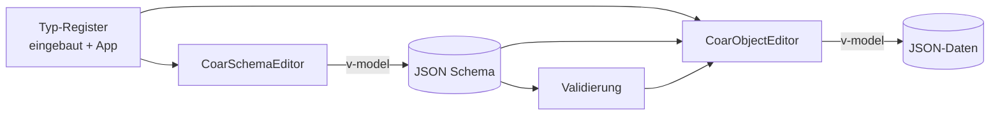

# Objekt-Editor und Schema-Editor

Heute gibt es nur den Spike unter `apps/playground/src/json-editor-spike/`. Er zeigt, wie das Bearbeiten aussehen soll,
aber sein Modell (`Field` mit `kind` und `value`) ist ein flaches Eigenformat ohne echtes Schema, und eigene Typen sind
fest im Code verdrahtet.

Danach gibt es das Paket **`@cocoar/vue-object-editor`** mit zwei Komponenten:

- **`CoarObjectEditor`** zeigt und bearbeitet ein JSON-Objekt, auch verschachtelt, gesteuert von einem
  **Standard-JSON-Schema** (Draft 2020-12). Das Schema sagt, ob ein String ein Datum oder nur Text ist.
- **`CoarSchemaEditor`** beschreibt so ein Objekt: Properties anlegen, Typ wählen, Pflicht, Grenzen, Auswahlwerte.
  Er schreibt dasselbe JSON Schema, das der Objekt-Editor liest.

Eigene Typen (wie „Geldbetrag“) legt der **Entwickler im Code** an. Im Schema-Editor erscheinen sie neben den
eingebauten Typen, im Objekt-Editor mit ihrem eigenen Control.



## Was sich ändert

### Das Schema: Standard-JSON-Schema mit wenigen `x-coar-*`-Angaben

Gespeichert wird reines JSON Schema. Damit lassen sich die Daten auch ohne unsere Komponenten prüfen, etwa im Backend.
Was JSON Schema nicht kennt, steht in Erweiterungen mit dem Präfix `x-coar-`; andere Werkzeuge ignorieren sie.

So sieht das Produkt aus dem Spike als Schema aus (gekürzt):

```json
{
  "$schema": "https://json-schema.org/draft/2020-12/schema",
  "type": "object",
  "required": ["name", "price", "launchDate"],
  "x-coar-order": ["name", "description", "price", "launchDate", "category", "tags", "owner", "dimensions"],
  "properties": {
    "name":        { "type": "string", "title": "Produktname", "x-coar-type": "text" },
    "description": { "type": "string", "title": "Beschreibung", "x-coar-type": "multiline" },
    "price":       { "$ref": "#/$defs/money", "title": "Preis", "x-coar-type": "money" },
    "launchDate":  { "type": "string", "format": "date", "title": "Verkaufsstart", "x-coar-type": "date" },
    "category": {
      "title": "Kategorie", "x-coar-type": "choice",
      "oneOf": [
        { "const": "lighting",  "title": "Beleuchtung" },
        { "const": "furniture", "title": "Möbel" }
      ]
    },
    "tags": {
      "type": "array", "title": "Schlagwörter", "x-coar-type": "choices", "uniqueItems": true,
      "items": { "anyOf": [ { "const": "led", "title": "LED" }, { "const": "minimal", "title": "Minimal" } ] }
    },
    "owner":      { "type": "string", "title": "Verantwortlich", "x-coar-type": "choice", "x-coar-options": "people" },
    "dimensions": {
      "type": "object", "title": "Abmessungen", "x-coar-type": "object",
      "properties": { "width": { "type": "number", "minimum": 0, "x-coar-unit": "cm", "x-coar-type": "number" } }
    }
  },
  "$defs": {
    "money": {
      "type": "object", "required": ["amount", "currency"],
      "properties": { "amount": { "type": "number" }, "currency": { "enum": ["EUR", "USD", "CHF"] } }
    }
  }
}
```

Die Regeln dahinter:

- **Auswahl.** Eine Wahl ist `oneOf` aus `{ const, title }`, mehrere Wahlen ein `array` mit `uniqueItems` und
  `items.anyOf` aus `{ const, title }`. So haben die Werte Beschriftungen. Ein reines `enum` wird auch gelesen.
  Varianten mit je eigenen Feldern (diskriminierte Unions) gibt es nicht.
- **Freie Schlagwörter** (Werte, die der Nutzer selbst anlegt) sind ein `array` von `string` ohne feste Werte;
  `x-coar-suggestions` kann Vorschläge liefern.
- **`x-coar-type`** nennt den Typ der Property. Der Schema-Editor schreibt ihn immer. Fehlt er (ein fremdes Schema),
  erkennt der Editor den Typ an der Form (`format: "date"` → Datum, `oneOf` mit `const` → Auswahl).
- **Eigene Typen** stehen als `$ref` auf `$defs`. Der Schema-Editor kopiert das Schema des Typs beim ersten Gebrauch
  nach `$defs`. So bleibt das Schema für sich allein gültig und prüfbar, auch ohne die App.
- **Reihenfolge** steht in `x-coar-order`. Die Reihenfolge der Schlüssel in `properties` reicht nicht: Datenbanken wie
  PostgreSQL (`jsonb`) sortieren Schlüssel um. Fehlt `x-coar-order`, gilt die Reihenfolge von `properties`.
- **Optionen aus einer Quelle** (Personen aus einer API) nennen in `x-coar-options` nur den Namen der Quelle. Die App
  liefert sie über die Prop `optionSources`.

### Das Typ-Register: eingebaute und eigene Typen gleich behandelt

Jeder Typ, auch jeder eingebaute, ist ein Eintrag im Register. Das Muster lehnt sich an das Feld-Register von
`@cocoar/vue-markdown-form` an (`packages/markdown-form/src/registry.ts`).

```ts
export interface CoarValueType<TValue = unknown> {
  id: string;                       // 'money' — steht in x-coar-type
  label: string;                    // 'Geldbetrag' — Auswahl im Schema-Editor
  icon: string;
  schema: JsonSchema;               // Form der Daten; bei eigenen Typen das $defs-Schema
  settings?: readonly CoarTypeSetting[]; // was der Schema-Editor anbietet: 'min-max', 'unit', 'options', …
  control?: Component;              // Bearbeiten; ohne Control: verschachtelte Zeilen aus dem Schema
  display?: (value: TValue, ctx: CoarDisplayContext) => string; // Ansicht
  isEmpty?: (value: TValue) => boolean;
  validate?: (value: TValue, ctx: CoarValidateContext) => string | null; // zusätzlich zum Schema
}

// In der App:
const types = defineObjectEditorTypes([moneyType]);   // ergänzt die eingebauten Typen
```

```vue
<CoarSchemaEditor v-model="schema" :types="types" />
<CoarObjectEditor v-model="product" :schema="schema" :types="types" :option-sources="{ people }" mode="edit" />
```

Eingebaut sind die Typen des Spikes, die kein App-Wissen brauchen: `text`, `multiline`, `number`, `boolean`, `date`,
`email`, `color`, `choice`, `choices`, `tags`, `object`. **Geldbetrag kommt nicht ins Paket**, sondern als Beispiel
eines eigenen Typs in die Doku. Er beweist, dass die Schnittstelle trägt.

Ohne eigenes Control zeigt der Objekt-Editor einen eigenen Typ als verschachteltes Objekt. Ein Typ funktioniert also
sofort, das Control ist eine Verbesserung.

### Das Modell: rekursiv und über Pfade adressiert

Der Objekt-Editor hält **kein zweites Datenmodell** wie das `Field[]` des Spikes. Er läuft über das Schema und liest und
schreibt den Wert über **JSON Pointer** (`/dimensions/width`). Jede Zeile kennt ihren Pfad, ihr Teil-Schema und
ihren Typ. Fehler der Validierung tragen ebenfalls einen Pointer und landen so in der richtigen Zeile.

Listen von Objekten (`/contacts/0/name`) sind damit nur ein weiterer Pfad. Version 1 zeigt eine Property vom Typ
„Array von Objekten“ als schreibgeschützte Zeile mit der Anzahl der Einträge. Sie geht beim Speichern nicht
verloren. Das spätere Bearbeiten braucht keinen Umbau des Modells.

Änderungen sind unveränderlich: Jede Eingabe erzeugt ein neues Objekt und gibt es über `update:modelValue` heraus.
Die App bekommt immer reines JSON.

### Leer, `null` und fehlend

| Zustand | Wann | Was der Editor tut |
| --- | --- | --- |
| **fehlend** (Schlüssel nicht da) | Der Nutzer leert ein Feld | Entfernt den Schlüssel. „Pflicht“ heißt: Schlüssel da und nicht leer |
| **leer** (`""`, `[]`) | Nur wenn ein Typ es so will (`isEmpty`) | Wird wie fehlend behandelt |
| **`null`** | Nur wenn das Schema `null` erlaubt | Schreibt der Editor nie von sich aus; vorhandenes `null` bleibt |

In der Ansicht zeigt ein leerer Wert `–`, wie im Spike.

### Daten, die das Schema nicht kennt

Sie bleiben unverändert erhalten und werden nie beim Speichern entfernt. Der Editor zeigt sie am Ende als
schreibgeschützte Zeilen „Nicht im Schema“. Steht im Schema `additionalProperties: false`, meldet die Validierung sie
als Fehler.

### Validierung

Die Prüfung gegen das Schema übernimmt **`@cfworker/json-schema`**, hinter einer kleinen eigenen Schnittstelle
(`validate(schema, value) → Issue[]` mit `pointer`, `keyword`, `params`). Gründe:

- Es unterstützt Draft 2020-12 und erzeugt **keinen Code zur Laufzeit**. Ajv dagegen kompiliert Schemas mit
  `new Function` und braucht deshalb in der Content Security Policy `'unsafe-eval'`. Bei Schemas, die Nutzer zur
  Laufzeit anlegen, kann man nicht vorab kompilieren.
- Die Schnittstelle bleibt unsere: Ein Wechsel des Validators ändert keine API.

Die Meldungen erzeugen wir selbst aus `keyword` und `params`, übersetzbar über `@cocoar/vue-localization`
(„Bitte ausfüllen.“, „Mindestens 0.“). Dazu kommt das `validate` des Typs (etwa: Geldbetrag braucht eine Währung).

Der Schema-Editor prüft auch das Schema selbst: eindeutige Schlüssel, gültige Namen, Minimum nicht über Maximum,
eindeutige Auswahlwerte.

### Die Komponenten und der Spike

Die Optik des Spikes bleibt: Zeilen mit Schlüssel und Wert, `appearance="inline"` und `width="content"`, Ansicht und
Bearbeiten ohne Sprung, das Inline-Select im Suffix für die Währung, die Templates für Personen. Konkret wandern:

| Aus dem Spike | Wird zu |
| --- | --- |
| `App.vue` (Zeilen, Verschachtelung, Hinzufügen) | `CoarObjectEditor.vue`, `ObjectEditorRow.vue` |
| `ValueEditor.vue`, `ValueRenderer.vue` | die `control`- und `display`-Teile der eingebauten Typen |
| Inspector in `App.vue` | `CoarSchemaEditor.vue` (Liste der Properties + Inspector) |
| `model.ts` (`Field`, `errorFor`, `toJson`) | entfällt; ersetzt durch Schema, Pointer und Validierung |

Der Schalter „Select und Datum ohne Icons“ des Spikes greift per `:deep()` in die Interna von `@cocoar/vue-ui`. Das
übernimmt das Paket nicht: Es nutzt die normalen Picker. Ein Picker ohne Icon wäre ein eigener Wunsch an
`@cocoar/vue-ui`.

## Steps

Ein Pull Request für alles (Entscheidung im Review: ein CI-Lauf statt zwei), Titel
`feat(object-editor): object editor and schema editor driven by JSON Schema (preview)`. Die API bekommt den
`Preview`-Badge, weil sie noch wachsen wird. Innerhalb des Branches trennen eigene Commits Kern, Objekt-Editor und
Schema-Editor, damit der Review in Abschnitten geht.

**Teil 1 — Kern und Objekt-Editor**

- [x] 1. Paket anlegen wie `packages/markdown-form`: `packages/object-editor/` mit `package.json`
      (`@cocoar/vue-object-editor`, Version `0.0.1`, Peer `@cocoar/vue-ui` und `vue`, Abhängigkeit
      `@cfworker/json-schema`), `vite.config.ts`, `tsconfig.json`, `src/index.ts`, `styles/object-editor.css`.
- [x] 2. Kern ohne Vue in `src/core/`: Typen für das unterstützte JSON Schema, `pointer.ts` (get, set, remove,
      unveränderlich), `resolve.ts` (Teil-Schema und Typ zu einem Pfad, `$ref` auf `$defs`, Erkennung ohne
      `x-coar-type`, `x-coar-order`), `validate.ts` (Adapter auf `@cfworker/json-schema`, Issues mit Pointer).
      Dabei prüfen, welche `format`-Werte der Validator kennt (`date`, `email`), und fehlende selbst ergänzen.
- [x] 3. Unit-Tests für den Kern: Pointer, Auflösen verschachtelter und referenzierter Schemas, Erkennung fremder
      Schemas, leer/fehlend, unbekannte Properties bleiben erhalten, Array von Objekten wird nicht angetastet.
- [x] 4. Typ-Register mit den eingebauten Typen (`src/types/`), deren Controls und Anzeigen aus `ValueEditor.vue` und
      `ValueRenderer.vue` des Spikes, ohne `:deep()`-Eingriffe.
- [x] 5. `CoarObjectEditor` und `ObjectEditorRow` aus `App.vue` des Spikes: Modus Ansicht/Bearbeiten, Verschachtelung,
      Fehler pro Zeile, `optionSources`, Zeilen „Nicht im Schema“. Komponententests mit `@vue/test-utils`.
- [x] 6. Einhängen: `apps/docs/package.json`, Seitenleiste in `apps/docs/.vitepress/config.ts`,
      `apps/docs/skill/SKILL.header.md`. Umgesetzt ohne Alias (die Doku löst Pakete über die `source`-Bedingung auf,
      wie `markdown-form`) und ohne Playground-Abhängigkeit (der Playground nutzt das Paket nicht).
      `compact-packages/` braucht keinen Eintrag: das Paket führt keine eigenen Tokens ein. Dazu kamen die Icons
      `list-checks` und `braces` in `assets/icons/` (`pnpm build:icons`).
- [x] 7. Doku `apps/docs/components/object-editor.md` mit `devices`-Frontmatter, Demos: Produkt aus dem Spike, ein
      eigener Typ „Geldbetrag“ mit Control, Optionen aus einer Quelle. `pnpm skill:sync`.

**Teil 2 — Schema-Editor**

- [ ] 8. Schema-Operationen im Kern (`src/core/schema-ops.ts`): Property anlegen, entfernen, umbenennen,
      verschieben (`x-coar-order`), Typ wechseln, Einstellungen setzen, eigenen Typ nach `$defs` kopieren. Mit Tests.
- [ ] 9. Prüfung des Schemas (eindeutige und gültige Schlüssel, Grenzen, Auswahlwerte), mit Tests.
- [ ] 10. `CoarSchemaEditor` aus dem Inspector des Spikes: Liste der Properties mit Verschachtelung, Typ-Auswahl aus dem
      Register (eingebaut und eigene), Einstellungen je nach `settings` des Typs, Auswahlwerte bearbeiten.
- [ ] 11. Doku-Abschnitt mit Demo: Schema-Editor und Objekt-Editor nebeneinander am selben Schema. `pnpm skill:sync`.
- [ ] 11a. Lokale Prüfungen (siehe unten), Branch `feat/object-editor`, PR nach Skill `cocoar-pr`, CI beobachten.

**Aufräumen (ohne PR)**

- [ ] 12. Den lokalen Spike `apps/playground/src/json-editor-spike/`, `json-editor-spike.html` und
      `vite.json-editor-spike.config.ts` löschen, sobald PR 1 die Optik übernommen hat. `mockups/` bleibt, bis du es
      nicht mehr brauchst.

## How it is verified

- [ ] Unit-Tests des Pakets (`pnpm --filter @cocoar/vue-object-editor test`) grün, mit den Fällen aus Schritt 3 und 9.
- [ ] Ein Schema aus dem Schema-Editor validiert mit einem zweiten, unabhängigen Validator: ein Test prüft die
      Demo-Schemas zusätzlich mit `ajv` als Dev-Abhängigkeit. So stellen wir sicher, dass wir Standard schreiben.
- [ ] Rundreise: Schema-Editor erzeugt ein Schema → Objekt-Editor füllt es → die Daten bestehen die Prüfung → Daten
      mit unbekannten Properties und einem Array von Objekten kommen unverändert zurück.
- [ ] Doku-Browser-Tests (`apps/playground/docs-e2e/`) für die Demo-Seite: Wert bearbeiten, Fehler erscheint in der
      richtigen Zeile, Ansicht und Bearbeiten verschieben nichts.
- [ ] `pnpm lint && pnpm typecheck && pnpm build`, `pnpm skill:check`; `pnpm test` läuft in der CI.
- [ ] Visueller Vergleich `node apps/playground/scripts/visual.mjs`: keine bestehende Aufnahme ändert sich (das Paket
      ist neu und ändert `@cocoar/vue-ui` nicht).

## Decisions

| Entscheidung | Wahl | Warum |
| --- | --- | --- |
| Paketname | `@cocoar/vue-object-editor`, Ordner `packages/object-editor`, Scope `object-editor` | Im Review bestätigt; enthält beide Komponenten, weil sie Kern und Register teilen |
| Zuschnitt | Ein PR, getrennte Commits je Teil | Im Review entschieden: ein CI-Lauf |
| Format | JSON Schema Draft 2020-12 + `x-coar-*` | Deine Entscheidung; prüfbar ohne unsere Komponenten |
| Auswahl | `oneOf`/`anyOf` aus `{ const, title }`, keine Varianten | Deine Entscheidung; Beschriftungen ohne Eigenformat |
| Eigene Typen | Register im Code, Schema nach `$defs`, Control optional | Deine Entscheidung; Schema bleibt eigenständig |
| Validator | `@cfworker/json-schema` hinter eigener Schnittstelle | Kein `new Function`, also CSP-tauglich; austauschbar |
| Reihenfolge | `x-coar-order` | Schlüssel-Reihenfolge überlebt `jsonb` nicht |
| Leeren | Schlüssel entfernen statt `""` oder `null` | Ein Zustand für „nicht gesetzt“; `required` bleibt eindeutig |
| Unbekannte Daten | Erhalten, schreibgeschützt anzeigen | Der Editor darf nie still Daten verlieren |
| Listen von Objekten | Im Modell vorgesehen, in Version 1 nur angezeigt | Deine Entscheidung: später ohne Umbau |
| Geldbetrag | Beispiel in der Doku, nicht eingebaut | Beweist die Schnittstelle für eigene Typen |
| Mobile | `devices: { desktop: ready, tablet: partial, phone: planned }` | Der Spike ist nur für den Desktop gebaut |

## Risks

- **Teilmenge von JSON Schema.** Fremde Schemas können Schlüsselwörter enthalten, die der Editor nicht darstellt
  (`if`/`then`, `patternProperties`). Der Validator prüft sie trotzdem; der Editor zeigt solche Properties
  schreibgeschützt, statt sie falsch zu bearbeiten.
- **Größe des PR.** Kern, Typen, Objekt- und Schema-Editor sind viel für einen PR. Getrennte Commits je Teil und
  ein Adaptive Review je Teil vor dem Push halten den Review handhabbar.
- **Meldungen der Validierung.** Eigene Texte aus `keyword` und `params` decken die unterstützten Schlüsselwörter ab;
  für andere fällt der Editor auf eine allgemeine Meldung zurück.

## Out of scope

- Bearbeiten von Listen von Objekten (nur vorbereitet).
- Varianten (`oneOf` mit je eigenen Feldern), bedingte Felder (`if`/`then`).
- Rückgängig/Wiederholen, Speichern, Versionen und Migration von Daten bei Schemaänderungen.
- Ein Schema aus vorhandenen JSON-Daten ableiten.
- Picker ohne Icon in `@cocoar/vue-ui`.
- Mobile-Ausbau und Mobile-Tests.

<details><summary>Warum nicht Ajv, und was im Repo schon da ist</summary>

- Ajv ist im Lockfile nur indirekt über Werkzeuge (Version 6 und 8), kein Paket hängt davon ab. Es ist schneller als
  `@cfworker/json-schema`, aber für Formulare mit einigen Dutzend Feldern spielt die Geschwindigkeit keine Rolle.
  `ajv` dient im Plan nur als zweite Meinung in den Tests.
- `@cocoar/vue-markdown-form` hat ein Feld-Register mit `control`, `readonly`, `validate`, `isEmpty`,
  `formatReadonly`. `CoarValueType` folgt diesem Muster, damit sich beide Pakete gleich anfühlen; ein gemeinsames
  Register ist ein späterer Schritt, wenn beide stabil sind.
- Das Paket-Gerüst (Vite-Lib-Build mit `source`-Bedingung, `vite-plugin-dts`, `happy-dom`-Tests) kommt aus
  `packages/markdown-form/vite.config.ts`.

</details>
