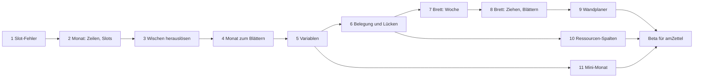
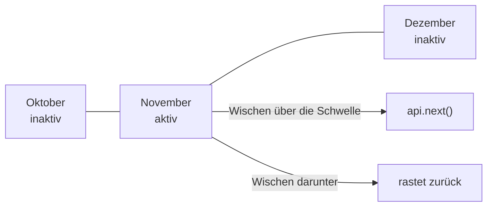

# Kalender-Bausteine für den Familienkalender

amZettel Neo löst die native iOS-App ab und bekommt einen neuen Kalender (Entwurf: `am-zettel/design/neu/kalender/index.html`). Mit der heutigen Library geht das nur gegen ihre internen Klassen. Dieser Plan beschreibt, was die Library dafür lernt. Die Oberfläche von amZettel ist nicht Teil davon.

**Die Grenze:** Die Library weiß, wie Zeit auf eine Fläche kommt. Was ein Termin bedeutet (Essen, Familie, „frei“, Countdown), weiß nur die App.

## Was neu ist und was bleibt

| Baustein | Heute | Nach diesem Plan |
| --- | --- | --- |
| Monat | in `CoarCalendar` endlos scrollend, Zeilen wachsen mit den Balken, kein Inhalt je Tag | auf Wunsch **Monat für Monat zum Wischen**, gleich hohe Zeilen, Slots für Zellkopf und Zellinhalt (die drei Striche) |
| Tagesraster | Spalten sind immer Tage | auf Wunsch eine Spalte je Ressource, Termine über mehrere Spalten |
| Woche als Brett | gibt es nicht | `CoarCalendarBoard` |
| Woche nach Personen | gibt es nicht | dasselbe Brett, Zeilen je Ressource |
| Jahr als Wandplaner | `CoarYearView` zeigt keine Termine | dasselbe Brett, Monate als Zeilen. `CoarYearView` bleibt unverändert |
| Mini-Monat | nur in amZettel | `CoarMiniMonth` |
| Belegung, „frei“ | nur im Entwurf | reine Funktionen im Core |
| Tag als Ablauf, Demnächst, Sheets | – | bleiben in amZettel |

`CoarMonthView` wird **nicht** auf das Brett umgebaut. Er hat eigene Geometrie, Drag & Drop und Baselines, und der Umbau brächte dem Entwurf nichts. Das endlose Scrollen bleibt der Standard von `CoarCalendar`, das Blättern ist eine gleichwertige Einstellung.

## Grundsätze für alle Schritte

- **Ohne neue Option sieht alles aus wie heute.** Keine `--default-`-Baseline ändert sich, und bestehende Stories bleiben unangetastet. Neue Bausteine bekommen neue Stories.
- **Neue Variablen tragen den bisherigen Wert als Fallback.**
- **Der Core bleibt rein und Temporal-only.** Die Invarianten C1–C8 gelten weiter, vor allem die eine Drop-Pipeline (C2) und der eine Schreiber des sichtbaren Fensters (C5).
- **Keine App-Begriffe in der API.** Es heißt `resource`, nicht Person, und `period`, nicht Tagesteil.
- **Neue APIs tragen das Preview-Badge** und stehen mit `devices` in der Doku.
- **Jeder Schritt ist ein eigener Pull Request** mit Doku, Demo, Tests und `pnpm skill:sync`.

## Reihenfolge



Nach Schritt 5 lohnt sich schon eine erste Beta: amZettel kann dann seine `!important`-Regeln abbauen und den Monat fertig bauen.

## Schritte

### 1. Ganztag-Slot der Tagesansicht

`fix(calendar): the day view passes the all-day event slot through CoarCalendar` (Aufgabe `s28m`)

- [x] `CoarCalendar` reicht `#allDayEvent` auch an `CoarDayView` weiter
- [x] Test wie bei Woche und Arbeitswoche

### 2. Monat: stabile Zeilen und Inhalt je Tag

`feat(calendar): month rows can keep one height, day cells take custom content`

Heute wächst eine Zeile mit der Zahl ihrer Balken, also würde das Raster beim Blättern springen. Sechs Zeilen hat `CoarMonthView` bereits.

```ts
builder.monthRowSizing('auto' | 'uniform' | 'fill'); // Standard: 'auto' (wie heute)
```

- [x] `uniform`: Alle Zeilen sind gleich hoch, egal wie viele Balken sie tragen. Für das Telefon, wo der Monat über der Tageskarte steht und keine Höhe zum Füllen hat
- [x] `fill`: Die sechs Zeilen teilen sich die Höhe des Containers, für Tablet und Desktop
- [x] In beiden Formen falten Balken und Termine, die nicht passen, in das vorhandene „+N“ (`capMonthRowLanes`, `capMonthCellPills`)
- [x] Slots `#dayNumber` und `#dayContent` an `CoarMonthCell`, durchgereicht von `CoarMonthView`, `CoarContinuousMonthView` und `CoarCalendar`. Sie bekommen `{ date, isToday, isSelected, isOtherMonth }`, damit die App die Striche der Nachbartage blass zeichnen kann
- [x] Builder-Funktion `dayClass(date)` für hervorgehobene Tage, die Grundlage von „Frei finden“
- [x] Tests für beide Formen, Überlauf „+N“, Zeilen mit Balken und Slots auf Nachbartagen

### 3. Wischen aus dem Stundenraster herauslösen

`refactor(calendar): share the page swipe between surfaces`

- [x] Die Geste aus `useTimeGridSwipe` wandert in ein internes `usePageSwipe` mit frei wählbarer CSS-Variable
- [x] `useTimeGridSwipe` bleibt als öffentliche API mit gleichem Verhalten bestehen, seine Tests laufen unverändert

### 4. Monat zum Blättern

`feat(calendar): a paged month that follows the finger`

```ts
builder.monthPresentation('continuous' | 'paged'); // Standard: 'continuous'
```



- [x] Neue Komponente `CoarPagedMonthView`: drei `CoarMonthView` nebeneinander über die vorhandene `month`-Prop. Nur die mittlere ist bedienbar, die Nachbarn sind für Tastatur und Screenreader unsichtbar
- [x] Ein einziger `useViewWindow` mit `monthBuffer: 1`, damit die Nachbarmonate beim Ziehen schon ihre Termine zeigen (C5)
- [x] `CoarCalendar` zeigt bei `paged` diese Komponente statt der endlosen Liste, `api.next()` und `api.prev()` blättern animiert
- [x] Die Geste nimmt nur waagrechte Bewegung. Senkrecht bleibt der Seite, ein Tipp wählt den Tag, langes Drücken zieht einen Termin
- [x] Ein Tipp auf einen Nachbartag löst wie jeder Tag `onDateClick` aus. Die App entscheidet, ob sie dabei umblättert
- [x] `prefers-reduced-motion`: ohne Animation
- [x] Tests für Schwelle, Zurückrasten, Tipp gegen Wischen, Laden der Nachbarmonate
- [ ] Neue Story mit Baselines (am Ende gesammelt, braucht Docker)

### 5. Gestaltung über Variablen

`feat(calendar): tokens for the month title, day number, today marker and pills`

- [x] Variablen für Zeilen-Innenabstände, Monatstitel, Tageszahl, Heute-Markierung, Pills und Wochentagszeile
- [x] Builder-Option `weekdayFormat('narrow' | 'short')`
- [x] Jede `!important`-Regel in Neos `CalendarView.vue` prüfen: Variable, Slot oder eigener Fehler der Library. `touch-action: auto !important` ist kein Gestaltungsthema und bleibt bis zur Klärung der Ursache (eigene Aufgabe)
- [x] Tabelle der Variablen in der Doku

**Fertig, wenn** Neo keine `!important`-Regel mehr gegen Klassen der Library braucht.

### 6. Belegung und Lücken im Core

`feat(calendar): compute who is busy in a period and the gaps of a day`

```ts
interface CalendarPeriod { key: string; startMinutes: number; endMinutes: number } // 0–1440

computeOccupancy(events, {
  dates, periods, resources, timezone,
  resourcesOf: (event) => string[],
  counts?: (event) => boolean,   // Standard: nur Termine mit Uhrzeit
}): {
  busyResources(date, periodKey): string[];
  isFree(date, periodKey, resourceIds): boolean;
}

findDayGaps(intervals, { date, timezone, fromMinutes?, toMinutes?, minMinutes? }):
  { start: ZonedDateTime; end: ZonedDateTime; minutes: number }[]
```

- [x] Minuten statt `PlainTime`, weil das Ende eines Abends 24:00 ist und `PlainTime` das nicht kennt
- [x] Belegung zählt **Überschneidung** mit halboffenen Intervallen. Ein Termin von 15:30 bis 18:00 belegt den Nachmittag, nicht den Abend
- [x] Ganztägige Einträge zählen standardmäßig nicht, wie im Entwurf (die Projektwoche macht niemanden unfrei)
- [x] `findDayGaps` nimmt beliebige `{ start, end }`, damit die App Essen mitrechnen kann. Überlappende Intervalle werden vereint, Lücken gibt es nur zwischen Einträgen
- [x] Tests: Mitternacht, mehrtägig, Sommerzeit-Tage (23 und 25 Stunden), Anzeigezone ungleich Quellzone, Serien

### 7. `CoarCalendarBoard`: die Woche

`feat(calendar): a board of days and periods with free rows`

Eine Zeile sagt, welche Tage sie zeigt und welche Termine zu ihr gehören. Damit sind Woche, Personen und Wandplaner dieselbe Form:

```ts
interface BoardRow<TMeta> {
  key: string;
  dates: (Temporal.PlainDate | null)[];     // eine Zelle je Spalte, null = keine (31. Februar)
  kind: 'cells' | 'bars' | 'custom';        // Termine, durchlaufende Balken, nur Slot
  match?: (event: CalendarEvent<TMeta>) => boolean;
}

weekBoardRows({ dates, periods, allDay: true, extraRows: ['meals'] });
resourceWeekRows({ dates, resources, resourcesOf, extraRows: ['allFree'] });
yearWallRows({ year });                      // Schritt 9
```

- [x] `layoutBoard` im Core: Balken über `layoutOverlappingIntervals`, die Tagesgrenzen (`dayBoundsOf`) aus `monthGridLayout` werden geteilt, ohne das Verhalten zu ändern
- [x] **Zuordnung:** Ein Termin mit Uhrzeit steht im Abschnitt, in dem er **beginnt**. Mehrtägiges und Ganztägiges läuft in der Balkenzeile
- [x] Slots `#rowLabel`, `#columnHeader`, `#event`, `#bar`, `#cell` (für `custom`-Zeilen)
- [x] Das Fenster kommt über `useViewWindow` mit den vorhandenen Ansichten `week` und `year`, es gibt keine neue View-ID
- [x] Spaltenbreiten und Mindestbreite über Variablen, Zustände `today` und `past` als Klassen
- [x] Barrierefreiheit: `role="grid"`, Pfeiltasten zwischen Zellen, Beschriftung aus Zeile und Spalte
- [ ] Neue Stories in Standard und `.coar-mobile`, hell und dunkel (am Ende gesammelt, braucht Docker)

### 8. Brett: Ziehen, Anlegen, Blättern

`feat(calendar): drag, create and swipe on the board`

- [x] Verschieben durch die vorhandene Drop-Pipeline (`applyMoveToEvent`, `canDrop`, Sommerzeit-Regel)
- [x] **Anderer Tag: die Uhrzeit bleibt.** Anderer Abschnitt: der Termin beginnt am Anfang des Abschnitts oder an seiner `dropMinutes` (ein Morgen ab 00:00 bräuchte das), die Dauer bleibt
- [x] Payload und `canDrop` bekommen optional `rowKey`. Was der Zeilenwechsel bedeutet (etwa eine andere Person), entscheidet die App
- [x] Anlegen durch Ziehen über Zellen, auf Touch langes Drücken wie im Raster
- [x] Wischen blättert über `usePageSwipe` aus Schritt 3

### 9. Wandplaner

`feat(calendar): a year wall planner on the board`

- [x] `yearWallRows`: zwölf Zeilen, 31 Spalten, fehlende Tage als `null`
- [x] Bänder laufen je Monat und tragen `clippedStart` und `clippedEnd`, damit Sommerferien über den Monatswechsel lesbar bleiben
- [x] Punkte über `#cell`, Wochenenden und heute als Klassen
- [x] Beschriftung nur, wenn das Band breit genug ist; auf dem Telefon Bänder ohne Text
- [x] Performance: 365 Zellen plus Bänder ohne Virtualisierung messen, Ziel unter 16 ms je Aktualisierung (Layout mit 1000 Terminen: Median 1 ms)

### 10. Ressourcen-Spalten im Stundenraster

`feat(calendar): one time-grid column per resource`

```ts
builder
  .resources([{ id: 'emma', label: 'Emma', color: '#…' }])
  .eventResources((event) => event.meta.personIds);
```

- [x] Gilt für die Tagesansicht mit einem Tag und senkrechtem Raster. Mehrere Tage oder Zeilen-Ausrichtung: Warnung im Dev-Modus, Raster wie bisher
- [x] **Geteilte Termine:** Nebeneinanderliegende Spalten werden ein Block. Nicht benachbarte ergeben mehrere Blöcke desselben Termins
- [x] **Überlappung:** Ein Block über mehrere Spalten bleibt ganz, solange er in jeder davon allein liegt. Sonst zerfällt er in Stücke je Spalte
- [x] Termine ohne Ressource gehen nie verloren: Sie stehen in einer eigenen Spalte, die nur erscheint, wenn es solche gibt
- [x] Ziehen, Fokus und Klick behandeln alle Blöcke als einen Termin
- [x] Payloads von Drop, Klick und Zeitauswahl bekommen optional `resourceId`. Die Library ändert die Zuordnung nicht, das tut die App in `onEventDrop`
- [x] Slot `#resourceHeader`, Überlagerungen quer durch alle Spalten (`overlays(date)` mit Slot `#overlay`, antippbar) für Essen
- [x] Die Jetzt-Linie läuft über alle Spalten
- [x] Tests; die bestehenden Raster-Baselines bleiben gleich
- [ ] Neue Story mit Baselines (am Ende gesammelt, braucht Docker)

> **Abweichung:** Die Spalten sind eine eigene Fläche (`CoarResourceDayGrid`), die `CoarDayView` bei gesetzten Ressourcen zeigt, kein Modus von `CoarTimeGrid`. Dort ist eine Spalte durchgehend ein Tag, und ein Umbau hätte die bestehenden Ansichten gefährdet. Größe ziehen (Resize) gibt es in dieser Fläche noch nicht.

### 11. Mini-Monat

`feat(calendar): a small month for picking a day`

- [x] `CoarMiniMonth` mit `v-model` (Tag), eigenem Blättern und Markierung der aktiven Woche
- [x] Ohne Builder nutzbar, Slot `#day` für Marken
- [x] Tastatur wie im Grid, Neos `MiniMonth.vue` als Maßstab

## Prüfung je Pull Request

- [ ] `pnpm lint && pnpm typecheck && pnpm build`, `pnpm test` als Hintergrundjob
- [ ] `node apps/playground/scripts/visual.mjs`: keine bestehende Baseline ändert sich
- [ ] Doku und Demo aktualisiert, `pnpm skill:sync`, `devices` je Komponentenseite
- [ ] Nach Schritt 5 und nach Schritt 10: Beta und Probe im echten Neo gegen den Entwurf auf Telefon, Tablet und Desktop

## Entscheidungen

| Frage | Entscheidung | Warum |
| --- | --- | --- |
| Monat blättern oder scrollen | Beides, Blättern per `monthPresentation('paged')` | Der Familienkalender braucht ein stilles Raster, bestehende Apps behalten das Scrollen |
| Zeilen beim Blättern | Immer sechs, gleich hoch | Nichts springt beim Umblättern |
| Nachbartage | Tragen Inhalt und sind antippbar, die Blässe zeichnet die App | Die Library liefert `isOtherMonth`, die Striche gehören der App |
| Verschieben im Brett | Anderer Tag: Uhrzeit bleibt. Anderer Abschnitt: Beginn am Abschnittsanfang | Die Dauer bleibt immer erhalten |
| Termine ohne Ressource | Eigene Spalte, nur wenn nötig | Nichts geht verloren |
| Ganztägiges und Belegung | Zählt standardmäßig nicht, per `counts` änderbar | So rechnet auch der Entwurf |

## Nicht Teil dieses Plans

- Tag als Ablauf, Demnächst, Sheets, „Alle frei“ als Text, Tastenbelegung T W M J D: bleiben in amZettel
- Das Datenmodell „eine Person über alle Kalender“: wird in amZettel geklärt. Die Library kennt nur Ressourcen-IDs und wartet nicht darauf. Die Personenansichten in Neo gehen aber erst danach live
- Nachbau neuer Bausteine in `Cocoar.Calendar.iOS`: Neo löst die App ab
- Eine Woche als Stundenraster nach Personen: Der Entwurf schließt sie bewusst aus