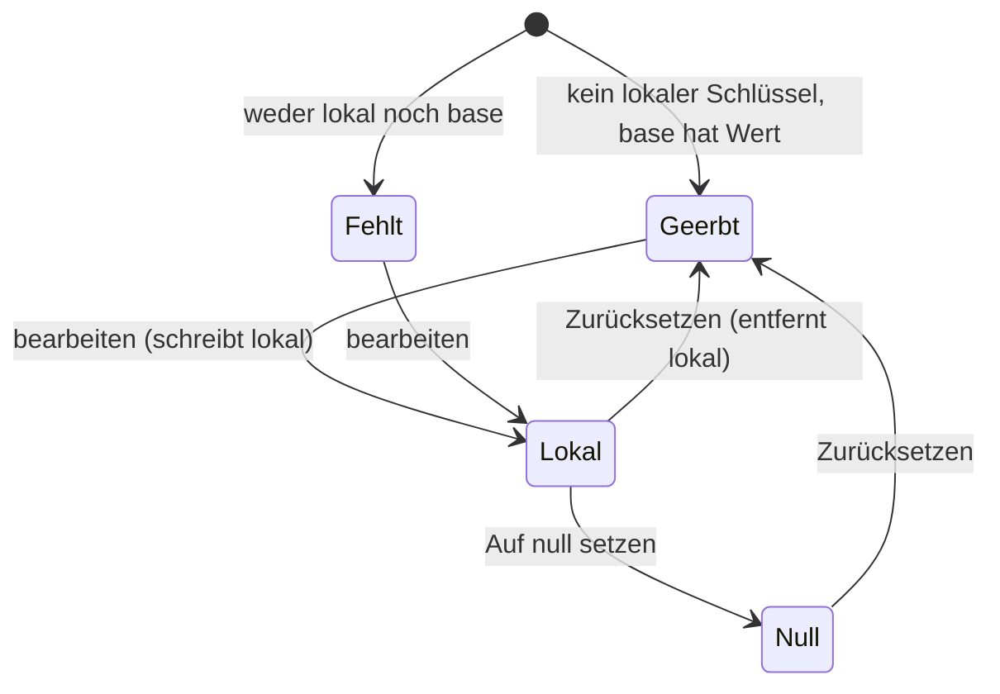

# Object Editor für ConfigHub

Heute macht der Object Editor aus `null`, `""`, `[]` und `{}` stillschweigend „Schlüssel entfernen“. Er kennt keine
geerbten Werte, gibt jeden unbekannten Wert als JSON-Text aus, findet nur sichtbare Zeilen, bearbeitet keine
Listen oder Maps, und der Schema-Editor schreibt importierte Schemas um, statt sie zu bewahren. ConfigHub braucht
das alles für seine spärlichen Ebenen-Dokumente (Issue #94).

Danach gilt: Der Editor speichert genau, was der Nutzer setzt. Nur eine ausdrückliche Aktion entfernt einen
Schlüssel. Er zeigt lokal gesetzte und geerbte Werte unterscheidbar an. Die App bestimmt, wie Geheimnisse aussehen,
und kein Wert landet in generischer Ausgabe. Suche, Listen und Maps funktionieren über alle Ebenen. Merge-Regeln,
Verschlüsselung, Versionen und Veröffentlichung bleiben bei ConfigHub.

Voraussetzung: #85 (Zeilen, Linien) und #95 (#92, #93) sind auf `develop`.

## What changes

### 1. JSON-Semantik als Standard (#86)

Ein Wert ist da, wenn sein Schlüssel da ist. Die Controls geben den echten Wert heraus: Ein geleertes Textfeld ist
`""`, eine geleerte Tag-Auswahl `[]`. Den Schlüssel entfernt nur die neue Zeilen-Aktion **Entfernen**. Erlaubt das
Schema `null`, gibt es zusätzlich **Auf null setzen**.

Wo ein Control gar keinen Wert darstellen kann (geleerte Zahl, geleertes Datum, abgewählte Auswahl), schreibt die
Zeile `null`, wenn das Schema `null` erlaubt, und sonst nichts: Der alte Wert bleibt, und die Zeile meldet
„Wert fehlt“, statt den Schlüssel heimlich zu löschen. `false` und `0` sind immer Werte.

```vue
<!-- Standard: JSON-Semantik. Das alte Formular-Verhalten nur noch auf Wunsch. -->
<CoarObjectEditor v-model="doc" :schema="schema" />
<CoarObjectEditor v-model="form" :schema="schema" presence="filled" />
```

| Zustand | Anzeige | JSON |
| --- | --- | --- |
| fehlt | `–` gedämpft, „nicht gesetzt“ | kein Schlüssel |
| `null` | Marke `null` | `"x": null` |
| leer | `""` bzw. `[]` / `{}` als Marke | `"x": ""` |

Mit `presence="key"` (Standard) prüft `required` nur, ob der Schlüssel da ist: `null` erfüllt `required`, ein
fehlender Schlüssel nicht. Mit `presence="filled"` zählt ein leerer Wert als fehlend, wie bisher.

Typen, die `null` erlauben, werden durchschaut: `type: ["boolean", "null"]` und
`anyOf: [{ type: "boolean" }, { type: "null" }]` sind ein Ja/Nein-Feld mit der Aktion „Auf null setzen“. Dafür
kommt eine Hilfe `nonNullSchema()` nach `core/resolve.ts`, die `detectTypeId` und die Controls nutzen.

### 2. Erweiterungspunkte für sensible Werte (#88)

Drei kleine Ergänzungen. Die Verschlüsselung und das Envelope-Format bleiben bei der App:

```ts
// Typ aus vorhandenen Schema-Angaben wählen, ohne das gespeicherte Schema zu ändern.
<CoarObjectEditor :resolve-type="({ schema }) => schema['x-cocoar-secret'] ? 'secret' : undefined" … />

const secret: CoarValueType = {
  id: 'secret',
  sensitive: true,          // nie in generischer Ausgabe, Titel, Suche oder Kopie
  validateSchema: false,    // gespeicherte Form (Envelope) weicht vom logischen Schema ab: keine type-Fehler
  control: markRaw(SecretControl), // schreibt nur, liest nie; leer bei vorhandenem Wert
  format: () => '••••••',
  …
};

// Unbekannte Pfade, Vorschauen von Gruppen und Listen: die App maskiert.
<CoarObjectEditor :redact="(pointer, value) => isEnvelope(value)" … />
```

Alles, was heute `JSON.stringify` zeigt (Zeilen „nicht im Schema“, der Typ `json`, Vorschauen), läuft über eine
gemeinsame Ausgabe-Funktion, die `sensitive` und `redact` beachtet. Die Doku zeigt ein Demo mit einem Typ „Secret“,
dessen Control nur schreibt.

### 3. Geerbte Basis (#87)

Neue Props von `CoarObjectEditor`, keine eigene Komponente:

```vue
<CoarObjectEditor
  v-model="local"                 <!-- nur die lokalen Überschreibungen -->
  :schema="schema"
  :base="inherited"               <!-- nur lesend: was ohne lokalen Schlüssel gilt -->
  :origin="(pointer) => sourceOf(pointer)"   <!-- { label, title?, conflict? } für die Anzeige -->
  view="local"                    <!-- 'all' (Standard) | 'local' -->
  :validate="false"               <!-- eingebaute Prüfung aus … -->
  :issues="effectiveIssues"       <!-- … die App prüft das effektive Dokument -->
/>
```

Der Wert einer Zeile ist der lokale Wert an ihrem Pfad. Fehlt er dort, gilt der Wert von `base` am selben Pfad. Das
ist ein Nachschlagen pro Pfad, kein Merge: Die Regeln, wie Ebenen zusammengehen, bleiben bei ConfigHub.



- **Geerbte Zeilen** zeigen den Wert gedämpft, aber lesbar, mit der Marke „geerbt“ und der Herkunft aus `origin`.
  Bei `conflict` steht „unterschiedlich je Kontext“ statt eines Werts, der maßgeblich wirkt.
- **Bearbeiten** einer geerbten Zeile schreibt lokal; **Zurücksetzen** entfernt den lokalen Schlüssel.
- **Ein Kind unter lokalem `null`** wird nicht still überschrieben: Seine Zeilen sind gesperrt, mit dem Hinweis,
  dass die Gruppe auf `null` steht und erst zurückgesetzt werden muss.
- **`view="local"`** zeigt nur Pfade mit lokalem Schlüssel (auch `false`, `0`, `null`, leere Werte) und ihre
  Vorfahren. Umschalten ändert nie das Dokument.
- **Prüfung:** Mit `:validate="false"` prüft der Editor selbst nicht. Mit `issues` zeigt er die Meldungen der App
  in ihren Zeilen. Fehlende lokale Schlüssel sind dann kein Fehler.

### 4. Suche und Sprung zu einer Zeile (#91)

```vue
<CoarObjectEditor v-model:search="query" … />   <!-- Titel, Schlüssel oder Pfad (dimensions.width) -->
editor.value.focus('/dimensions/width')          <!-- öffnet Vorfahren, scrollt, fokussiert -->
```

Bei einer Suche zeigt der Editor die Treffer samt Vorfahren, auch unter zugeklappten Gruppen und in rekursiven
Gruppen mit Daten. Leert man die Suche, kehrt der alte Zuklapp-Zustand zurück. Die Suche liest nur Titel, Schlüssel
und Pfade, nie Werte, also auch nie sensible Werte. Sie wirkt zusammen mit `view="local"`. Klicks auf Meldungen der
App können `focus()` nutzen.

### 5. Geordnete Listen und typisierte Maps (#90)

Zwei neue eingebaute Typen. Das Modell adressiert schon über Pfade (`/servers/2`), also bekommt jeder Eintrag eine
eigene Zeile mit dem Control seines Typs:

- **`list`:** `type: "array"` mit skalaren `items`. Einträge bearbeiten, einfügen, entfernen und umsortieren, auch
  per Tastatur (`Alt+↑/↓`). Reihenfolge und Duplikate bleiben, `false` und `0` sind Werte. Fehler hängen am
  Eintrag (`/servers/2`).
- **`map`:** `type: "object"` mit schemawertigem `additionalProperties`. Schlüssel anlegen, umbenennen, löschen, mit
  Warnung bei doppelten Schlüsseln am Schlüssel-Pfad. Die Werte bekommen das passende Control.

Der bisherige, schreibgeschützte Typ `list` (Liste von Gruppen) heißt dann `group-list`. Listen von Gruppen bleiben
schreibgeschützt.

Der Schema-Editor legt beide an: `list` mit der Einstellung „Typ der Einträge“, `map` mit „Typ der Werte“.

```json
{ "servers": { "type": "array", "items": { "type": "string" }, "x-coar-type": "list" },
  "limits":  { "type": "object", "additionalProperties": { "type": "integer" }, "x-coar-type": "map" } }
```

### 6. Schema-Editor: importierte Schemas bewahren, Profile der App (#89)

- **Bewahren:** Titel- oder Beschreibungsänderungen fassen nichts anderes an, das gilt heute schon (`updateProperty`
  ändert nur die genannten Schlüsselwörter). Neu ist ein Test mit importierten Schemas: Alles, was nicht bearbeitet
  wurde, ist danach unverändert, auch `$defs`, Annotationen und Referenzen.
- **Nicht unterstützt** (`allOf`, `if`/`then`, `patternProperties`, `not`, fremde `$ref` …): Die Property ist
  markiert, im Inspector sind nur Titel und Beschreibung änderbar, der Rest bleibt unangetastet.
- **Typwechsel mit Verlust:** Verwirft ein Typwechsel Schlüsselwörter, nennt eine Bestätigung sie vorher.
- **`null` erlauben:** ein Schalter im Inspector. Er schreibt `type: [t, "null"]`. Eine vorhandene `anyOf`-Form
  bleibt erhalten und wird dort ergänzt.
- **Neuer Typ `date-time`:** `format: "date-time"` mit Zeitzone. Control ist `CoarZonedDateTimePicker`, gespeichert
  wird ISO 8601 mit Offset.
- **Profil der App:**

```ts
<CoarSchemaEditor
  v-model="schema"
  :profile="{
    types: ['text', 'number', 'boolean', 'choice', 'list', 'map', 'secret'], // erlaubte Typen
    choiceEncoding: 'enum',                       // Auswahl als enum statt oneOf mit Titeln
    diagnostics: (schema) => confighubProblems(schema),
  }" />
```

Eine Rohansicht als JSON bietet die App selbst. Der Editor garantiert dafür, dass nichts, was er nicht bearbeitet,
beim Hin und Zurück verloren geht.

## Steps

Die Arbeit beginnt, wenn #85 und #95 gemergt sind.

**PR A — Kern (#86, #88, #87)**, Titel `feat(object-editor)!: keep null and empty values, host-defined sensitive values, inherited base values`

- [x] 1. `core/resolve.ts`: `nonNullSchema()`, `allowsNull()`; `detectTypeId` sieht durch `null`. Tests.
- [x] 2. `core/validate.ts`: Option `presence: 'key' | 'filled'` für `collectRequired`. Tests für `null`, `""`, `[]`
      und `{}` mit beiden Optionen.
- [x] 3. Controls (`types/controls/*`) geben echte Werte heraus. `ObjectEditorRow.vue` setzt nicht mehr leer gleich
      fehlend. Zeilen-Aktionen „Entfernen“ und „Auf null setzen“ (`CoarPopover` + `CoarMenu`) und Anzeige
      der Zustände nach Tabelle. Prop `presence` in `CoarObjectEditor.vue`.
- [x] 4. `CoarValueType`: `sensitive`, `validateSchema`. Props `resolveType`, `redact`. Gemeinsame Ausgabe-Funktion
      für alle generischen Darstellungen. Tests: kein Klartext und kein Envelope in Text, `title` und Vorschau.
- [x] 5. Props `base`, `origin`, `view`, `validate`, `issues`. Zeilenzustand lokal, geerbt, fehlt, gesperrt unter
      `null`. Filter `view="local"` nach Schlüssel-Präsenz mit Vorfahren. Tests für jeden Übergang des Diagramms.
- [x] 6. Doku: Abschnitte „Values and absence“, „Sensitive values“ (Demo „Secret“), „Inherited values“ (Demo mit
      `base`, Umschalter „all/local“). Notiz zum geänderten Standard mit `presence="filled"` als Weg zum alten
      Verhalten (`apps/docs/guide/migration*.md`). `pnpm skill:sync`.
- [x] 7. Test `confighub-roundtrip.test.ts` mit synthetischen Daten: Verschachtelung, Ja/Nein mit `null`,
      String-`enum`, Geheimnis, spärliches Dokument über `base`. Eine Änderung lässt alle anderen Schlüssel
      unverändert, Zurücksetzen stellt das Geerbte her, Umschalten der Ansicht ändert nichts.

**PR B — Suche, Listen und Maps, Schema-Profile (#91, #90, #89)**, Titel
`feat(object-editor)!: search, ordered lists and maps, schema editor profiles`

- [ ] 8. `v-model:search` und `focus(pointer)` in `CoarObjectEditor.vue`, Filter in `rows.ts` (Treffer und
      Vorfahren, Zuklapp-Zustand bleibt erhalten). Tests, Demo mit Suchfeld.
- [ ] 9. Zeilen für Einträge und Map-Schlüssel in `rows.ts`. Typen `list` und `map` mit Controls in
      `types/controls/`. `list` → `group-list` für Listen von Gruppen. Tastatur zum Umsortieren. Tests für
      Reihenfolge, Duplikate, `false`/`0`, doppelte Schlüssel, Fehler-Pfade.
- [ ] 10. Schema-Editor: Einstellungen „Typ der Einträge“ und „Typ der Werte“, Typ `date-time`, Schalter
      „null erlauben“ mit Erhalt der `anyOf`-Form, Markierung nicht unterstützter Properties, Bestätigung bei
      verlustreichem Typwechsel.
- [ ] 11. Prop `profile` mit `types`, `choiceEncoding`, `diagnostics`. Bewahrungs-Test mit importierten Schemas
      (Deep-Equal aller nicht bearbeiteten Teile).
- [ ] 12. Doku: „Search“, „Lists and maps“, „Schema profiles“. `pnpm skill:sync`. Der Round-Trip-Test aus Schritt 7
      bekommt Liste und Map dazu.

Umgesetzt in PR A, mit diesen Details: Der Hook `resolveType` bekommt `{ schema, pointer, typeId }`. Das Menü der
Zeile (⋯) heißt bei vorhandener Basis „Reset to inherited“. Gesperrt sind Zeilen unter einer Gruppe, die lokal oder
geerbt `null` ist. Die Migrations-Notiz steht auf der eigenen Seite `guide/migration-object-editor-values.md`.

Je PR: Branch von `origin/develop`, `pnpm lint && pnpm typecheck && pnpm build`, `pnpm test` als Job, Adaptive
Review, PR nach Skill `cocoar-pr`. Danach eine Beta für ConfigHub, wenn der Maintainer sie anstößt.

## How it is verified

- [ ] Unit-Tests des Pakets für jeden Schritt, auch die Reproduktionen aus #86–#91.
- [ ] Round-Trip-Test (Abnahme aus #94): Verschachtelung, Ja/Nein mit `null`, String-`enum`, geordnete Liste,
      Map, Geheimnis. Eine Änderung lässt alle anderen Schlüssel unverändert, Zurücksetzen stellt das Geerbte her
      ohne `base` zu speichern, die Ansichten ändern nichts, und das geschriebene Schema validiert mit Ajv.
- [ ] Doku-Browser-Tests (`apps/playground/docs-e2e/object-editor.spec.ts`): geerbte und lokale Zeile, Zurücksetzen,
      `view="local"`, Suche unter zugeklappter Gruppe, Liste per Tastatur umsortieren.
- [ ] `pnpm lint && pnpm typecheck && pnpm build`, `pnpm skill:check`; `pnpm test` in der CI.
- [ ] Abnahme in ConfigHub mit einem echten Produkt-Schema (durch ConfigHub, nicht in diesem Repo).

## Decisions

| Entscheidung | Wahl | Warum |
| --- | --- | --- |
| Standard der Wert-Semantik | JSON-Semantik (`presence="key"`), Formular-Verhalten als `presence="filled"` | Deine Entscheidung; das Paket ist Preview |
| Breaking Change | Beide PRs mit `!` und `BREAKING CHANGE:`, Migrations-Notiz | Geänderter Standard (A), umbenannter Typ `list` (B); AGENTS.md verlangt die Kennzeichnung |
| Geerbte Basis | Props von `CoarObjectEditor` | Deine Entscheidung; ein Editor für alles |
| Merge | Nachschlagen pro Pfad, kein Merge | Merge-Regeln bleiben bei ConfigHub |
| Prüfung mit `base` | `validate=false` + `issues` der App | Nur die App kennt das effektive Dokument |
| Geleerte Zahl / Datum / Auswahl | `null` wenn erlaubt, sonst Meldung statt Entfernen | „Ungültig“ wird gemeldet, nie still zu „fehlt“ |
| Sensible Werte | `sensitive`, `validateSchema`, `resolveType`, `redact` | Kein ConfigHub-Wissen in der Bibliothek |
| Suche | liest Titel, Schlüssel, Pfad, nie Werte | Sensible Werte können nicht durchsickern |
| `date-time` | `CoarZonedDateTimePicker`, ISO mit Offset | JSON-Schema-`date-time` verlangt einen Offset |
| Zuschnitt | Zwei PRs: A = Kern (#86, #88, #87), B = Rest (#91, #90, #89) | Im Review entschieden: wenige CI-Läufe, ConfigHub testet nach A schon den Kern |

## Risks

- **Geänderter Standard.** Apps, die sich auf „leer = fehlt“ verlassen, ändern ihr Verhalten. Das begrenzen die
  Preview-Kennzeichnung, die Migrations-Notiz und `presence="filled"`. Intern nutzt bisher nur die Doku den Editor.
- **Viele neue Props.** `base`, `origin`, `view`, `validate`, `issues`, `resolveType`, `redact`, `search`, `presence`
  machen `CoarObjectEditor` breit. Jede ist ohne die anderen nutzbar und hat einen Standard, der heutiges Verhalten
  (außer `presence`) beibehält.
- **Durchsickern sensibler Werte.** Eine vergessene generische Ausgabe könnte Klartext zeigen. Deshalb läuft alles
  über eine Ausgabe-Funktion, und ein Test prüft Text, `title` und Vorschauen jeder Zeilenart.

## Out of scope

- Merge-Regeln, Versionsbereiche, Entwürfe, Veröffentlichung und Verschlüsselung von ConfigHub.
- Bearbeiten von Listen von Gruppen (Arrays von Objekten) und Merge-Regeln für Collections.
- Eine eingebaute Rohansicht als JSON (die App bietet sie; der Editor garantiert verlustfreies Hin und Zurück).
- Varianten (`oneOf` mit je eigenen Feldern), bedingte Felder.

<details><summary>Woher die Ursachen kommen</summary>

- `""` wird in `types/controls/TextControl.vue` zu `undefined`, und `ObjectEditorRow.vue` (`update`) wirft jeden
  Wert weg, den `isEmptyValue` als leer ansieht: `null`, `""`, `[]`, `{}`.
- `required` zählt einen leeren Wert in `core/validate.ts` (`collectRequired`) als fehlend.
- Generische Ausgabe: `displayText` in `ObjectEditorRow.vue` und der Typ `json` nutzen `JSON.stringify`, auch für
  Zeilen „nicht im Schema“.
- `detectTypeId` sieht `type: ["boolean", "null"]` nicht als Ja/Nein und fällt auf `json` zurück.
- Der Typ `list` (Liste von Gruppen) ist schreibgeschützt; skalare Listen gibt es nur als `tags` (ungeordnet,
  eindeutig) und `choices`.

</details>
