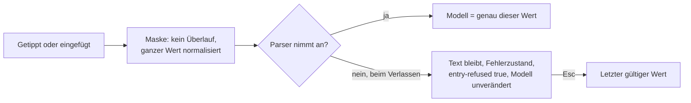

# Datums-Picker übernehmen genau das Eingegebene oder lehnen es sichtbar ab

Heute speichern die Datums-Picker in drei Fällen stillschweigend einen anderen Zeitpunkt als den eingegebenen:

- **#109:** Aus dem `30.02.2026` wird der `02.03.2026`.
- **#110:** Ein eingefügtes `03:46 PM` wird zu `03:46 AM`.
- **#111:** Aus `15:46:56.123` wird `15:46:00`.

Der Object Editor erbt alle drei Fehler und schreibt zusätzlich jeden `date-time`-Wert in die Zeitzone des Browsers um.

Nach der Arbeit gilt: Ein Picker übernimmt genau den eingegebenen Wert, oder er lehnt die Eingabe sichtbar ab und lässt das Modell unverändert. Der Object Editor ändert einen `date-time`-Wert nur, wenn der Nutzer ihn ändert. Sekunden, Nachkommastellen und Offset bleiben dabei erhalten.

## Ursachen

Alle drei Fälle habe ich in Chromium mit den Demos der Doku nachgestellt (`4.0.0-beta.51`, `develop` auf `b2b2eadc`).

| Issue | Beobachtet | Ursache |
| --- | --- | --- |
| #109 | Der letzte Tastendruck macht aus `02/30/2026` den Text `03/02/2026` | Die Maske von Maskito rechnet jedes vollständige Datum über `new Date(y, m-1, d)` (`segmentsToDate` in `createMinMaxDatePostprocessor` bzw. `createMinMaxDateTimePostprocessor`) und schreibt das Ergebnis zurück. Unser Parser (`coarParsePlainDateFromInput`, `overflow: 'reject'`) bekommt den unmöglichen Tag nie zu sehen. |
| #110 | Eingefügt oder per `fill`: `03:46 PM` → `03:46 AM`, `12:00 AM` → `12:00 PM`. Getippt stimmt alles. | Die Präprozessoren der Maske werten bei einem eingefügten Text nur dessen Ziffern aus (`createValidDateTimePreprocessor`). Das AM/PM des eingefügten Textes geht dabei verloren, und die Maske setzt selbst eines. |
| #111 | Aus `15:46:56.123` wird `15:46` | Die Maske kennt nur `HH:MM`, und `CoarTimeValue` hat nur `hours` und `minutes`. Der `DateTimeControl` des Object Editors wandelt zudem jeden Wert in die Zone des Browsers um und schreibt ihn mit `smallestUnit: 'second'`. |

## Was sich ändert

Die Arbeit kommt in zwei Pull Requests. Der erste behebt die Eingabe (#109, #110), der zweite bringt die Genauigkeit (#111). Der zweite baut auf dem ersten auf.

### 1. Die Maske gibt den Text unverändert an unseren Parser weiter

Die Masken in `packages/ui/src/components/date-time/_shared/maskito-config.ts` bekommen zwei Änderungen, und alle Picker profitieren davon: Datum, Datum-Zeit, Zoned und die „OrDate“-Varianten.

- **Kein Überlauf mehr:** Den min/max-Postprozessor von Maskito, also den letzten der Liste, umhüllen wir. Ist der vollständige Text kein echter Kalendertag, lässt die Hülle ihn unverändert. Sonst arbeitet Maskito wie bisher. Die Picker prüfen `min`/`max` ohnehin selbst, die Maske bekommt keine Grenzen.
- **Ganzer Wert auf einmal:** Ein neuer erster Präprozessor greift beim Einfügen, Ablegen, Autofill und bei `fill`. Ergibt der eingefügte Text zusammen mit dem Rest des Feldes einen vollständigen Wert, den unser Parser annimmt, setzt er das Feld direkt auf die normale Schreibweise, etwa `07/01/2026 03:46 PM`. Dabei akzeptiert er normales und geschütztes Leerzeichen sowie `am`/`pm` in jeder Schreibung. Einzelne Tastendrücke laufen weiter durch Maskito.

```ts
// maskito-config.ts (Skizze)
export function coarCreateDateTimeMask(pattern, use12Hour, parse: (text: string) => string | null) {
  const options = maskitoDateTimeOptionsGenerator({ /* wie bisher */ });
  return {
    ...options,
    preprocessors: [wholeValuePreprocessor(parse), ...options.preprocessors],
    postprocessors: withoutRollover(options.postprocessors, pattern),
  };
}
```

Weil die Hülle davon abhängt, dass der min/max-Schritt der letzte ist, sichert ein Unit-Test das ab: Er schickt `02/30/2026` durch die Maske und erwartet den Text unverändert. Ändert ein Update von Maskito die Reihenfolge, schlägt dieser Test fehl.

### 2. Eine abgelehnte Eingabe bleibt sichtbar stehen

Heute setzen die Picker beim Verlassen jeden Text, der kein gültiger Wert ist, stillschweigend auf den alten Wert zurück. Künftig verhalten sie sich wie `CoarNumberInput` mit `exact` seit #103:

- Der Text bleibt im Feld, das Feld zeigt den Fehlerzustand mit `aria-invalid`, und das Modell bleibt unverändert.
- Ein neues Event `entry-refused` (`boolean`) meldet den Zustand, so wie bei `CoarNumberInput`.
- Esc stellt den letzten gültigen Wert wieder her, und eine gültige Eingabe hebt den Zustand auf.

Abgelehnt werden: ein unmöglicher Kalendertag, ein Wert außerhalb von `min`/`max`, eine unvollständige Eingabe und mehr Genauigkeit, als das Feld zeigt (siehe Teil 3).

Die Logik liegt in den Composables `use-plain-date-picker.ts`, `use-plain-date-time-picker.ts` und `use-zoned-date-time-picker.ts` (`blurInput`). Die Komponenten reichen `entry-refused` weiter. Im Object Editor zeigen `DateControl` und `DateTimeControl` dazu eine Meldung mit `role="alert"`, wie `NumberControl`. Dafür kommen die neuen Schlüssel `coar.objectEditor.invalidDate` und `coar.objectEditor.invalidDateTime` dazu.



### 3. Sekunden und Millisekunden in den Datum-Zeit-Pickern (#111)

- **Neue Prop `precision` (Preview):** `CoarZonedDateTimePicker` und `CoarPlainDateTimePicker` bekommen `precision: 'minute' | 'second' | 'millisecond'`, Standard `'minute'`. Die Maske nutzt dann `HH:MM:SS` bzw. `HH:MM:SS.MSS`, auch mit `AA`. `CoarTimeValue` bekommt die optionalen Felder `seconds` und `milliseconds`, die bestehenden Aufrufer bleiben unverändert.
- **Was man nicht sieht, ändert man nicht:** Wählt man im Panel nur ein anderes Datum oder eine andere Zone, behält ein Wert seine Sekunden und Nachkommastellen. Ändert man Stunde oder Minute, werden die nicht angezeigten Teile 0.
- **Mehr Genauigkeit als angezeigt:** Wird bei `precision="minute"` der Text `15:46:56.123` eingefügt, lehnt das Feld ihn ab, wie in Teil 2 beschrieben. Bisher hat es die Sekunden stillschweigend abgeschnitten.
- **Zone beim Tippen:** Der Picker zeigt den Wert in der Anzeigezone, standardmäßig der des Nutzers. Getippten Text liest `parseValueFromInput` aber in der Zone des Wertes. Unterscheiden sich beide, verschiebt schon das erneute Tippen der angezeigten Zeit den Zeitpunkt. Ein Test soll das zuerst bestätigen. Trifft es zu, wird der Text in der Anzeigezone gelesen und dann in die Zone des Wertes umgerechnet.

### 4. Der Object Editor bearbeitet `date-time` verlustfrei

`packages/object-editor/src/types/controls/DateTimeControl.vue`:

- Als Zone dient der eigene Offset des Strings. Aus `…+05:00` wird ein `ZonedDateTime` in `+05:00`, nicht in der Zone des Browsers. Der Picker zeigt den Wert weiter in der Zone des Nutzers an, und sein Zonen-Hinweis macht den Unterschied sichtbar.
- Als `precision` setzt das Feld `'second'`, denn RFC 3339 schreibt Sekunden immer. Hat der vorhandene Wert Nachkommastellen, nutzt es `'millisecond'`.
- Ein neuer Wert wird nur ausgegeben, wenn sich der Zeitpunkt oder der Offset geändert hat. Ausgegeben wird er mit dem bisherigen Offset und ohne `smallestUnit`, also mit Nachkommastellen nur, wo es welche gibt. Öffnen und Schließen ändert nichts. Ein leerer Wert bekommt wie bisher den Offset des Browsers.

```ts
// vorher: jeder Wert in der Browser-Zone, Sekunden gekappt
Temporal.Instant.from(s).toZonedDateTimeISO(zone);              // lesen
next.toString({ timeZoneName: 'never', smallestUnit: 'second' }); // schreiben
// nachher: eigener Offset, volle Genauigkeit, keine Ausgabe ohne Änderung
const zdt = Temporal.Instant.from(s).toZonedDateTimeISO(offsetOf(s));
if (!next.equals(zdt)) emit('update:modelValue', next.toString({ timeZoneName: 'never' }));
```

Für `"2026-07-01T15:46:56.123+05:00"` gilt dann: Öffnen und Schließen ändert nichts. Wird nur das Datum auf den 2. geändert, entsteht `"2026-07-02T15:46:56.123+05:00"`.

## Steps

**Pull Request A** `fix(ui,object-editor): date pickers commit exactly the typed or pasted value, or refuse it (#109, #110)`

- [x] 1. Branch `fix/date-picker-exact-input` von `origin/develop` anlegen. (Gearbeitet im Worktree-Branch auf Stand `origin/develop`, gepusht unter diesem Namen.)
- [x] 2. In `maskito-config.ts` die Hülle `withoutRollover` und den Präprozessor für ganze Werte schreiben, verdrahtet in allen Masken von `CoarPlainDatePicker`, `CoarPlainDateTimePicker`, `CoarZonedDateTimePicker` und den OrDate-Varianten. Unit-Tests in `_shared/__tests__/maskito-config.test.ts`: `02/30/2026`, `29.02.2026`, `29.02.2028` sowie eingefügtes `03:46 PM`, `12:00 AM` und `12:00 PM`.
- [x] 3. Abgelehnte Eingaben in den drei Composables umsetzen (`refused`, Esc stellt wieder her) und das Event `entry-refused` in den Picker-Komponenten ergänzen. Dazu Unit-Tests in `use-*-picker.test.ts`.
- [x] 4. Meldungen in `DateControl.vue` und `DateTimeControl.vue` mit den beiden neuen i18n-Schlüsseln.
- [x] 5. Neue Playground-Seite `/date-input` (`src/views/DateInputDemo.vue`, `src/routes.ts`) und Spec `apps/playground/e2e/date-input.spec.ts`. Sie prüft das ausgegebene Modell, nicht nur die Anzeige, getrennt für Tippen, Einfügen aus der echten Zwischenablage und `fill`, jeweils in `de-DE` und `en-US`, und alle Regressionsfälle aus den Issues.
- [x] 6. Doku: Abschnitt „Typed and pasted input“ auf `date-picker.md`, `date-time-picker.md` und `zoned-date-time-picker.md`, dazu die neuen Schlüssel in `object-editor.md`. Anschließend `pnpm skill:sync`.
- [ ] 7. Prüfungen und Review laufen lassen (siehe unten), dann den Pull Request öffnen.

**Pull Request B** `feat(ui,object-editor): date-time fields keep seconds, fractions and the offset of a value (#111)`, auf Basis von `develop` nach dem Merge von A

- [ ] 8. Branch `feat/date-time-precision`. In `time-helpers.ts` Formatierung und Parser um Sekunden und Millisekunden erweitern, `CoarTimeValue` um die optionalen Felder.
- [ ] 9. Die Prop `precision` in beiden Datum-Zeit-Pickern samt Maske einführen. Die Regel „Was man nicht sieht, ändert man nicht“ in `setDateTime` und `selectDate` umsetzen. Mehr Genauigkeit als angezeigt wird abgelehnt.
- [ ] 10. Einen Test für das Lesen getippten Textes in der Anzeigezone schreiben. Schlägt er fehl, den Fehler beheben.
- [ ] 11. `DateTimeControl` umbauen: eigener Offset, `precision` wie beschrieben, keine Ausgabe ohne Änderung. Tests für einen Wert mit Nachkommastellen und Offset `+05:00`: Öffnen und Schließen ändert ihn nicht, eine Änderung nur des Datums behält Zeit, Nachkommastellen und Offset.
- [ ] 12. Die e2e-Spec um die Fälle aus #111 erweitern. Die Doku zu `precision` kommt mit Preview-Badge und Demo, dazu ein Absatz zu `date-time` auf `object-editor.md`. Anschließend `pnpm skill:sync`.
- [ ] 13. Prüfungen und Review laufen lassen, dann den Pull Request öffnen.

## How it is verified

- [ ] Die neue Spec `date-input.spec.ts` ist grün in Chromium (WebKit läuft im Playground nur `@touch`-Tests). Ohne den Fix schlagen ihre Fälle aus #109 und #110 fehl.
- [ ] `02/30/2026` und `29.02.2026` lassen das Modell unverändert und zeigen den Fehlerzustand. `29.02.2028` wird übernommen.
- [ ] Eingefügtes `07/01/2026 03:46 PM` ergibt `…T15:46:00+02:00[Europe/Berlin]`, und `12:00 AM` ergibt `…T00:00`.
- [ ] Ein Object-Editor-Wert `2026-07-01T15:46:56.123+05:00` bleibt nach Fokus und Verlassen unverändert, wie die Tests in Teil 4 zeigen.
- [ ] `pnpm lint && pnpm typecheck && pnpm build`, `pnpm skill:check`, `pnpm test` als Hintergrundjob sowie `node apps/playground/scripts/visual.mjs` sind grün. Erwartet wird kein geändertes `--default-`-Bild, denn der Fehlerzustand nutzt den vorhandenen Stil.

## Decisions

| Decision | Choice | Why |
| --- | --- | --- |
| Was beim Verlassen mit ungültigem Text passiert | Er bleibt als Fehler stehen, `entry-refused`, Esc stellt wieder her. Gilt für alle Picker, ohne Opt-in. | Das Issue verlangt eine sichtbare Ablehnung. Das stille Zurücksetzen verbirgt ebenso, dass die Eingabe nicht übernommen wurde. Es ist dasselbe Muster wie bei `CoarNumberInput`. |
| Wie der Überlauf verhindert wird | Den min/max-Schritt von Maskito umhüllen, nicht entfernen | Er setzt auch unvollständige Segmente auf gültige Mindestwerte. Dieses Verhalten beim Tippen bleibt so erhalten. |
| Aufteilung | Zwei Pull Requests: A für #109 und #110, B für #111 | Ein Zweck pro Pull Request. A ist ein reiner Fix, B bringt mit `precision` eine neue API. |
| Typ von B | `feat` | Die neue Prop `precision` ist das, was Nutzer der Pakete bekommen. Der Verlustfix im Object Editor gehört dazu. |
| Offset im Object Editor | Der eigene Offset des Wertes bleibt | Das Issue fordert, den Offset zu behalten oder die Umrechnung explizit zu machen. Den Offset zu behalten ist verlustfrei. |

> **Entschieden (Review):** Der sichtbare Fehlerzustand gilt für alle Picker standardmäßig, ohne Opt-in.

## Risks

- **Eingriff in die Interna von Maskito:** Die Hülle verlässt sich darauf, wie Maskito seine Schritte anordnet. Der Unit-Test aus Teil 1 schlägt bei einem Update fehl, das daran etwas ändert.
- **Sichtbare Änderung für bestehende Apps:** Ungültiger Text bleibt künftig als Fehler stehen, statt still zu verschwinden. Das ist beabsichtigt, im Review so entschieden, und steht im Pull Request.

## Out of scope

- Nanosekunden: Die Picker gehen höchstens bis Millisekunden. Hat ein Wert mehr Stellen, bleibt er erhalten, solange die Zeit nicht geändert wird.
- Eine reine ISO-Textbearbeitung im Object Editor, wie sie der Workaround der App nutzt. Mit Teil 4 braucht es sie nicht mehr, und für Sonderfälle gibt es seit #104 `editUnknown` bzw. ein eigenes Feld.

## Abweichungen

- **Einfügen (Teil 1):** Ein Präprozessor, der das Feld direkt setzt, reicht nicht: Maskito verwirft ein Einfügen ohne verbleibende Zeichen. Der erste Präprozessor merkt sich den normalisierten Wert, ein letzter setzt ihn nach Maskitos eigenen als einzufügenden Text ins geleerte Feld.
- **Parser:** `coarParsePlainDateFromInput` verlangt jetzt ein vierstelliges Jahr. Sonst übernahm das Tippen von `29.02.2026` schon `29.02.20` als 29.02.0020.
- **Playground-Seite:** Sie setzt `date-format` ausdrücklich, weil die Picker ihr Format vor der Prop `locale` aus den Sprachdaten nehmen.
