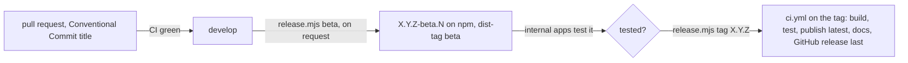

# Releasing cocoar-ui-vue

For the maintainer, **windischb**, and nobody else. A tag publishes 17 packages to npm, deploys the docs
and creates a GitHub release: every step is outward-facing, and a version on npm can never be reused.

Run it only when the maintainer asks for a release (or a beta) in the current conversation, and stop at
once when a check fails. A request for a release allows the steps of this skill for that version only.
Do not skip a step silently: when one does not apply, say so in the report.

## How a release works



- A **beta** is started by hand (`ci.yml` run with workflow_dispatch), never by a merge. It has no git tag: the
  notes and the version script do not see it. The internal apps install `@cocoar/*@beta` or pin the version.
- A **release** is a tag `vX.Y.Z`. The tag starts `ci.yml`, which builds, tests, packs and publishes
  the packages (`latest` only when higher, otherwise `release-X.Y`; `beta` follows), deploys the docs, and
  creates the GitHub release with notes generated by dotnet-releaser **last**. When a step fails, nothing
  after it happens.
- Packages and docs leave only from `cocoar-dev/cocoar-ui-vue`. In a fork or the release sandbox every
  publish is a dry run (`scripts/release/lib.mjs`), so the whole flow can be rehearsed there.
- There are no release candidate tags: the beta of the commit is the candidate.
- **Rehearsal:** a private clone of this repository runs the same flow without publishing. Set its repository
  variable `SIMULATE_BUILD=true` to skip lint, tests and builds (a minute per run); `release.mjs` then reads the
  last beta from its beta runs instead of npm. The flow was rehearsed that way before it was introduced.

## The release script

[`scripts/release.mjs`](scripts/release.mjs) (Node, no dependencies; `git` and `gh` on PATH):

```sh
node .alta/skills/cocoar-release/scripts/release.mjs <command>
```

| Command | Step |
| --- | --- |
| `preflight` | 0: gh account, branch, clean tree, up to date, last release, npm dist-tags |
| `changes [--since vX.Y.Z]` | 1: commits by Conventional Commit type, merged pull requests, contributors |
| `beta [--ref develop]` | 3: starts the prerelease run, waits, says which beta it published |
| `ci [REF]` | 4: waits for the `ci.yml` run of the commit |
| `tag X.Y.Z [--commit SHA] [--accept-untested]` | 5: refuses without a green CI run, or when the last beta is another commit |
| `release-run X.Y.Z` | 6: waits for the `ci.yml` run of the tag, job by job |
| `npm X.Y.Z` | 6: every package lists the version |
| `docs X.Y.Z` | 6: the docs of the version answer |
| `notes X.Y.Z --summary FILE` | 7: the summary above the generated notes, folded in **All changes**, links checked |
| `links FILE` | 7: every link of the summary answers |

`ci`, `beta`, `release-run` and `npm` wait for minutes: start them with `alta job start`. Improve the script
when a release needs a step that will come back, rather than writing a one-off script.

Keep the files of a release (checklist, summary) in the ignored `tmp/release-X.Y.Z/`: the scratchpad of
CodeAlta can be cleared when it restarts during a release.

## Small and feature releases

- A **feature release** (`X.Y.0`) runs every step and gets a summary above the generated notes.
- A **patch** (`X.Y.Z`, `Z` > 0) keeps the generated notes, without a tour.
- A **major** (`X.0.0`) needs a migration page in the docs (`apps/docs/guide/migration*.md`) before the tag.

## 0. Before anything

- `release.mjs preflight` passes: the account is the maintainer's, the checkout is on `develop` (or the
  `release/X.Y` / `support/X.x` branch of the release), clean outside `.alta/` and `tmp/`, up to date.
- Choose the version with the maintainer: features → minor, fixes only → patch, breaking → major. Nothing in
  the repository holds the version: the tag is the version.
- Write the request and this checklist into `tmp/release-X.Y.Z/checklist.md` and keep it up to date.

## 1. Review the changes

- `release.mjs changes` lists the commits since the last release by type, the merged pull requests and the
  contributors. Read the diff by area (`git diff --stat <last tag>..origin/develop`) and the code of what the
  subjects do not explain.
- Make the list of what **a user of the packages sees**: new components and APIs, changed behaviour, fixes,
  Preview marks added or removed, breaking changes. Group the commits of one feature.
- A commit "without a Conventional Commit prefix" in the output is a gap of the notes: mention it.

## 2. Docs

- There is no CHANGELOG to write: the GitHub release is the record of a version (as in CodeAlta). `CHANGELOG.md`
  is frozen history; the docs page "Changelog" links to the releases.
- Every user-visible change of the list is in the docs (`apps/docs`), a breaking change has its migration note,
  and the Agent Skill matches the docs (`pnpm skill:check`). What is missing comes as a pull request
  (skill `cocoar-pr`) **before** the beta and the tag: the release publishes exactly the tagged commit.

## 3. Beta for the internal apps

- `release.mjs beta` (as a job) starts the prerelease run on `develop` and reports `X.Y.Z-beta.N`.
- Tell the maintainer which version to test in the internal apps, and wait for his answer. Fixes go through
  pull requests, then another beta.

## 4. CI of the commit

- `release.mjs ci` (as a job): the `ci.yml` run of the commit to tag must be green.

## 5. Tag

- `release.mjs tag X.Y.Z` tags `origin/develop` (or `--commit`), after checking the green CI run and that the
  last beta is this very commit. When it is not, it lists the commits no beta carried and refuses; only the
  maintainer decides to go on with `--accept-untested`.
- The tag starts a `ci.yml` run; it takes 20 to 30 minutes.

## 6. Watch the release

- `release.mjs release-run X.Y.Z` (as a job) follows the run job by job: publish, docs, GitHub release.
- `release.mjs npm X.Y.Z` and `release.mjs docs X.Y.Z` confirm the packages and the docs.
- A run that fails before publishing published nothing: fix, delete the tag (`git push origin :vX.Y.Z`,
  `git tag -d vX.Y.Z`), tag again. A run that fails after a partial publish is run again: publishing is
  idempotent. A version that is out and wrong is never unpublished: `npm deprecate` it and release a patch.
- The packages are out but the docs or the GitHub release step failed: do **not** tag again (the version is
  taken by its commit). Re-running the job uses the workflow of the tag, so it helps only for a passing
  outage. Otherwise finish by hand with the same scripts: `node scripts/release/notes.mjs X.Y.Z --update`
  (needs `dotnet-releaser` on PATH) or `cd-deploy-docs.yml` with `ref: vX.Y.Z`, then fix the workflow with a
  pull request for the next release.

## 7. Release notes

- Feature release: write the tour in `tmp/release-X.Y.Z/summary.md` and show it to the maintainer, then
  `release.mjs notes X.Y.Z --summary tmp/release-X.Y.Z/summary.md`. Read the tour of the previous release first
  (`gh release view <last tag> --json body -q .body`) and follow its form:

  ```markdown
  # ✨ The X.Y.Z tour

  One short paragraph: what this release is about, for the users of the packages, and "Here is the tour of what is new since vX.Y.Z."

  ## <emoji> <Feature, as a user would name it>

  Two short paragraphs at most: what it does, how to use it (component, prop, composable). [Docs →](https://docs.cocoar.dev/cocoar-ui-vue/vX.Y/<page>) (#<pr>)

  ## 🎁 And also

  - **Smaller improvement.** One sentence each. (#<pr>)

  ## 🙏 Thank you

  To @<login> for … (only contributors other than the maintainer)
  ```

- **Each paragraph on one line:** a GitHub release shows every line break.
- Links to files use the tag in their URL (`…/blob/vX.Y.Z/…`), so they keep working when `develop` changes.
- `release.mjs links tmp/release-X.Y.Z/summary.md` before, `notes` checks the result again after.
- Patch: leave the generated notes.

## 8. Report

Links to the release, the runs, the npm packages and the docs; what was skipped and why.
