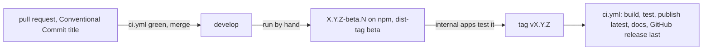

# Releasing cocoar-ui-vue

How changes become packages. The maintainer releases with the `cocoar-release` skill
(`.alta/skills/cocoar-release`); this page explains what happens underneath.

## One workflow

`.github/workflows/ci.yml` does everything, as in CodeAlta:

| Event | Jobs |
|---|---|
| pull request | build & test (the title is judged by the agent that merges, skill `cocoar-pr`) |
| push to `develop`, `release/*`, `support/*` | build & test |
| run by hand | build & test, then a beta (`develop`) or an alpha as `@cocoar-dev/*` on GitHub Packages (other branches) |
| tag `vX.Y.Z` | build & test, publish (`latest`), deploy the docs, create the GitHub release **last** |

When a step fails, nothing after it happens: no GitHub release without packages and docs.

## Versions

The tag is the version; nothing in the repository holds it (`package.json` keeps `0.0.1`).
Between tags, `scripts/release/version.mjs` counts from the last tag `vX.Y.Z`:

| Where | Version |
|---|---|
| tag `v3.4.0` | `3.4.0` |
| `develop`, 5 commits after `v3.3.0` | `3.4.0-beta.5` |
| … with a breaking commit (`type!:`, `BREAKING CHANGE:`) | `4.0.0-beta.5` |
| `release/3.4`, `support/3.x` | `3.4.1-…`, `3.3.1-…` |

A beta creates no git tag, so the release notes always compare two releases.

## Publishing

`scripts/release/` stamps the version, packs every package and publishes the tarballs:

- a version that is already out from the same commit (`gitHead`) is skipped, from another commit it stops the run;
- `latest` moves only to a higher version (a patch of an older line gets `release-X.Y`), and `beta` follows a release;
- packages and docs leave only from `cocoar-dev/cocoar-ui-vue`; anywhere else every publish is a dry run.

## Release notes

The GitHub release is the record of a version; there is no CHANGELOG to maintain (`CHANGELOG.md` is frozen history).
It is created by `dotnet-releaser changelog` (`scripts/release/notes.mjs`) from the pull requests
and commits since the previous tag, grouped by their Conventional Commit type. For a feature release the skill
puts a short summary above them.

## When something goes wrong

- The tag run fails before publishing: nothing is out. Fix it with a pull request, delete the tag, tag again.
- It fails while publishing: run it again; what is out already is skipped.
- The packages are out but the docs or the GitHub release failed: never tag again. Finish with the same scripts
  (`node scripts/release/notes.mjs X.Y.Z --update`, or `cd-deploy-docs.yml` with the tag), then fix the workflow.
- A release is wrong: never unpublish. `npm deprecate` it and release a patch.
